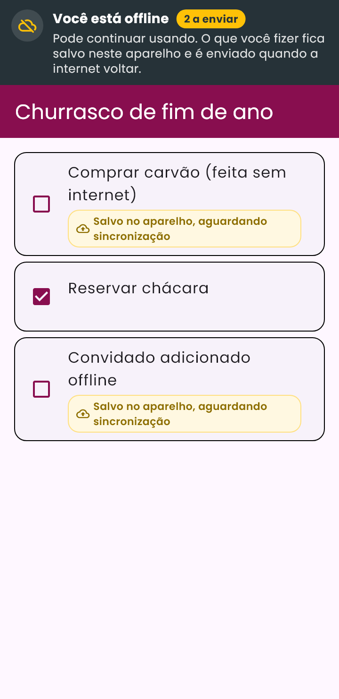
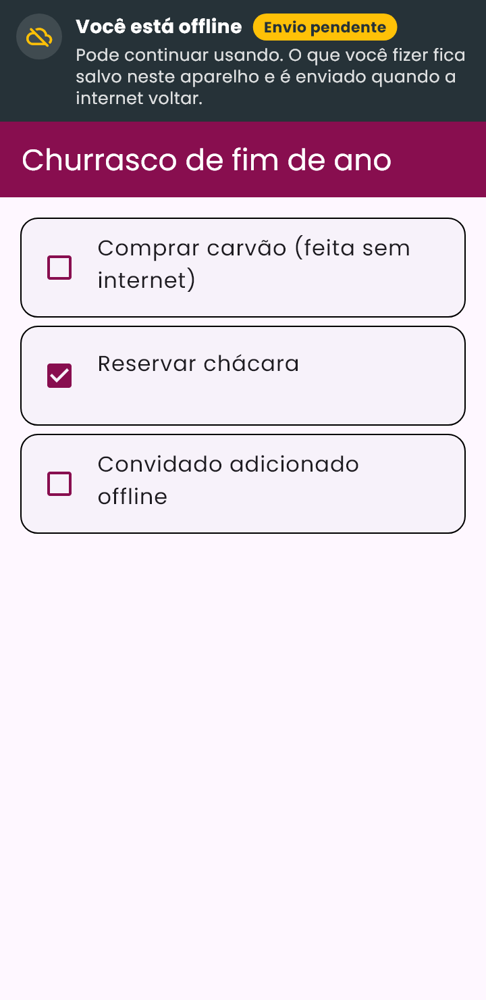
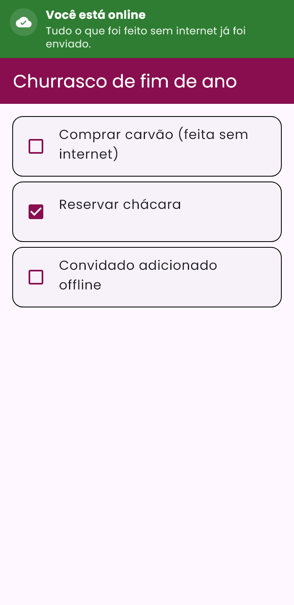
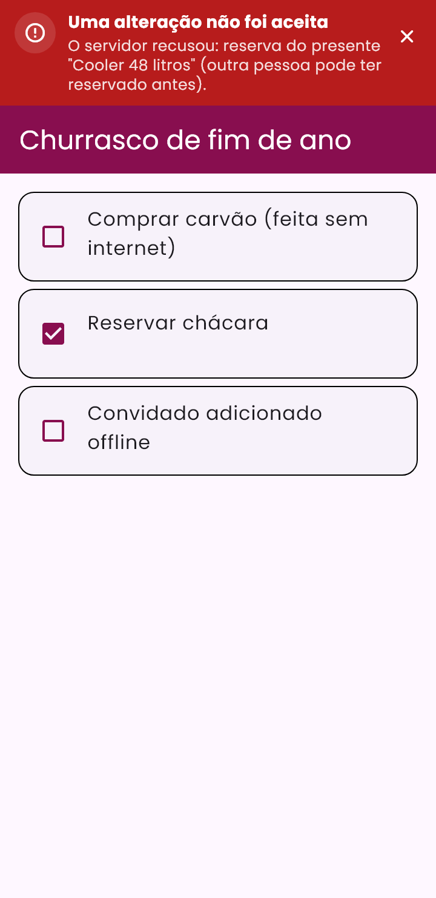

# Evidências: uso sem internet (mobile-first)

Prova ponta a ponta de que o Faça a Festa continua utilizável sem internet no celular/tablet Android, com dados sintéticos em projeto `demo-offline-mobile` (somente emuladores locais).

## Resultado

| Execução | Aparelho | Etapas aprovadas | Arquivo |
|---|---|---|---|
| Linha de base (antes das correções) | SM-X110, Android 16 | 27 de 49 | `resultado_linha_base.json` |
| Final | SM-X110, Android 16 | 59 de 59 | `resultado_final.json` |
| Repetição da final | SM-X110, Android 16 | 59 de 59 | `resultado_final_repeticao.json` |
| Final no celular | SM-G990E, Android 16 | 59 de 59 | `resultado_final_celular.json` |

Cada etapa registra o tempo medido no aparelho. As escritas offline terminam em milissegundos; na linha de base, elas ficavam presas até o limite de 8 segundos esperando o servidor.

## Como a prova funciona

- `npm run check:offline:aparelho` (variável `OFFLINE_QA_MODO` define o nome do resultado). O script `functions/scripts/testOfflineAparelho.js` sobe os emuladores de Auth e Firestore com as regras reais (`firestore.rules`), semeia os dados, instala um pacote de QA separado (`com.rrs.system.technology.facafesta.offlineqa`, sem tocar no app do usuário) e roda `integration_test/offline_mobile_first_aparelho_test.dart` no aparelho.
- **Corte de rede real:** o aparelho alcança os emuladores por `adb reverse` até um proxy TCP no computador. Cortar a rede fecha o proxy e derruba as conexões abertas; o app recebe a mesma falha de um servidor inalcançável. O Wi-Fi do aparelho continua ligado (caso mais difícil: só a sonda do `ConectividadeService` percebe a queda).
- O teste usa a mesma ligação do app: `ConectividadeService` com os intervalos de produção, `RedeFirestore` em cada perfil e `EstadoSincronizacao` (selos e banner).
- **Fases:** A, online, aquece o cache dos três perfis (organizador, convidado e fornecedor). B, offline, cobre as jornadas, o conflito e o reinício a frio da camada de dados. Depois o processo é encerrado e reaberto ainda sem rede, com sessão, cache e fila preservados. C é a reconexão com sincronização. Ao final, o Admin SDK verifica o servidor.
- **Conflito:** com o aparelho offline, o computador reserva o presente `p-conflito` para outra pessoa direto no servidor; o convidado reserva o mesmo presente sem saber. Na reconexão, a regra `reservaPresenteDoConvite` recusa a segunda reserva, o servidor mantém a primeira e o aparelho volta a mostrar o estado do servidor.

## Matriz jornada x cenário

| Jornada | Cenário | Etapa | Linha de base | Final | Tempo final |
|---|---|---|---|---|---|
| sessao | online | Login dos três perfis | aprovada | aprovada | 540 ms |
| organizador | online | Perfil e lista de eventos | aprovada | aprovada | 1.7 s |
| organizador | online | Checklist, convidados e orçamento | aprovada | aprovada | 925 ms |
| organizador | online | Presentes no aparelho | reprovada: Bad state: Presente do servidor não chegou ao banco local | aprovada | 473 ms |
| convidado | online | Abrir convite pelo link | aprovada | aprovada | 871 ms |
| fornecedor | online | Perfil, serviços e painel | aprovada | aprovada | 712 ms |
| calculadora | online | Catálogo e simulação | reprovada: Bad state: Sem cálculo (operacao=true erro="" evento=naoConsultada convidados=disponivel i | aprovada | 1.5 s |
| rede | corte | Servidor inalcançável no aparelho | aprovada | aprovada | 80 ms |
| rede | corte | App percebe a queda sem ação do usuário | não existia | aprovada | 56.2 s |
| organizador | offline | Perfil abre do cache | aprovada | aprovada | 23 ms |
| organizador | offline | Lista de eventos do cache | aprovada | aprovada | 36 ms |
| organizador | offline | Editar evento sem travar | reprovada: Não terminou em 8s (travou esperando o servidor) | aprovada | 56 ms |
| organizador | offline | Criar evento sem travar | reprovada: Não terminou em 8s (travou esperando o servidor) | aprovada | 2 ms |
| organizador | offline | Evento novo aparece na lista | reprovada: Não terminou em 8s (travou esperando o servidor) | aprovada | 65 ms |
| organizador | offline | Adicionar tarefa sem travar | reprovada: Não terminou em 8s (travou esperando o servidor) | aprovada | 3 ms |
| organizador | offline | Tarefa aparece no checklist | aprovada | aprovada | 15 ms |
| organizador | offline | Adicionar convidado sem travar | reprovada: Não terminou em 8s (travou esperando o servidor) | aprovada | 6 ms |
| organizador | offline | Convidado aparece na lista | aprovada | aprovada | 58 ms |
| organizador | offline | Registrar gasto no orçamento | reprovada: Não terminou em 8s (travou esperando o servidor) | aprovada | 53 ms |
| organizador | offline | Cadastrar presente sem travar | reprovada: Não terminou em 8s (travou esperando o servidor) | aprovada | 39 ms |
| organizador | offline | Registrar contribuição PIX | aprovada | aprovada | 29 ms |
| convidado | offline | Reabrir convite sem internet | reprovada: AbrirConvitePorTokenException(unavailable): UNAVAILABLE | aprovada | 4 ms |
| convidado | offline | Ver lista de presentes | aprovada | aprovada | 25 ms |
| convidado | offline | Reservar presente sem travar | reprovada: Não terminou em 8s (travou esperando o servidor) | aprovada | 19 ms |
| convidado | offline | Outra pessoa reserva o mesmo presente no servidor | não existia | aprovada | 3.0 s |
| convidado | offline | Reserva concorrente fica no aparelho | não existia | aprovada | 13 ms |
| organizador | offline | Selo conta as alterações pendentes | não existia | aprovada | 2 ms |
| fornecedor | offline | Perfil do fornecedor do cache | aprovada | aprovada | 31 ms |
| fornecedor | offline | Serviços do fornecedor do cache | reprovada: Não terminou em 10s (travou esperando o servidor) | aprovada | 132 ms |
| fornecedor | offline | Painel da última consulta | reprovada: ClientException with SocketException: Failed host lookup: 'southamerica-east1-faca-a-festa | aprovada | 2 ms |
| calculadora | offline | Itens por tipo de festa | aprovada | aprovada | 69 ms |
| calculadora | offline | Catálogo contextual | reprovada: [cloud_firestore/unavailable] The service is currently unavailable. This is a most likely  | aprovada | 13 ms |
| calculadora | offline | Simulação com dados do aparelho | reprovada: Bad state: Sem cálculo (operacao=false erro="A confirmação do planejamento está indisponív | aprovada | 188 ms |
| reinicio | reinicio | Fechar e reabrir Firestore e SQLite | aprovada | aprovada | 70 ms |
| reinicio | reinicio | Eventos e tarefas após reinício | reprovada: Não terminou em 10s (travou esperando o servidor) | aprovada | 105 ms |
| reinicio | reinicio | Presente offline após reinício | aprovada | aprovada | 7 ms |
| reabrir | processo_novo | Sessões continuam abertas | aprovada | aprovada | 15 ms |
| reabrir | processo_novo | App abre sabendo que está offline | não existia | aprovada | 0 ms |
| reabrir | processo_novo | Selo avisa pendências da sessão anterior | não existia | aprovada | 813 ms |
| reabrir | processo_novo | Perfil e eventos do cache | reprovada: Não terminou em 15s (travou esperando o servidor) | aprovada | 201 ms |
| reabrir | processo_novo | Pendências locais preservadas | aprovada | aprovada | 173 ms |
| convidado | processo_novo | Convite reabre sem internet | reprovada: AbrirConvitePorTokenException(unavailable): UNAVAILABLE | aprovada | 24 ms |
| rede | reconexao | Servidor volta a responder | aprovada | aprovada | 20.0 s |
| rede | reconexao | App percebe a volta sem ação do usuário | não existia | aprovada | 0 ms |
| sincronizacao | reconexao | Selo some quando o servidor confirma | não existia | aprovada | 415 ms |
| sincronizacao | reconexao | Fila do Firestore enviada | aprovada | aprovada | 16 ms |
| sincronizacao | reconexao | Fila de presentes enviada | aprovada | aprovada | 561 ms |
| sincronizacao | reconexao | Servidor recebeu tudo | reprovada: [cloud_firestore/permission-denied] The caller does not have permission to execute the spe | aprovada | 639 ms |
| convidado | reconexao | Conflito: vale a reserva que chegou primeiro | não existia | aprovada | 181 ms |
| admin_sdk | verificacao | Evento criado offline existe | aprovada | aprovada |  |
| admin_sdk | verificacao | Edição offline do evento chegou | aprovada | aprovada |  |
| admin_sdk | verificacao | Tarefa offline existe | reprovada:  | aprovada |  |
| admin_sdk | verificacao | Convidado offline existe | aprovada | aprovada |  |
| admin_sdk | verificacao | Gasto offline registrado uma única vez | aprovada | aprovada |  |
| admin_sdk | verificacao | Presente offline existe | aprovada | aprovada |  |
| admin_sdk | verificacao | Contribuição PIX sem duplicar | reprovada: encontradas: 0 | aprovada |  |
| admin_sdk | verificacao | Valor arrecadado coerente | reprovada: valor: 0 | aprovada |  |
| admin_sdk | verificacao | Reserva do convidado chegou | aprovada | aprovada |  |
| admin_sdk | verificacao | Conflito: a primeira reserva foi preservada | não existia | aprovada |  |

## Telas (celular 360 px)

Geradas por `test/presentation/widgets/offline_evidencias_visuais_test.dart` com o banner e os selos reais do app.

| Estado | Captura |
|---|---|
| Offline com alterações salvas no aparelho |  |
| App reaberto sem internet com fila anterior |  |
| Internet voltou |  |
| Servidor recusou uma reserva feita offline |  |

## O que funciona sem internet

- **Organizador:** abrir o app com a sessão salva, ver perfil, eventos, checklist, convidados e orçamento; criar e editar evento, tarefa, convidado, gasto e presente; registrar contribuição Pix já recebida (sem duplicar no envio). Cada item pendente mostra o selo "Salvo no aparelho, aguardando sincronização".
- **Convidado:** reabrir o último convite já aberto neste aparelho (mesma conta), ver presentes e reservar. A reserva é confirmada quando a internet volta; se outra pessoa reservou antes, vale a primeira e o app avisa.
- **Fornecedor:** perfil, serviços, agenda e painel da última consulta salva (com aviso de que são dados do aparelho). Alterações de cadastro e serviços são bloqueadas com a mensagem "precisa de internet".
- **Calculadora:** itens por tipo de festa (cache ou catálogo empacotado no app), catálogo contextual e simulação calculada no aparelho.

## Limites (dependem do servidor por natureza)

Pagamento Pix real, nova configuração de MFA, recursos de IA, envio de convites por e-mail, auditoria, avaliações, financeiro do evento, cotações por função e exportação LGPD. Sem internet, esses recursos param antes de chamar o servidor e mostram que precisam de conexão. Nada fica girando até o timeout. Primeiro acesso de um convite ou conta nunca aberta neste aparelho também exige internet.

## Observações

- **Detecção da queda:** em modo avião o sistema avisa na hora. Com Wi-Fi ligado e servidor inalcançável (portal cativo, roteador sem internet), a detecção vem da sonda periódica (até 60 s; medido entre 56 s e 58 s nas três execuções) ou da primeira escrita que não recebe confirmação. Nos dois casos, o que o usuário faz continua salvo no aparelho.
- **Ruído do teste:** na fase B, o reinício simulado usa `FirebaseFirestore.terminate()`. Escutas antigas que tentam reativar depois disso geram duas exceções de canal no relatório do `flutter test`, sem efeito nas etapas. O app real não chama `terminate()`. O reinício de verdade é a fase com processo novo, que passou limpa.
- **Fontes:** Poppins (fonte principal) vai empacotada em `assets/fonts`. As demais famílias dos temas de festa são baixadas uma vez e ficam em cache no aparelho; sem internet e sem cache, o texto usa a fonte do sistema e continua legível.
- **Regras do Firestore:** a regra de reserva do convite passou a recusar reservar presente já reservado por outro convidado (teste `npm run test:rules:presentes`). É preciso publicar `firestore.rules`.
- Protocolo manual complementar com modo avião real: `protocolo_modo_aviao.md`.
