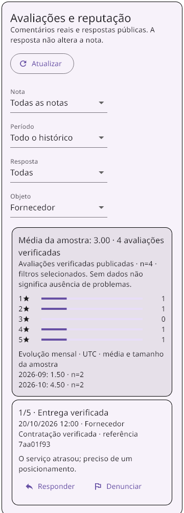
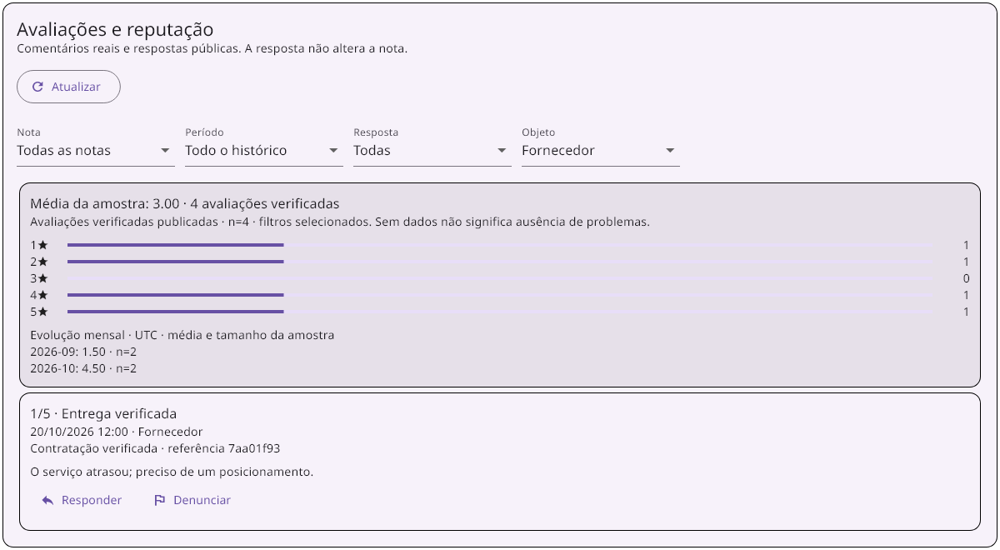
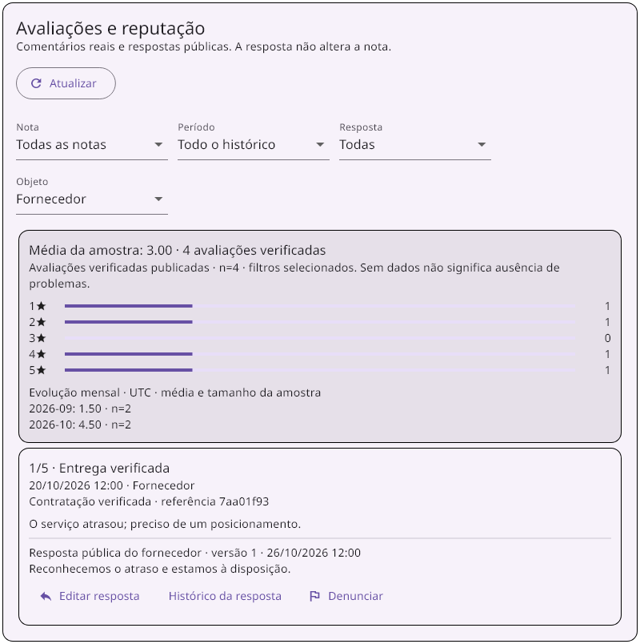
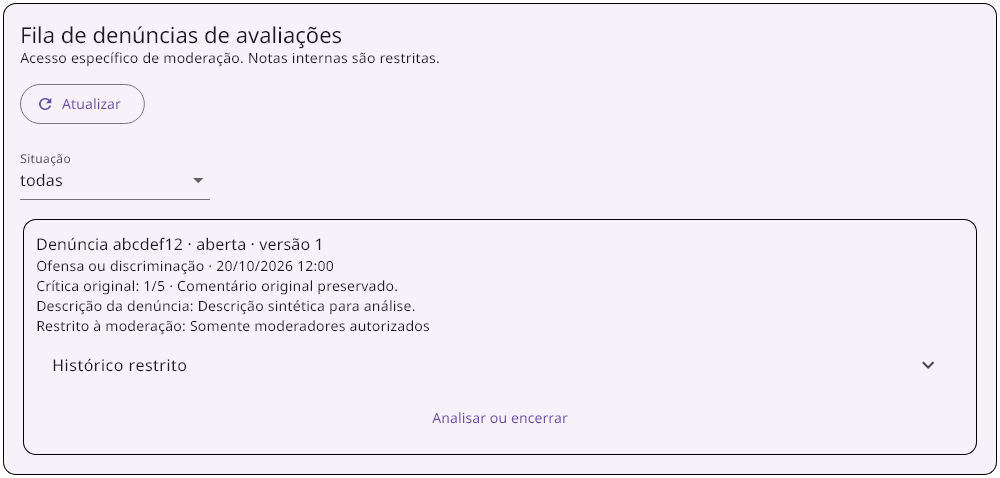

# Prompt 05 — Gestão operacional da reputação

Implementação e validação local em 26/10/2026, Windows/PowerShell, Flutter/GetX e Functions TypeScript. Sem deploy, commit, push, migração ou alterações em produção. Nenhuma notificação externa real foi enviada.

## Reconferência e integração

Foram lidos Git, regras, controller, entidades, datasources e consumidores. Não foram encontrados AGENTS.md aplicáveis no repositório/ancestrais. A árvore já continha alterações extensas, inclusive dos prompts 01–04, que foram preservadas.

A base verificada do prompt 04 existe: contratação canônica, identidade determinística por autor/contratação/objeto, aceite comprovado, criação atômica, histórico protegido e agregados separados por objeto. Ela foi reutilizada. Não existia fila de denúncias de avaliações; foi criada a menor fila restrita necessária. A regra de moderação e recomposição dos agregados foi extraída para `aplicarModeracaoAvaliacao`, compartilhada pelo comando anterior e pela nova decisão transacional.

A seção Avaliações da home do fornecedor abre o painel funcional de gestão. A fila está em `/moderacao-avaliacoes`, com entrada no painel administrativo; a tela e todos os comandos validam a permissão específica, sem considerar o tipo administrador uma autorização suficiente.

## Fluxo entregue

### Comentários, filtros e contexto

O fornecedor consulta seus registros canônicos, com nota, texto original, data, serviço público e referência compartilhável da contratação. Nome completo do cliente, nome/ID do evento, custo privado e dados financeiros não integram a resposta de gestão. O serviço é resolvido do catálogo e do vínculo da própria contratação. Legado sem comprovação recebe identificação explícita e data ausente não vira data atual.

Filtros: nota, últimos 30/90/365 dias ou todo o histórico, respondidas/sem resposta/todas e objeto fornecedor/serviços/todos. A seleção de objeto deixa claro que média da amostra de serviços não substitui o agregado de fornecedor. O filtro temporal permanece congelado durante a paginação, evitando mudar o contexto do cursor a cada chamada.

A paginação usa keyset por ID do documento, limite 10 na interface e máximo 30 no backend, com cursor vinculado à sessão, fornecedor e filtros. Não usa offset nem atribuição por evento. Os filtros são aplicados no servidor sobre cada página; uma página sem correspondência pode oferecer “Carregar mais”, sem declarar que não existem outros resultados. A ordem por ID mantém também registros legados sem data. Os indicadores usam o conjunto verificado correspondente aos filtros, não apenas os comentários visíveis na página.

Histórico das coleções gerais antigas permanece disponível em seção separada, somente leitura, em blocos de 10. Não é promovido a verificado, não compõe os indicadores e não ganha ações de gestão de registro canônico por inferência. Avaliações legadas já aninhadas no fornecedor continuam identificadas no painel; resposta/denúncia não as transformam em entrega comprovada.

### Resposta pública e edição

`fornecedor/{f}/avaliacoes/{a}/respostas_publicas/atual` guarda texto público, autor autenticado, versão e datas do servidor. A crítica original não é substituída. Apenas o fornecedor cujo UID corresponde ao caminho pode responder; cliente, outro fornecedor e administrador genérico não respondem em seu nome.

Cada edição envia `versaoEsperada`. Concorrência desatualizada recebe `aborted` e exige recarregar; não existe sobrescrita silenciosa. A transação grava resposta atual, versão em `respostas_historico`, operação idempotente e a projeção `resposta_revisao` do comentário. Esta projeção atualiza os listeners públicos sem mudar nota, autor, data, comprovação ou elegibilidade da avaliação. A interface permite consultar o histórico das versões, com autoria e data.

Os modelos/datasource públicos também carregam a resposta separada; o detalhe de serviço a apresenta após atualização/reabertura. A resposta permanece pública no mesmo escopo de leitura autenticada que já existe para as avaliações. Versões anteriores ficam restritas ao fornecedor e à moderação independente.

### Denúncia e fila

Motivos permitidos: ofensa, dados pessoais, conteúdo alegadamente falso, fora do contexto e outro. Descrição entre 10 e 1000 caracteres. Não há upload de anexos; campos de anexos são rejeitados, sem criar armazenamento desprotegido.

A denúncia não oculta nem reduz nota automaticamente. Existe um caso determinístico por avaliação/fornecedor, com histórico; nova chave não cria outro caso para a mesma avaliação. Uma chave repetida com payload divergente é rejeitada. O caso encerrado permanece imutável neste fluxo, sem reabertura silenciosa ou exclusão. A publicação ainda segue a autorização de moderação da base existente.

`denuncias_avaliacoes/{caso}` e seu histórico guardam motivo, descrição, responsáveis, versões, fundamentação e notas internas. Só a claim específica `moderar_avaliacoes: true`, com perfil ativo e sem conflito de interesse, autoriza ler/analisar/encerrar. Fornecedor interessado e autor da crítica não veem a fila do próprio caso e não o moderam, mesmo com claim. Tipo `A` sozinho não basta. Nenhuma claim ou perfil real foi alterado.

A fila possui paginação e filtro de situação. O operador lê a crítica e a denúncia, registra análise ou encerra com manter/ocultar/restaurar, fundamento compartilhável obrigatório e nota interna separada. A versão esperada evita decisões concorrentes sobrescreverem a análise. Histórico, caso, andamento e eventual publicação/agregado compartilham a mesma transação.

`denuncia_compartilhada/atual`, sob a avaliação, contém apenas situação, decisão, fundamentação compartilhável e data; somente o fornecedor dono pode ler. Nome do operador e notas internas não são copiados para esse andamento nem para a resposta pública. A moderação reutiliza a política de agregados verificados: ocultar exclui da amostra publicada, mantendo a crítica original e a trilha de decisão.

### Idempotência, sessão e estados

Comandos usam chave UUID persistida antes da rede, hash do payload normalizado e autor pela sessão. `reputacao_operacoes/{uid}/operacoes/{hash}` é somente backend para escrita. Repetir a mesma operação retorna o resultado anterior, mesmo após uma edição posterior; conteúdo diferente com a mesma chave falha.

O armazenamento local existente foi reutilizado com namespace `reputacao_pendente_v1`, separado dos recebimentos. No desktop usa arquivo temporário, flush e substituição. O resultado desconhecido permanece salvo: reabertura/“Retomar envio” reenvia a mesma chave, sem criar outro lançamento. Intenção diferente fica bloqueada enquanto houver envio desconhecido. Rejeição definitiva permite correção consciente.

Troca de sessão limpa listas, métricas e comandos ativos, cancela a assinatura antiga e ignora resultados tardios. Intenção persistida fica isolada pelo UID e não é executada pela sessão seguinte. Formulários capturam a geração da sessão e não enviam ao retornar de um diálogo antigo. Loading, vazio, falha com retry, envio em curso e resultado desconhecido têm estados próprios. Falha de consulta não apresenta uma amostra vazia como se a consulta tivesse sido concluída.

### Indicadores e acessibilidade

Distribuição de 1 a 5 estrelas, média e tamanho da amostra, além da evolução mensal com média e n. Meses são agrupados em UTC, explicitado na tela; datas de comentários são formatadas localmente. Não há elogios/falhas gerados por IA nesse fluxo. Os números derivam dos comentários verificados publicados; o texto avisa que ausência de amostra não significa ausência de problemas.

Formulários têm rótulos, limites, validação e botões textuais; status usam regiões semânticas e indicadores têm descrição de nota/quantidade/amostra. Filtros e ações quebram linha no celular. Textos originais e respostas permitem seleção. A validação cobre 360 px e 1200 px, sem overflow.

## Dados e regras

- Reutilizados: avaliação canônica e `historico` do prompt 04. Respostas não concedem nem alteram verificação.
- Novos registros: `respostas_publicas`, `respostas_historico`, `denuncia_compartilhada`, `denuncias_avaliacoes` e `reputacao_operacoes`.
- Escritas diretas negadas para todos esses caminhos, inclusive fornecedor dono e moderador. Não há concessão genérica sobreposta que permita editar texto/nota ou apagar histórico.
- A fila e notas internas não são públicas. O fornecedor só lê o andamento compartilhável. A autorização específica não é inferida de um tipo de usuário genérico.
- Não foi necessário índice composto novo: consultas paginadas usam ordenação por ID, e os filtros são aplicados no backend sobre as páginas. Nenhum índice foi publicado ou alterado em produção.
- Para compor métricas e comprovar origem, o resumo lê o conjunto canônico do fornecedor e seus históricos protegidos. Não foi feito benchmark de grandes coleções; a evidência usa dados sintéticos pequenos e não afirma desempenho em volume de produção.

## Validação real

### Functions, integração e regras

```powershell
$env:JAVA_HOME=Join-Path $env:TEMP 'codex-chat-jdk/jdk-21.0.12.1+1'
$env:PATH="$env:JAVA_HOME/bin;$env:PATH"
npm run test:reputacao:gestao
```

O script compila TypeScript estrito e executa `functions/scripts/testGestaoReputacaoEmulator.js` no Firestore emulado. Cenários:

1. Amostra conhecida 1/2/4/5: n=4, média 3, distribuição [1,1,0,1,1]. Setembro n=2/média 1,5; outubro n=2/média 4,5. Serviço avaliado separadamente não duplica o agregado do fornecedor.
2. Paginação sem repetir/perder comentários; cursor incompatível com filtro rejeitado; nota, período, situação de resposta e objeto testados. Dados privados de evento/cliente não aparecem na resposta.
3. Oito respostas concorrentes com a mesma chave produzem uma versão; mesma chave divergente rejeitada. Duas edições com mesma versão esperada têm um vencedor; replay tardio não rebaixa a resposta atual. Histórico, autoria e datas persistem; nota/comentário/agregado original permanecem iguais após responder.
4. Oito denúncias iguais produzem um caso/histórico; nova chave não duplica o caso e anexos são rejeitados. A crítica continua publicada antes da decisão.
5. Administração genérica não acessa a fila; interessados não moderam nem leem as notas do próprio caso. Análise compartilhável e nota interna são separadas. Duas decisões concorrentes resultam em uma decisão e um conflito. Encerramento oculta conforme política, sem editar a nota e com histórico preservado.
6. SDK cliente testa leitura pública da resposta, restrição de versões/andamento/fila, anonimato e negação de update/delete diretos, inclusive para moderadores.

Resultado final: **código 0**, build TypeScript e integração/regras aprovados. Log final: `$env:TEMP/gestao-reputacao-emulador-final.log`.

Regressão da base verificada e regras anteriores, em instância limpa separada:

```powershell
firebase emulators:exec --project demo-avaliacoes-verificadas --only firestore "node functions/scripts/testAvaliacoesVerificadasEmulator.js && node test/firestore/atendimentos.rules.test.js && node test/firestore/financeiro_fornecedor.rules.test.js"
```

Resultado final: **código 0**; passaram a integração das avaliações verificadas, **116 verificações de atendimentos** e a suíte de privacidade dos custos. Log: `$env:TEMP/gestao-reputacao-regressao.log`. Uma tentativa anterior de executar duas fixtures de projeto no mesmo processo de emulador misturou contratos sintéticos pelo `FIREBASE_CONFIG` do CLI. A regressão final usa instâncias limpas separadas, sem alterar dados reais. As negações `PERMISSION_DENIED` esperadas fazem parte dos testes de regras.

### Flutter, domínio, controller e widgets

```powershell
flutter test test/features/avaliacoes test/features/ranking test/features/fornecedor/fornecedor_recomendacao_controller_test.dart test/features/fornecedor/fornecedor_model_test.dart test/features/fornecedor/fornecedor_localizacao_controller_test.dart test/features/financeiro/recebimentos_caixa_idempotencia_test.dart --reporter expanded
```

Resultado: **50 testes aprovados**, código 0, incluindo 16 novos de gestão. Log `$env:TEMP/gestao-reputacao-flutter-final.log`. Cobertura: gravação/reabertura real do arquivo local e isolamento do namespace financeiro; timeout antes/depois da persistência; mesma chave após nova instância; concorrência/versionamento; consulta tardia após troca de sessão; período estável entre páginas; falha/retry; comentário/resposta/edição/histórico; denúncia; fila restrita e encerramento; loading, vazio, retomada, semântica e goldens responsivos.

Os doubles de gateway nos widgets complementam a integração real Firestore/Functions; não são apresentados como prova de integração com servidor real.

### Análise estática

```powershell
dart analyze lib/presentation/modules/avaliacao lib/presentation/modules/fornecedor/sections/avaliacoes_section.dart lib/presentation/modules/fornecedor/pages/cotacao/servico_detalhe_screen.dart lib/presentation/modules/admin/pages/admin_dashboard_screen.dart lib/app/routes/app_routes.dart lib/domain/entities/gestao_reputacao.dart lib/domain/entities/avaliacao.dart lib/domain/entities/avaliacao_servico.dart lib/data/models/avaliacao/avaliacao_model.dart lib/data/models/fornecedor/avaliacao_servico_model.dart lib/data/datasources/remote/gestao_reputacao_remote.dart lib/data/datasources/remote/avaliacao_servico_remote_datasource.dart lib/data/local/recebimento_pendente_store.dart test/features/avaliacoes/gestao_reputacao_test.dart
```

Resultado: **No issues found**, código 0. Log `$env:TEMP/gestao-reputacao-dart.log`. `npm --prefix functions run build` executa TypeScript estrito com `noUnusedLocals`. `git diff --check` no escopo foi utilizado para verificar whitespace.

## Evidências visuais

Capturas dos widgets efetivamente renderizados pelos testes, com dados sintéticos, fonte Noto Sans já disponível no repositório e ícones Material. Foram abertas e inspecionadas localmente. Não são screenshots de aplicativo instalado nem evidência de conexão bancária/produção.

Geração inicial e comparação posterior:

```powershell
flutter test test/features/avaliacoes/gestao_reputacao_test.dart --update-goldens --reporter expanded
```

A suíte final de 50 testes compara os mesmos arquivos sem `--update-goldens`.

### Celular, 360 px



### Desktop, 1200 px



### Resposta persistida após reabrir



### Fila restrita



## Arquivos deste prompt

Backend: `functions/src/services/avaliacoes/gestaoReputacaoService.ts` (novo); extração compartilhada em `avaliacaoVerificadaService.ts`; exports em `functions/src/index.ts`; regras e script npm; `functions/scripts/testGestaoReputacaoEmulator.js` (novo).

Flutter: entidade `gestao_reputacao.dart`, gateway `gestao_reputacao_remote.dart`, `gestao_reputacao_controller.dart`, `gestao_reputacao_painel.dart` (novos); integração em `avaliacoes_section.dart`, rota e entrada administrativa; namespace opcional em `recebimento_pendente_store.dart`; projeção pública de resposta no datasource/modelos/entidades de avaliação e no detalhe do serviço.

Testes/artefatos: `test/features/avaliacoes/gestao_reputacao_test.dart`, quatro PNGs e este documento.

## Limites da evidência e compatibilidade

Os callables foram invocados por `onCall.run` com sessão/claims sintéticas, sobre Firestore real emulado; permissões foram exercitadas por SDK cliente. Não houve login HTTP no Auth emulator, atribuição de claim real, aplicativo instalado, execução em navegador real ou teste em produção. Fixtures não têm token de notificação externo e Functions de envio real não foram disparadas. A permissão de moderação permanece requisito operacional explícito, sem promoção automática de administradores.

Não há migração de legado nem respostas/denúncias sobre coleções gerais antigas por inferência de vínculo. O histórico anterior permanece legível. O fluxo canônico é funcional sem executar outro prompt: avaliação comprovada, consulta, resposta/reabertura/edição, denúncia, análise e encerramento com agregados rastreáveis.
