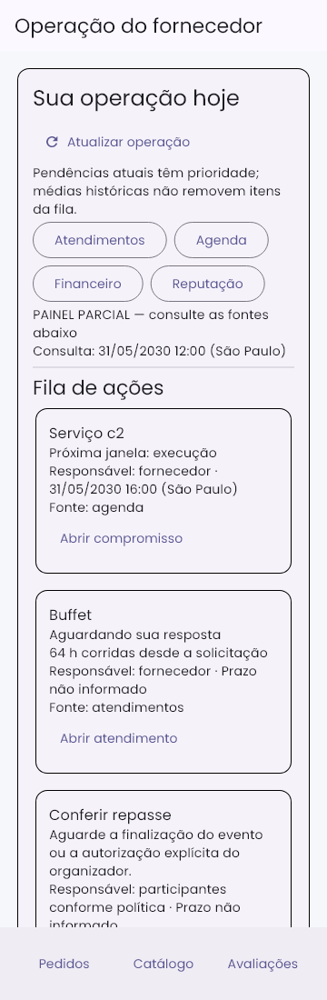
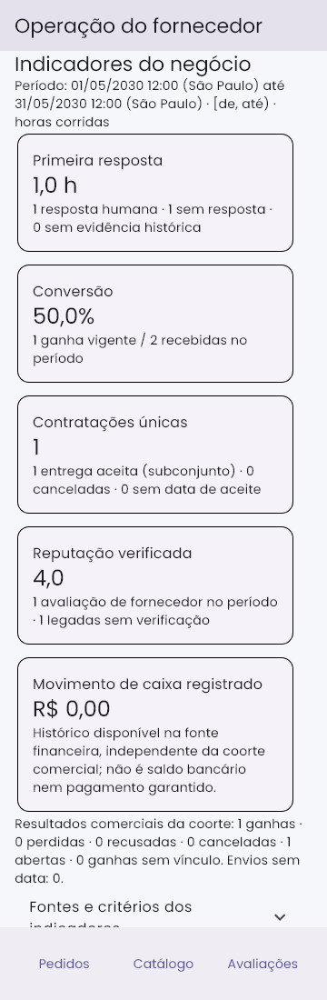
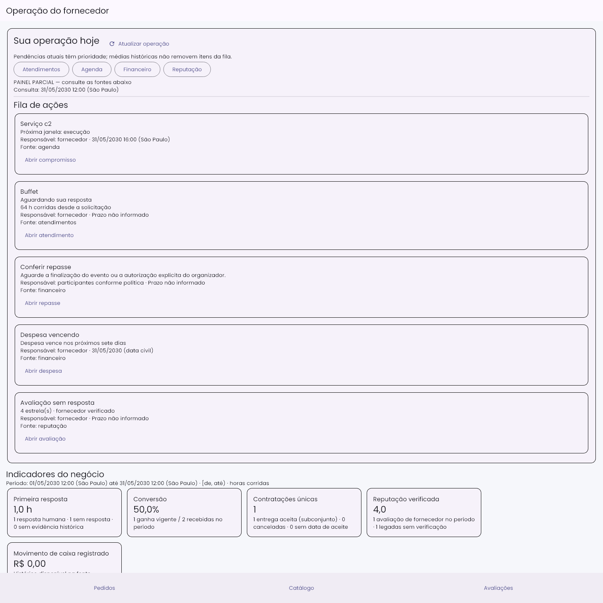

# 09 — Painel operacional e indicadores rastreáveis

Validação local em 27/10/2026. Repositório existente, branch main, com alterações anteriores preservadas. Não foram encontrados AGENTS.md aplicáveis no repositório/ancestrais durante a inspeção inicial. Sem deploy, commit, push, escrita em produção, dependências novas ou plataforma externa.

## Implementação e fontes

O resumo do fornecedor agora abre com fila operacional e navegação para Atendimentos, Agenda, Financeiro e Reputação. Indicadores ficam separados dos atalhos Catálogo, Estoque, Perfil/configurações e Comissões. O painel antigo de cartões equivalentes e métricas estimadas não alimenta a nova visão. A IA continua disponível na elaboração de propostas com revisão humana; o índice heurístico das solicitações deixou de ser apresentado como porcentagem de probabilidade.

`consultarPainelFornecedorFn` usa exclusivamente o UID autenticado, exige perfil F ativo e recusa identificador de outro fornecedor. As consultas são limitadas ao fornecedor, inclusive orçamentos, participações de cotação, agenda, finanças e avaliações verificadas. Não há acesso administrativo geral novo. As fontes independentes podem falhar isoladamente: a fonte indisponível fica nula, o painel fica parcial e os demais alertas continuam visíveis.

| Informação | Origem e critério |
|---|---|
| Primeira resposta | Envio da participação da cotação até primeira mensagem humana do fornecedor ou proposta com autoria do fornecedor. Mensagens de sistema, cliente, eventos anteriores ao envio e futuros são excluídos; reenvios posteriores não reiniciam a medição. |
| Período comercial | Últimas 720 horas corridas por padrão, intervalo fechado no início e aberto no fim [de, até). Horas corridas, sem supor expediente comercial; apresentação em America/Sao_Paulo. Períodos explícitos são validados pelo backend, até 366 dias, sem futuro. |
| Amostra | Quantidade de solicitações com primeira resposta comprovada. Sem resposta, sem evidência histórica e sem data de envio aparecem explicitamente, sem média zero. O campo legado data_resposta não substitui o evento original. |
| Conversão | Solicitações ganhas vigentes com vínculo contratual / solicitações recebidas na coorte. Perdidas, recusadas, canceladas, abertas e ganhas sem vínculo são separados. Sem denominador, sem amostra. |
| Contratações | Identidade contrato_financeiro.id_contrato; legado agrupado por cotação quando disponível, senão orçamento. Somente contratação reconhecida pela política existente ou histórico cancelado identificado. Data de aceite/proposta ou fechamento/snapshot existente, sem data inventada. Espelhos divergentes tornam a fonte indisponível. |
| Concluídas | Estado atual aceito da execução dos contratos da coorte de aceite. Não significa entregas ocorridas no período nem nova venda. Canceladas são separadas. |
| Reputação | Mesma validação registrosConfiaveis da gestão de reputação; tipo fornecedor, visibilidade e período. Legado sem comprovação não entra como verificado. Avaliação de serviço pode gerar ação de resposta sem duplicar a média do fornecedor. |
| Movimento financeiro | Serviço canônico de planejamento, todas as datas registradas, explicitamente identificado na tela. Não é saldo bancário, previsão garantida nem pagamento declarado pelo cliente. Falha não vira zero. |

A fila usa todas as pendências atuais, independentemente da coorte histórica: atendimento aguardando fornecedor/cliente, prazo persistido vencido quando existente, compromisso operacional vigente/próximos sete dias, repasse efetivamente impedido pela política atual, despesa com vencimento conhecido e saldo, avaliação verificada sem resposta. Sem horário/prazo não se inventa vencimento. Cotação ganha sem vínculo pede conferência, não cria compromisso. Motivo, responsabilidade, fonte e prazo conhecido acompanham cada ação. A média histórica de 1 hora não retira o atendimento parado há 64 horas.

## Navegação, atualização e privacidade

Cada botão passa a identidade real: jornada por idCotacao/idFornecedor, agenda por idOrcamento, acompanhamento por evento/orçamento/fornecedor, planejamento por idObrigacao, reputação por idAvaliacao. Planejamento destaca a obrigação autorizada; a consulta de reputação valida o foco e mantém a base canônica dos agregados. Voltar ao painel atualiza a consulta.

Controller descarta respostas de requisição anterior e de outra sessão, limpa os dados na troca, cancela assinaturas/timer ao encerrar e invalida também a fachada antiga de estatísticas. Atualização falha preserva apenas a última leitura do mesmo usuário com aviso; esse aviso permanece até sucesso. Após cinco minutos, os dados são marcados desatualizados. Atualização manual e pull-to-refresh disponíveis. Não existe atualização instantânea garantida entre consultas.

A fila e os cartões usam conteúdo expansível, botões nativos com semântica/teclado e rodapé respeitado. Falha inicial oferece retry; ausência de amostra e fonte parcial ficam visíveis.

## Arquivos desta implementação

- functions/src/services/fornecedores/painelOperacionalService.ts e export em functions/src/index.ts.
- functions/src/services/avaliacoes/gestaoReputacaoService.ts: consulta focada autorizada.
- lib/presentation/modules/fornecedor/controllers/painel_operacional_controller.dart e fornecedor_painel_ao_vivo.dart; integração em fornecedor_controller.dart.
- lib/presentation/modules/fornecedor/sections/painel_operacional_fornecedor.dart, resumo_section.dart, solicitacoes_section.dart e pages/fornecedor_home_screen.dart.
- lib/app/routes/app_routes.dart; controller/widget de gestão de reputação; planejamento_financeiro_page.dart para focos de navegação.
- functions/scripts/testPainelFornecedorEmulator.js, test/features/painel/painel_operacional_test.dart, duas fixtures JSON retornadas pelo emulador e comando test:painel:fornecedor em package.json.

Nenhum índice novo: reutilizado collectionGroup fornecedores/id_fornecedor ASC já existente em firestore.indexes.json. Nenhuma concessão de regras ampliada; o endpoint lê via Admin SDK após restringir explicitamente o fornecedor. Não altera fatos financeiros, contratação ou nota para construir indicadores.

## Verificações executadas

Ambiente Windows/PowerShell, Flutter/Dart local e JDK 21 para Firestore Emulator. Projeto sintético demo-painel-fornecedor; relógio fixo 31/05/2030 15:00 UTC nas fixtures (não são dados reais ou datas atuais).

```powershell
$env:JAVA_HOME = Join-Path $env:TEMP 'codex-chat-jdk/jdk-21.0.12.1+1'
$env:PATH = "$env:JAVA_HOME/bin;$env:PATH"
npm run test:painel:fornecedor
flutter test test/features/painel --update-goldens --reporter expanded
flutter test test/features/painel test/features/avaliacoes/gestao_reputacao_test.dart test/features/planejamento test/features/agenda test/features/cotacoes --reporter expanded
```

- Backend TypeScript compilado e teste Firestore Emulator: PASS, saída 0. Exercita documentos persistidos de cotação/mensagens/propostas, contratação, agenda, planejamento, impedimento de repasse, criação real de avaliação elegível, agregados e consulta focada. Inclui fornecedores distintos, cliente, administrador, ausência de autenticação, métricas/períodos, reenvio, cancelamento/perda/recusa e corrupção real de espelho financeiro que torna a fonte indisponível. Não usa somente mocks como prova de integração.
- Regressão Flutter: **65 testes aprovados**, incluindo **12 do painel**. As fixtures do painel são saídas reais do teste de emulador; o gateway é substituído apenas para transportar esses dados no teste de widget. Cobre estado parcial, sem amostra, retry, troca de sessão/consulta antiga, atualização, todos os destinos/argumentos dos alertas, tecla Enter, semântica, fonte ampliada 2x, larguras 360/1280 e comparação de imagens 360/1600. O teste final rodou sem atualizar goldens.
- Análise estática dos 11 arquivos Dart de integração alterados e test/features/painel: **No issues found**. Build TypeScript incluído no comando de backend.

## Evidências visuais

Imagens de widgets executados com Poppins e ícones existentes do aplicativo, dados sintéticos vindos do emulador e Scaffold/rodapé de teste. São comparações reproduzíveis, não captura de aplicativo instalado autenticado em produção.





## Limites explícitos

Não houve teste manual do aplicativo instalado em Windows/dispositivo, leitor de tela externo ou implantação do callable em ambiente hospedado. Integração foi executada diretamente nos serviços reais com Firestore Emulator; transporte callable e autenticação hospedada não foram exercitados ponta a ponta. Sem eventos antigos comprováveis, a média fica parcial; não há migração nem reconstrução artificial. A leitura de fontes diferentes não representa snapshot transacional global: cada fonte informa sua atualização e o painel explicita incompletude. O endpoint usa o volume atual de participações do fornecedor para calcular sua coorte; bases muito grandes podem exigir agregação incremental futura, sem alterar o critério aqui implementado.
