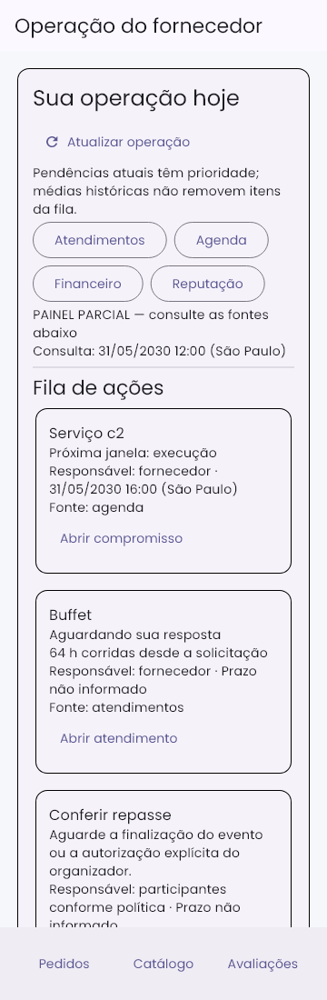
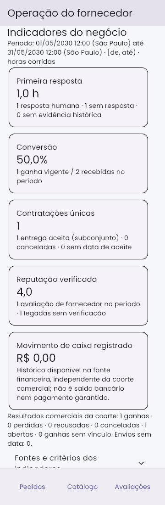
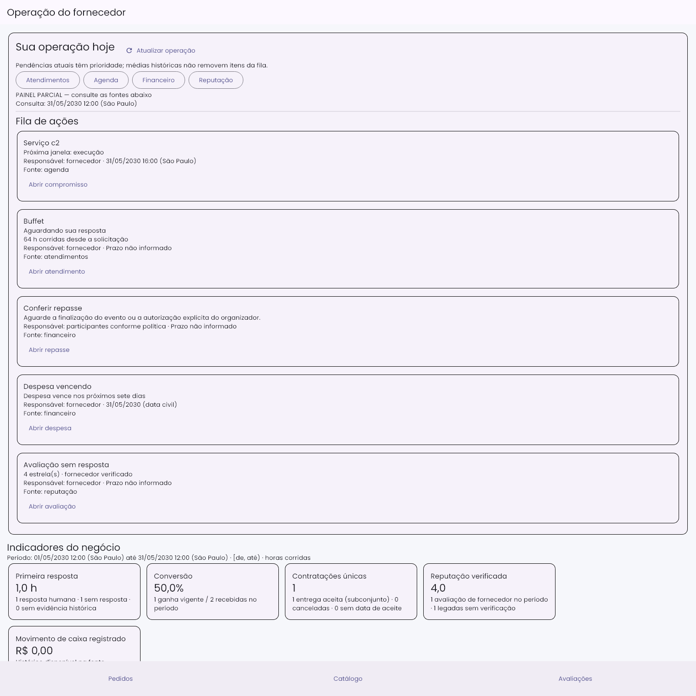

# 10 — Validação integrada da operação do fornecedor

Execução local: **27/10/2026**, America/Sao_Paulo. Repositório `D:/repository/unicesumar/tcc/app/src/app_faca_festa`, branch main. Inspeção inicial: 179 entradas alteradas/não rastreadas no Git, preservadas; nenhum AGENTS.md encontrado no repositório/ancestrais. Prompts e evidências 01–09 foram usados como contexto; os resultados abaixo vêm de execução nova contra código atual, não de documentação anterior.

## Ambiente e reprodução

Windows/PowerShell; Flutter 3.27.2, Node v24.12.0, Firebase CLI 15.10.0, JDK 21.0.12.1. O package.json das Functions declara Node 22: a paridade de runtime 22 não foi medida nesta máquina. Não houve deploy, commit, push, cobrança, transferência, migração, envio externo ou operação em produção.

```powershell
$env:JAVA_HOME = Join-Path $env:TEMP 'codex-chat-jdk/jdk-21.0.12.1+1'
$env:PATH = "$env:JAVA_HOME/bin;$env:PATH"
npm run test:operacao:fornecedor
npm --prefix functions run check:financeiro
flutter test test/features/cotacoes test/features/agenda test/features/avaliacoes test/features/planejamento test/features/painel test/features/financeiro/financeiro_contratos_unificado_test.dart test/features/financeiro/recebimentos_caixa_idempotencia_test.dart test/features/financeiro/comissao_plataforma_test.dart --reporter expanded
flutter test test/features/painel --dart-define=EVIDENCIA_OPERACAO=10 --update-goldens --reporter expanded
flutter test test/features/painel --dart-define=EVIDENCIA_OPERACAO=10 --reporter expanded
```

O primeiro comando executa build TypeScript, domínio de caixa, reinício limitado/idempotente de transação e um único Firestore Emulator com namespaces demo isolados. O manifesto `functions/scripts/casosOperacaoFornecedor.json` aponta para as suítes reais existentes; não substitui persistência por mocks. Cada subprocesso recebe sua própria identidade e configuração demo. O executor preserva logs e resultado/horário/exit code em diretório novo a cada execução; falha em qualquer cenário faz o comando terminar com erro.

Configuração exclusiva: `firebase.operacao-test.json`, loopback 127.0.0.1:8080, UI desativada e múltiplos projetos **demo** explícitos. O Functions HTTP Emulator e Auth Emulator não são iniciados: as Functions reais são chamadas por seus handlers/serviços com contexto sintético, usando Firestore real emulado; regras são avaliadas pelo rules-unit-testing com identidades distintas. Isso comprova regras e transações, mas não o transporte HTTP, emissão de tokens ou inicialização integral dos triggers.

## Estabilização realizada

1. Scripts antigos exigiam apenas FIRESTORE_EMULATOR_HOST e alguns sobrescreviam GCLOUD_PROJECT silenciosamente. `exigirEmuladorDemo.js` agora roda antes dos imports Firebase e recusa projeto não-demo, projeto divergente, configuração externa por arquivo e endpoint fora de loopback. O teste de barreira executa configurações inválidas sem abrir rede.
2. A CLI fornece placeholders databaseURL/storageBucket mesmo em projeto demo. Duas tentativas de preparação foram corretamente bloqueadas pela primeira versão da barreira. A versão final reconhece exclusivamente placeholders do **mesmo projeto demo** e os remove antes do SDK; URLs/buckets reais continuam recusados. Testes comprovam remoção e rejeição.
3. HTTP/HTTPS, HTTP2 e fetch dos processos de teste têm barreira de saída externa, incluindo destinos de FCM. Nenhuma chamada externa é usada como prova. Fixtures não possuem tokens de notificação reais.
4. Comandos financeiros que encadeavam scripts de projetos diferentes sob uma única FIREBASE_CONFIG foram separados por projeto explícito; a identidade não é mais silenciosamente trocada. Comando agregado de regras reutiliza esses comandos isolados.
5. Jornada ganhou assertivas transversais sobre o **mesmo orçamento criado pelo aceite real**: agenda, entrega/aceite, avaliação, resposta pública, nota preservada e painel. Não apenas documentos artificiais independentes por módulo.
6. Evidências visuais têm prefixo selecionável por dart-define, permitindo capturas novas 10 sem reutilizar capturas 09. O fake de cotações já estava compatível com o contrato real; os testes de delegação/parâmetros passaram sem remover assertions.

Não foi necessário mudar a lógica de produção para fazer os cenários existentes passarem; as correções desta rodada concentram-se na segurança e reprodutibilidade da validação e na cobertura transversal. Nenhuma funcionalidade ausente foi substituída por botão/fixture que simula implementação.

## Cenários, identidades e evidências

Todos os IDs abaixo são sintéticos e ficam exclusivamente em namespaces demo. Identificadores curtos se repetem entre namespaces, não representam usuários reais. A suíte de chat cria **ca/cb, fa/fb, outro/admin**, com duas conversas no mesmo evento. As demais criam f/g ou f/f2, c/x ou o, e administradores; reputação acrescenta mod/mod2 com claim específica moderar_avaliacoes. Administrador genérico não ganha acesso ao financeiro privado nem ao chat. O modelo de chat atual não contém atribuição de suporte: nenhum papel novo foi inventado para ampliar sua leitura.

| Cenário obrigatório | Dados e verificações reais |
|---|---|
| 1 — Isolamento | Chat direto, consulta ordenada, collectionGroup irrestrito e filtrado, remetente forjado, edição/exclusão e mensagens de sistema; duas conversas no mesmo evento. Regras de contratos/agenda/reputação/finanças e comandos negam terceiro/outro fornecedor/admin sem vínculo. Moderação exige claim específica; custos privados continuam inacessíveis ao administrador/cliente. |
| 2 — Jornada | Projeto demo-jornada-atendimentos: q → propostas 1/2, negociação e próxima ação → um orçamento por aceite concorrente → preparação/agenda/capacidade → execução → entrega → aceite. Chat operacional continua aberto. Contratação não permite fornecedor aceitar pelo cliente. Contestação reutiliza mediação; histórico mantém a mesma identidade. Expiração, revisão concorrente, disputa entre fornecedores e cancelamento competem transacionalmente. |
| 3 — Contrato líquido | Projeto demo-financeiro-contratos: c de 315000 centavos, comissão 15750, direito 299250; declaração do cliente mantém recebido zero; repasse manual confirmado 100000 deixa 199250 no resumo e acompanhamento, com revisão conciliada. Extrato de intermediação usa o mesmo direito. Parcela final retém apenas o saldo de comissão; pagamento separado/misto não liquida duas vezes. Comissão adicionada/absorvida não reduz automaticamente o direito. Confirmação manual de repasse é registro autorizado, não comprovação de transferência bancária real. |
| 4 — Alocação/caixa | Projeto demo-caixa-fornecedor: c1=200000, c2=300000 no mesmo evento e recebimento 50000 em c1 → pendentes 150000/300000; movimento 50000 uma vez. Listeners reais, nova consulta/refresh e retries preservam totais. Legado livre fica não alocado. |
| 5 — Concorrência | Oito recebimentos com a mesma chave produzem um fato/espelho; mesma chave com payload distinto é recusada. Timeout simulado após commit reconcilia a chave persistida. Falha injetada antes do commit não deixa contas_receber/movimentos/auditoria parciais. Concorrência de repasse, estorno, contratação, revisão e agenda/capacidade é exercitada. Capacidade 1/2 e terceiro excedente, limites semiabertos, virada de dia/fuso, reagendamento/cancelamento e estoque/devolução são verificados. |
| 6 — Reputação | Projetos demo-avaliacoes-verificadas/demo-gestao-reputacao e jornada: entrega aceita elegível, identidade determinística/uma avaliação, autoria, faixa de nota, autoavaliação/terceiros negados, agregados convergentes. Resposta pública versionada e concorrente preserva nota/comentário; denúncia não apaga crítica e decisão específica mantém histórico/notas internas restritas. |
| 7 — Ausência/erros | Cancelamento/estorno preservam fatos; sem vínculo, data, custo ou evidência não se fabrica alocação, atraso, aceite, lucro ou quitação. Fonte financeira inconsistente realmente persistida torna a fonte indisponível; widgets de erro/retry não exibem saldo zero. Sem resposta não vira média zero. |
| 8 — Conciliação/interface | Planejamento confronta contas/baixas, resumo e CSV filtrado com fatos persistidos; resultado direto 199250 e caixa líquido 60000 são distintos. Proteção de fórmula CSV verificada. Painel usa média 1h/amostra1 e mantém pendência64h; identidade contratual única, métricas canônicas de reputação, destinos/argumentos corretos. Widgets cobrem troca de sessão, resultado antigo, teclado/semântica, fonte2x, 360/1280 e imagens360/1600, sem esconder a última ação pelo rodapé. |

As suítes são complementares, com projetos independentes. Não se afirma que toda a matriz financeira foi executada no único orçamento da jornada. A assertiva transversal liga jornada/agenda/reputação/painel; as suítes financeiras confrontam seus próprios fatos reais com resumo, acompanhamento, planejamento e exportação.

## Resultados da execução atual

- **104 testes Flutter aprovados**, incluindo domínio/widgets financeiros, cotações, agenda, avaliações, planejamento e painel. [Log completo](10-logs/flutter-104.txt).
- **12 testes do painel aprovados novamente**, gerando as imagens 10 e depois comparando sem update-goldens. [Geração](10-logs/visuais-geracao.txt) e [comparação](10-logs/visuais-comparacao.txt).
- `npm --prefix functions run check:financeiro`: **exit 0**, TypeScript --noEmit e suítes de fundação, concorrência, autorização, previsão, estoque, comissão, dashboard, simulação e conciliação. [Log](10-logs/dominio-financeiro.txt). Esses testes de domínio complementam o emulador; não o substituem.
- Análise estática Dart dos módulos fornecedor/cotação, planejamento, gestão de reputação, datasources de cotação/avaliação e testes correspondentes: **No issues found**. [Log](10-logs/dart-analyze.txt). Nova análise do teste visual alterado também sem problemas.
- `functions/package.json` contém lint que apenas imprime Skipping lint. **Não foi utilizado como validação**. Verificação efetiva: build tsc, tsc --noEmit, dart analyze e node --check dos scripts alterados.
- A primeira rodada completa executou **13 cenários de emulador aprovados**, saída 0. [Log da rodada](10-logs/primeira-rodada.txt). Rodada final com barreira completa e assertiva transversal: resultado detalhado abaixo.

**Rodada final: 13/13 aprovados, saída global 0**, 27/10/2026 06:19–06:22 (São Paulo). [JSON de resultados](10-logs/run-2026-10-27T09-19-41-744Z/resultados.json). Os horários no JSON são UTC. Mensagens PERMISSION_DENIED nos logs são negativas esperadas com assertFails, não falhas ignoradas.

| Cenário | Projeto | Comando interno executado | Saída/log |
|---|---|---|---|
| atendimentos | demo-chat-privado | `node test/firestore/atendimentos.rules.test.js` | [0](10-logs/run-2026-10-27T09-19-41-744Z/atendimentos.txt) |
| contratos | demo-financeiro-contratos | `node functions/scripts/testVisaoContratoEmulator.js` | [0](10-logs/run-2026-10-27T09-19-41-744Z/contratos.txt) |
| recebimentos | demo-caixa-fornecedor | `node functions/scripts/testRecebimentosCaixaEmulator.js` | [0](10-logs/run-2026-10-27T09-19-41-744Z/recebimentos.txt) |
| repasses | demo-repasse-operacional | `node functions/scripts/testRepasseOperacionalEmulator.js` | [0](10-logs/run-2026-10-27T09-19-41-744Z/repasses.txt) |
| jornada | demo-jornada-atendimentos | `node functions/scripts/testJornadaAtendimentosEmulator.js` | [0](10-logs/run-2026-10-27T09-19-41-744Z/jornada.txt) |
| agenda | demo-agenda-fornecedor | `node functions/scripts/testAgendaFornecedorEmulator.js` | [0](10-logs/run-2026-10-27T09-19-41-744Z/agenda.txt) |
| agenda-regras | demo-agenda-fornecedor | `node test/firestore/agenda_fornecedor.rules.test.js` | [0](10-logs/run-2026-10-27T09-19-41-744Z/agenda-regras.txt) |
| avaliacoes | demo-avaliacoes-verificadas | `node functions/scripts/testAvaliacoesVerificadasEmulator.js` | [0](10-logs/run-2026-10-27T09-19-41-744Z/avaliacoes.txt) |
| reputacao | demo-gestao-reputacao | `node functions/scripts/testGestaoReputacaoEmulator.js` | [0](10-logs/run-2026-10-27T09-19-41-744Z/reputacao.txt) |
| planejamento | demo-planejamento-fornecedor | `node functions/scripts/testPlanejamentoFornecedorEmulator.js` | [0](10-logs/run-2026-10-27T09-19-41-744Z/planejamento.txt) |
| painel | demo-painel-fornecedor | `node functions/scripts/testPainelFornecedorEmulator.js` | [0](10-logs/run-2026-10-27T09-19-41-744Z/painel.txt) |
| financeiro-regras | demo-faca-festa-fin-forn | `node test/firestore/financeiro_fornecedor.rules.test.js` | [0](10-logs/run-2026-10-27T09-19-41-744Z/financeiro-regras.txt) |
| comissao-regras | demo-faca-festa-comissao | `node test/firestore/comissao_plataforma.rules.test.js` | [0](10-logs/run-2026-10-27T09-19-41-744Z/comissao-regras.txt) |

A análise Dart ampla foi executada com:

```powershell
dart analyze lib/presentation/modules/fornecedor lib/presentation/modules/cotacao lib/presentation/modules/financeiro/controllers/planejamento_financeiro_controller.dart lib/presentation/modules/financeiro/pages/planejamento_financeiro_page.dart lib/presentation/modules/avaliacao/controllers/gestao_reputacao_controller.dart lib/presentation/modules/avaliacao/widgets/gestao_reputacao_painel.dart lib/data/datasources/remote/cotacao_remote_datasource.dart lib/data/datasources/remote/avaliacao_servico_remote_datasource.dart test/features/cotacoes test/features/agenda test/features/avaliacoes test/features/painel test/features/planejamento
```

`git diff --check` nos caminhos desta rodada também passou. O comando integrado é o recomendado para toda a matriz; os comandos internos da tabela dependem do ambiente isolado montado pelo executor.

## Capturas novas desta execução

Produzidas por teste de widget em 27/10/2026, usando as fixtures retornadas pela execução atual do emulador. Relógio dos dados de painel fixo em 31/05/2030; testes de agenda também usam intervalos2030 e planejamento usa data sintética2026-10-26. As datas exibidas são dados de teste, não estado atual de produção. Capturas usam componentes/fontes existentes com Scaffold e rodapé de teste; não são capturas de aplicativo instalado.





## Arquivos desta rodada

- `functions/scripts/exigirEmuladorDemo.js`, `testExigirEmuladorDemo.js`, `testOperacaoFornecedorIntegrada.js` e `casosOperacaoFornecedor.json`.
- Guardas iniciais nos nove scripts Functions de emulador dos prompts02–09 (contratos, caixa, repasse, jornada, agenda, avaliações, reputação, planejamento, painel); jornada também contém a conferência transversal.
- Guardas nas suítes de regras atendimentos, agenda, financeiro_fornecedor e comissao_plataforma.
- `firebase.operacao-test.json`, comandos em `package.json` e prefixo de evidência em `test/features/painel/painel_operacional_test.dart`.
- Este documento, imagens10 e logs novos. As duas fixtures do painel são regeneradas pelo teste de persistência, preservando os dados determinísticos. Alterações anteriores em outras áreas não pertencem a esta rodada.

## Prontidão e bloqueadores

**Prontidão para ensaio técnico local com dados sintéticos: validada pelos testes listados. Piloto com usuários reais em homologação: condicionado**, sem declaração de prontidão de produção.

Bloqueadores de evidência para liberar piloto em ambiente hospedado:

1. Não foi executado ponta a ponta login/emissão/renovação de token → transporte HTTP callable → cliente Flutter instalado. Autorização e regras foram testadas com contextos sintéticos, não um login real no Auth Emulator.
2. Não foi executada a inicialização de todos os triggers no Functions Emulator nem implantação em homologação. As Functions reais foram invocadas diretamente; efeitos assíncronos de runtime/entrega de eventos não estão aprovados por esta evidência.
3. Não houve execução em dispositivo físico/instalador Windows, leitor de tela externo nem medição sob rede real. Cobertura visual é de widgets nas larguras/fontes descritas.
4. Functions foram compiladas e testadas em Node24 local; o runtime declarado22 ainda precisa de paridade antes de liberar o piloto hospedado.

Não foi observada lacuna funcional adicional nos cenários implementados que passaram. Limites de compatibilidade permanecem explícitos: legado sem prova não recebe verificação/data/valor inventado, recebimentos manuais não comprovam banco e dados sem componentes mantêm resultado parcial. Não houve migração, teste de carga massiva, integração bancária real, envio de FCM/email ou validação de produção. Nada disso foi simulado como aprovado.
