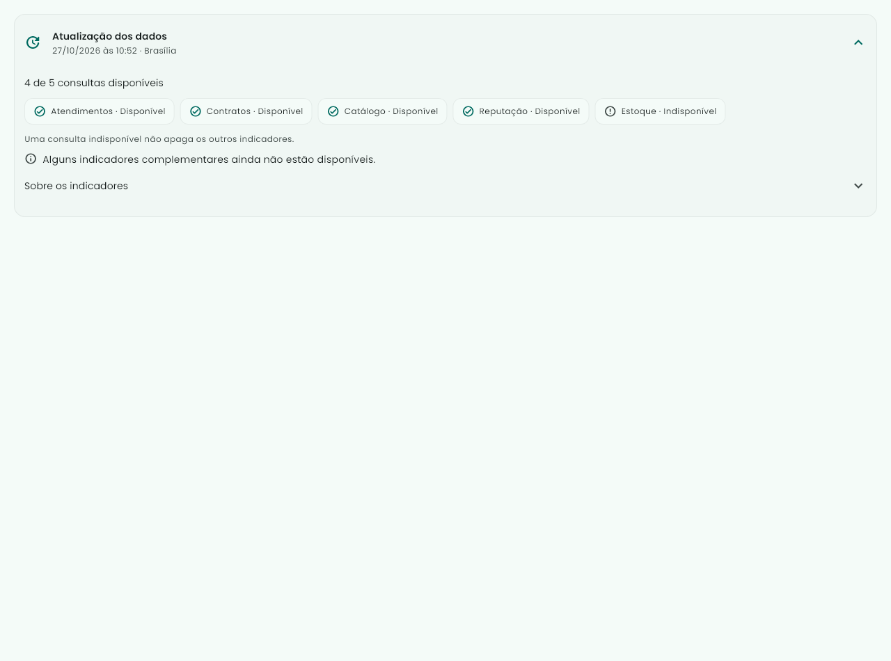

# Atualização dos indicadores — área compacta

Revisão de 27/10/2026 da região marcada pelo usuário.

- Cabeçalho Atualização dos dados com data legível convertida para Brasília; sem timestamp ISO na leitura principal.
- Status agrupados em etiquetas com ícone e texto, acentos e nomes claros. Quantidade de consultas disponíveis sem confundir falta de informação com zero.
- Explicações ficam em Sobre os indicadores; códigos ficam em Detalhes para suporte, recolhidos.
- Aviso complementar fica nessa área, sem repetição ao lado do atalho Planejamento e relatórios.
- Correção do singular de primeira resposta e expressão últimos30dias, mantendo a janela real de720horas.

Validação: **23 testes aprovados**, comparação de imagens final sem update-goldens, larguras360/1280, fonte2x, status parcial, ausência da primeira consulta, código técnico recolhido e conversão de horário UTC→Brasília. Análise Dart sem problemas; git diff --check aprovado. Nenhuma consulta, regra ou cálculo financeiro foi alterado.

```powershell
flutter test test/features/painel --reporter expanded
dart analyze lib/presentation/modules/fornecedor/sections/atualizacao_indicadores.dart lib/presentation/modules/fornecedor/sections/visao_operacional_fornecedor.dart test/features/painel/atualizacao_indicadores_test.dart
```




Imagens de teste atuais com dados sintéticos. [Testes](widgets.txt) · [Análise](analyze.txt).
