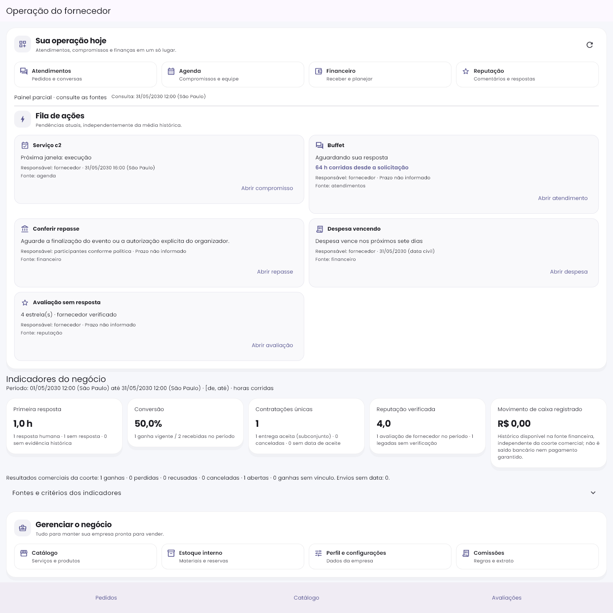
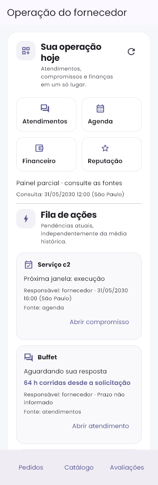
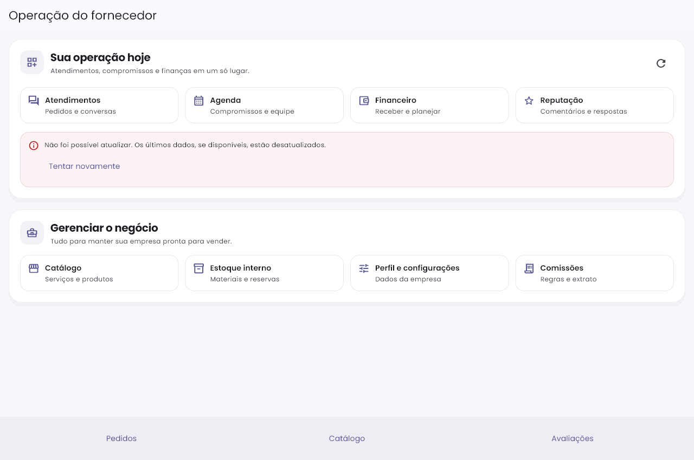
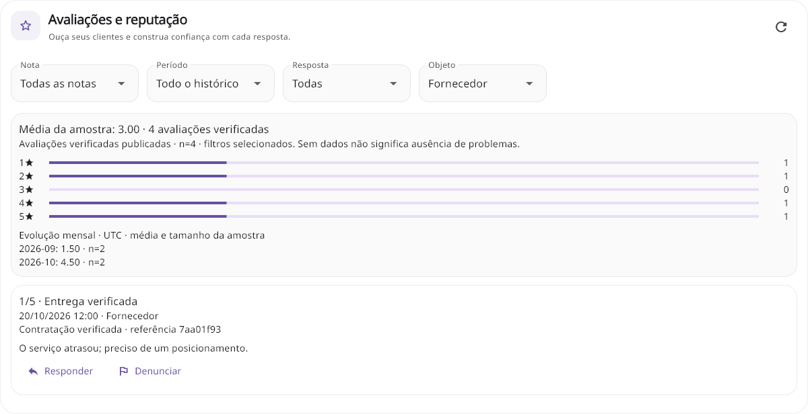
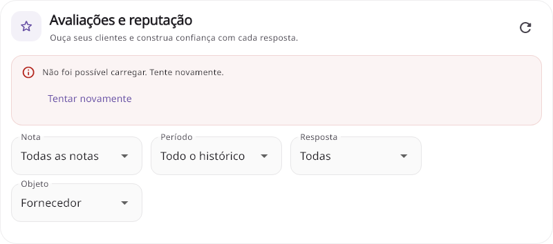

# Refinamento visual — operação do fornecedor

Implementado em 27/10/2026 a partir das duas capturas fornecidas. Foco: ergonomia, navegação intuitiva e continuidade com a identidade existente. Alterações anteriores de segurança, financeiro e jornada preservadas; nenhuma dependência, deploy ou operação em produção.

## O que mudou

- Superfícies claras, bordas discretas, cantos e espaçamento consistentes; tema escuro continua usando as superfícies do tema.
- Navegação operacional em blocos com ícone, título e descrição: Atendimentos, Agenda, Financeiro e Reputação. Botões nativos mantêm foco, teclado e semântica.
- Fila com ícones por assunto e duas colunas quando há espaço; idade da solicitação ganha destaque. No celular, cada ação ocupa a largura disponível. Layout sem alturas fixas para acomodar fonte ampliada.
- Indicadores distribuídos conforme a largura, com hierarquia entre rótulo, valor e contexto. Fontes, períodos, amostra e falhas continuam explícitos.
- Gestão da empresa agrupada em uma superfície própria, com atalhos de catálogo, estoque, perfil e comissões.
- Reputação com cabeçalho/refresh acessível, filtros contornados, comentários e resumo com bordas suaves. Fonte ampliada faz filtros ocuparem toda a largura.
- Avisos de falha compactos com ícone e retry. A mensagem de API continua real: o refinamento visual não mascara indisponibilidade com números fictícios.
- Cartões de pedidos ganham ação contextual: Ver atendimento ou Gerenciar contrato; execução tem rótulos legíveis, sem repetir o estado comercial em texto técnico.
- Explicação de IA recolhida em seção expansível; revisão humana e critérios seguem disponíveis.

## Validação executada

```powershell
flutter test test/features/painel test/features/avaliacoes/gestao_reputacao_test.dart --update-goldens --reporter expanded
flutter test test/features/painel test/features/avaliacoes/gestao_reputacao_test.dart test/features/cotacoes --reporter expanded
dart analyze lib/presentation/widgets/operacao lib/presentation/modules/fornecedor/sections/painel_operacional_fornecedor.dart lib/presentation/modules/fornecedor/sections/solicitacoes_section.dart lib/presentation/modules/avaliacao/widgets/gestao_reputacao_painel.dart lib/presentation/modules/fornecedor/pages/fornecedor_home_screen.dart test/features/painel test/features/avaliacoes/gestao_reputacao_test.dart
```

**49 testes aprovados**, comparação final sem update-goldens. Incluem navegação aos registros corretos, teclado, erro/retry, fonte2x, painel360/1280 e reputação360/1200. **Análise estática sem problemas**. git diff --check aprovado nos caminhos alterados. As primeiras diferenças de golden eram esperadas pelo redesenho; novas referências usam prefixo premium, preservando imagens históricas05/09/10. Duas verificações novas cobrem fonte ampliada da reputação.

As imagens são renderizações novas de widgets com dados sintéticos e fontes locais; não representam execução de aplicativo instalado conectado ao backend real. Não foram repetidos os testes de backend/regras nesta rodada, pois a mudança é de apresentação. Falhas de consulta mostradas nas capturas originais dependem da disponibilidade/configuração dos endpoints; esta entrega não faz deploy para corrigi-las.

## Evidências








## Arquivos

Componente compartilhado em lib/presentation/widgets/operacao/operacao_surface.dart; painel_operacional_fornecedor.dart, solicitacoes_section.dart, fornecedor_home_screen.dart e gestao_reputacao_painel.dart. Testes de painel e gestão de reputação atualizados; este registro e imagens premium novas. Nenhuma regra financeira, autorização ou fórmula foi alterada.
