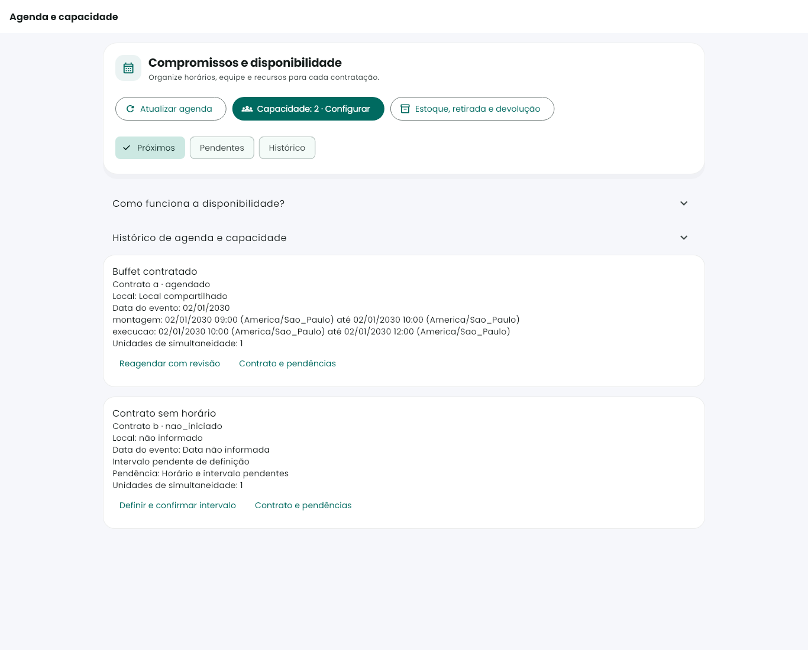
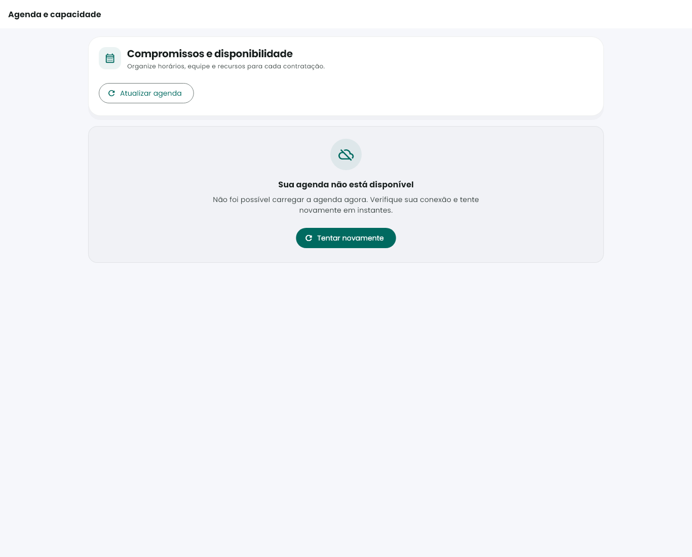
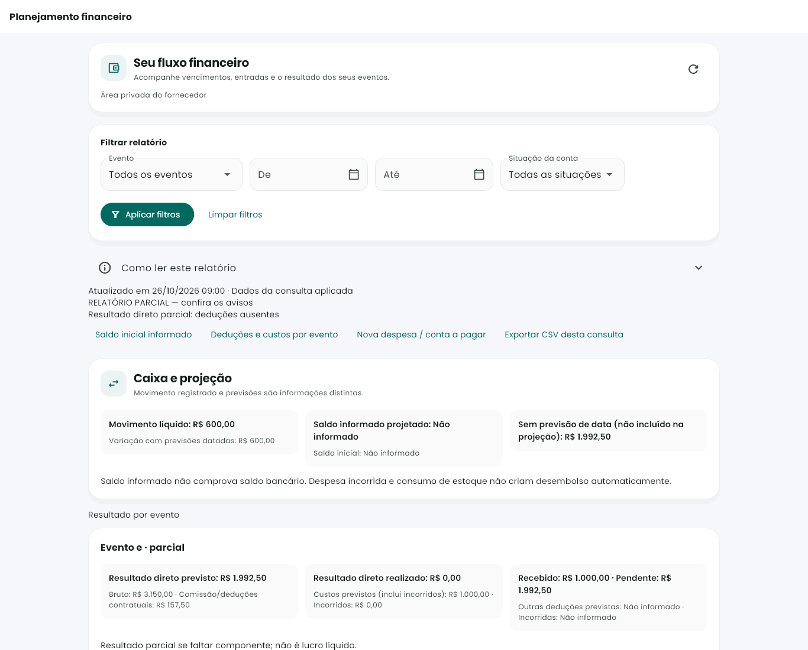
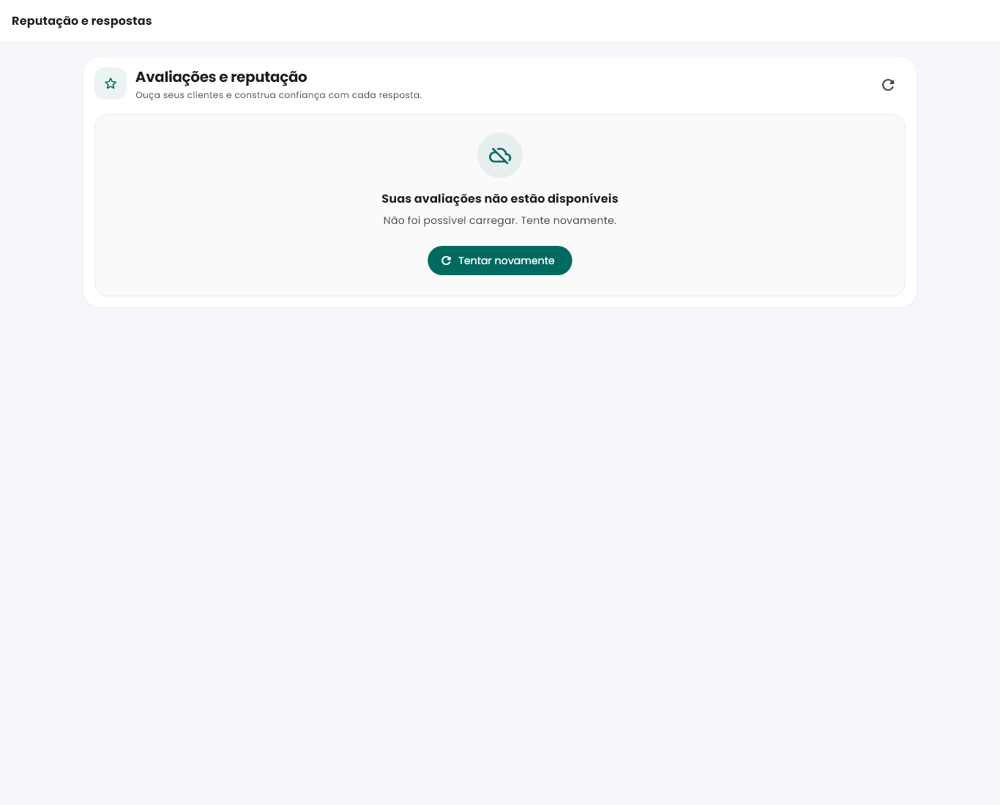
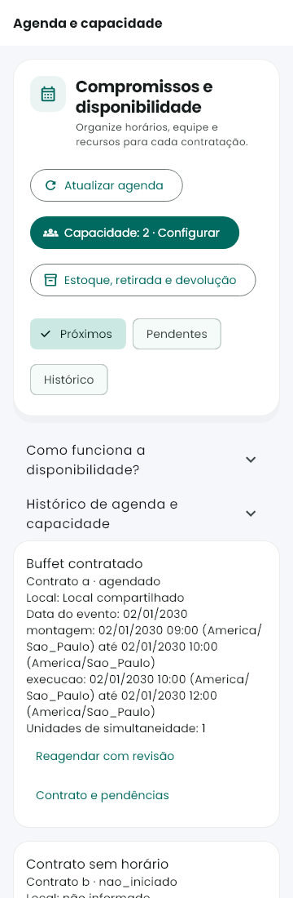
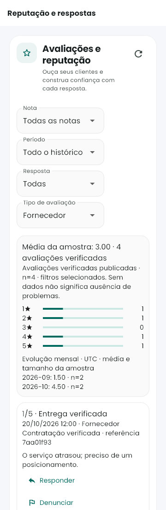

# Agenda, planejamento e reputação — revisão de ergonomia

27/10/2026. Alterações locais sobre trabalho existente preservado, sem deploy, commit/push ou operações em produção.

## Mudanças entregues

- Moldura comum das páginas: fundo neutro, barra clara, largura de conteúdo limitada, superfícies e espaçamentos consistentes. Reputação não ocupa mais toda a largura de um monitor grande.
- Agenda: cabeçalho com ações agrupadas, capacidade e estoque, filtros em chips e explicação recolhida. Estados de falha e de ausência de compromissos continuam distintos.
- Financeiro: seleção dos eventos disponíveis nos dados autorizados já consultados, datas em dd/mm/aaaa com calendário, situações legíveis, aplicar/limpar filtros. A consulta continua recebendo ISO yyyy-MM-dd. Não houve nova consulta com acesso ampliado. Se a fonte ainda não fornece nome, a opção identifica honestamente o evento por seu código.
- Caixa/projeção e resultado por evento separados em grupos visuais; cálculos e valores não foram alterados. Dados ausentes continuam Não informado; resultado parcial continua identificado.
- Falha inicial tem ícone, título, explicação e ação principal. O texto bruto internal não é apresentado em agenda/financeiro; mensagens de validação de negócio e permissão continuam distintas.
- Reputação não oferece filtros de conteúdo antes de uma primeira consulta bem-sucedida quando há erro. Depois de carregada, mantém filtros editáveis se uma nova consulta falhar. O mesmo vale para filtros financeiros; limpar permite recuperar uma consulta inválida sem ficar preso no retry.
- Cache de opções financeiras e sinalização de consulta são descartados na mudança de sessão. Calendário descarta seleção se a sessão mudar durante o diálogo.
- Explicação de IA retirada do rodapé. Orientação contextual está no tooltip da ação Calcular IA; a revisão humana de propostas segue preservada.

## Verificação atual

```powershell
flutter test test/features/operacao test/features/avaliacoes/gestao_reputacao_test.dart --update-goldens --reporter expanded
flutter test test/features/operacao test/features/agenda test/features/planejamento test/features/avaliacoes/gestao_reputacao_test.dart test/features/painel test/features/cotacoes --reporter expanded
```

**82 testes aprovados** na rodada final, sem update-goldens. A nova suíte operacional inclui 12 combinações de página/largura/estado (360 e 1366 px, dados e falha), fonte2x, retry, tratamento de erro técnico e preservação de filtros após falha. As fixtures reutilizam os cenários das suítes existentes; são dados sintéticos.

Análise estática com `dart analyze` nas páginas/widgets/controllers/rotas/helper e testes alterados: **No issues found**. Comando completo registrado no cabeçalho de analyze.txt. `git diff --check` nos caminhos alterados aprovado. As assertions financeiras, exportação, autoria e invalidação de formulários por troca de sessão continuam exercitadas. Testes foram ajustados para selecionar eventos e digitar datas no formato apresentado, além de rolar até ações fora do primeiro viewport; não se ignoraram avisos de hit-test.

[Log dos testes](widgets.txt) · [Análise estática](analyze.txt)

## Prévia desktop






## Prévia celular





Capturas são renderizações atuais de widgets, com fontes do aplicativo. Não são capturas de ambiente hospedado. A causa da indisponibilidade da API mostrada pelo usuário não foi diagnosticada em produção ou corrigida por deploy: esta rodada corrige apresentação, orientação de erro e recuperação da interface. Não houve teste de backend/regras, pois nenhuma regra, fórmula ou escrita do backend foi alterada.

Arquivos principais: operacao_scaffold.dart; mensagem_falha_operacional.dart; agenda_fornecedor_page.dart/controller; planejamento_financeiro_page.dart/controller; gestao_reputacao_painel.dart; fornecedor_home_screen.dart; solicitacoes_section.dart; app_routes.dart; testes de operação/planejamento/reputação. Referências visuais anteriores preservadas em seus caminhos históricos.
