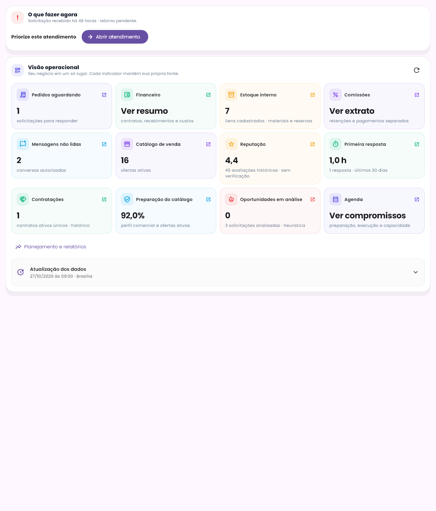
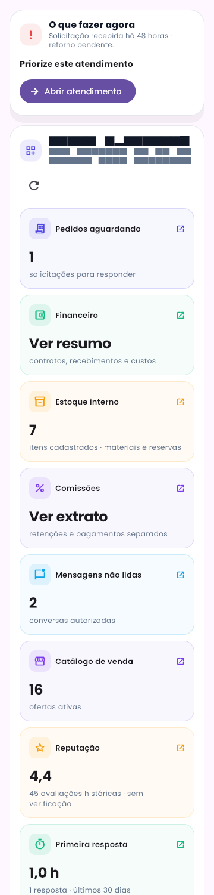

# Recuperação da visão operacional do fornecedor

27/10/2026. As quatro capturas do usuário foram tratadas como referência funcional, preservando os componentes premium existentes. Alterações anteriores, regras, comissões e repasses foram mantidos. Sem deploy, commit/push ou operação em produção.

## Regressões confirmadas no código

1. O resumo anterior foi substituído por um componente cuja informação dependia de consultarPainelFornecedorFn. Na falha dessa consulta, o usuário recebia navegação e um aviso, sem o contexto do negócio que existia antes.
2. O atalho Financeiro passou a abrir /fornecedor/planejamento. A tela completa FinanceiroFornecedorPage, com contratos, recebimentos, custos, lançamentos e acesso aos repasses, continuava no repositório em /fornecedor/financeiro, mas deixou de ser o destino principal.
3. A leitura do perfil passou a priorizar o agregado verificado, escondendo a média histórica quando não havia esse agregado. A recuperação não atribui verificação ao histórico.

## Recuperação implementada

- Grade de cartões e faixa O que fazer agora reaproveitam fornecedor_premium_layout.dart. Pedidos, mensagens, catálogo, estoque, contratos, reputação, perfil e análise de oportunidades voltam a ter espaço na visão principal.
- Financeiro abre novamente a tela completa existente. Planejamento e relatórios são uma opção complementar. Contratações abre o acompanhamento de contratos intermediados já existente.
- Fonte independente e somente de leitura consulta documentos do próprio UID: participações de cotação, mensagens e propostas de cada conversa permitida, contratos, catálogo, agregado de reputação e estoque privado. Não usa collectionGroup global de mensagens, permissões gerais novas, outro livro financeiro nem cópia de saldo.
- Falha de uma fonte resulta em ausência naquele indicador, sem converter erro em zero. A falha da consulta consolidada não apaga os indicadores diretos já carregados. Consultas diretas exigem servidor, têm limite de espera e indicam seus diagnósticos na área de fontes. Nova consulta, troca de sessão e descarte de resultado antigo são protegidos por geração/identidade.
- Primeira resposta pode ser medida diretamente nos eventos persistidos autorizados: primeira mensagem humana do fornecedor ou proposta de sua autoria, em horas corridas e coorte das últimas720h. Sistema, cliente, reenvios posteriores e futuro são excluídos. Evidência incompleta não vira medição ou valor seed.
- Contratos são únicos pela identidade contratual/cotação legada. Cancelamento não infla contratações ativas. A idade na prioridade é identificada como tempo desde o recebimento da solicitação, não um prazo de retorno inventado.
- Quando há agregado verificado, ele é usado sem somar avaliações históricas. Sem agregado, histórico numérico válido pode aparecer com o rótulo explícito avaliações históricas · sem verificação. Não se grava selo nem se altera ranking.
- Perfil usa o mesmo cálculo de completude já usado no catálogo. Oportunidades usam apenas a amostra de índices heurísticos já calculados; sem análise não se mostra zero como resultado medido.
- Tratamento HTTP preserva status UNAVAILABLE/CANCELLED em vez de rotular ambos internal. A consulta consolidada tem timeout15s; as fontes independentes continuam próprias.

Nenhum valor dos prints foi copiado para o aplicativo. Os números das imagens abaixo pertencem às fixtures sintéticas dos testes. Não se reativou a contagem de itens do catálogo como contratos nem a comissão em duplicidade.

## Verificação realizada

- **118 testes Flutter aprovados** na regressão (painel, agenda, planejamento, reputação, cotações, financeiro, contratos, recebimentos, layout operacional e voltar).
- **7 testes adicionais da recuperação aprovados novamente** após o refinamento final, incluindo imagens sem update-goldens, sessão antiga descartada, contrato único, reputação legada identificada, medição1h com eventos válidos e navegação para atendimento/financeiro/planejamento corretos.
- **25 verificações de regras aprovadas no Firestore Emulator**, projeto demo-painel-fontes: as consultas independentes autorizadas funcionam e consultas de conversas/estoque de terceiros são recusadas, inclusive para administrador genérico.
- Análise estática Dart: No issues found. Node --check do script de regras e git diff --check aprovados.

```powershell
flutter test test/features/painel/visao_restaurada_test.dart --update-goldens --reporter expanded
flutter test test/features/painel test/features/agenda test/features/planejamento test/features/avaliacoes/gestao_reputacao_test.dart test/features/cotacoes test/features/financeiro/financeiro_contratos_unificado_test.dart test/features/financeiro/financeiro_fornecedor_test.dart test/features/financeiro/recebimentos_caixa_idempotencia_test.dart test/features/operacao test/presentation/widgets/operacao --reporter expanded
npm run test:painel:fontes
```

Para o emulador, foi utilizado JDK21 configurado em JAVA_HOME. O script exige projeto demo e endpoints locais antes de qualquer acesso Firebase. Logs: [regressão](widgets.txt), [permissões](regras.txt), [análise](analyze.txt), [confirmação final](confirmacao.txt).

## Prévia nova




As prévias são widgets renderizados agora, com dados sintéticos, e exercitam a falha da consulta consolidada. Não são evidência de disponibilidade do backend hospedado. A publicação e os logs das Functions em produção não foram consultados ou alterados. A tela financeira completa foi reconectada; seus valores permanecem dependentes das fontes contratuais autorizadas e não recebem fallback bruto incorreto para preencher a interface.

Arquivos centrais: painel_fontes_disponiveis.dart; visao_operacional_fornecedor.dart; resumo_section.dart; painel_operacional_controller.dart; exposição do cálculo existente em perfil_section.dart; destino financeiro no painel anterior; callable_https_client.dart; teste de visão restaurada, script de regras e comando package.json.
