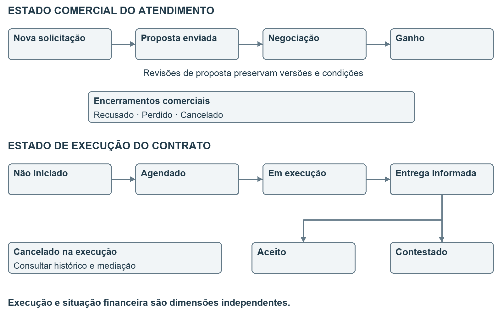
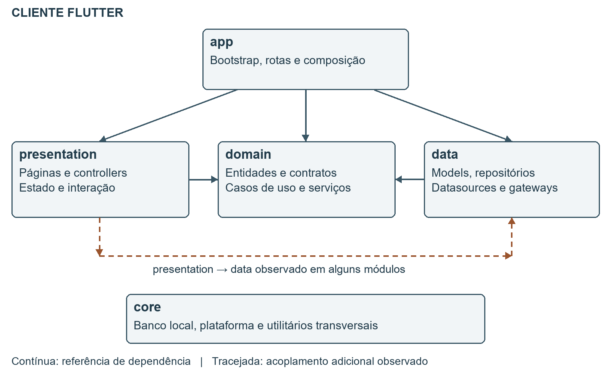
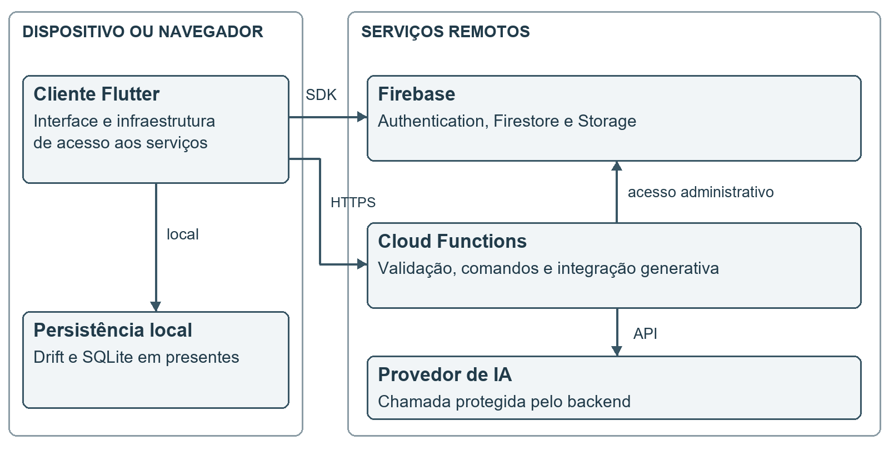
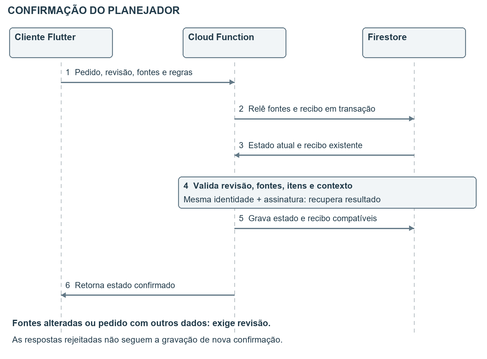
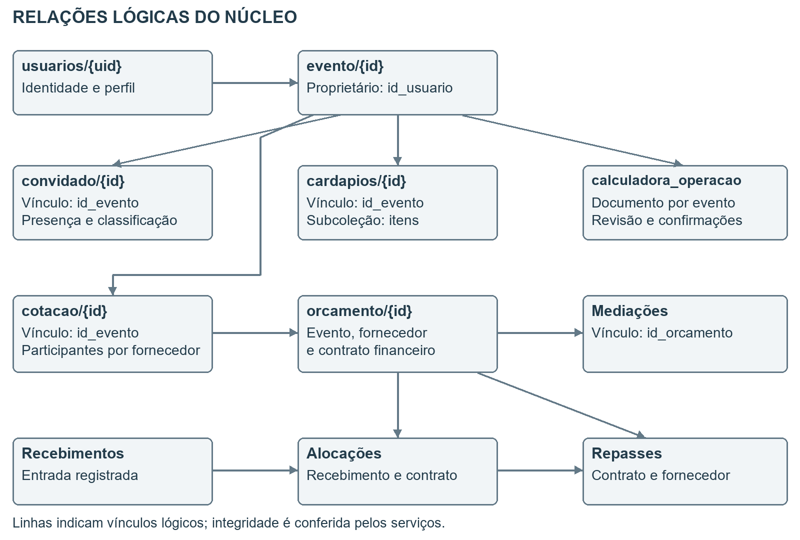
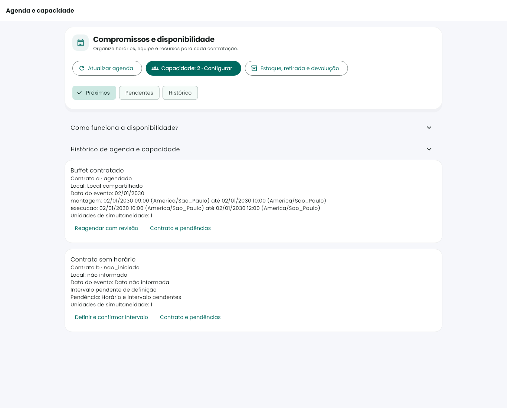
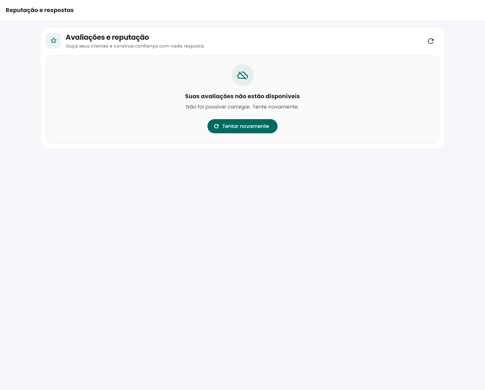
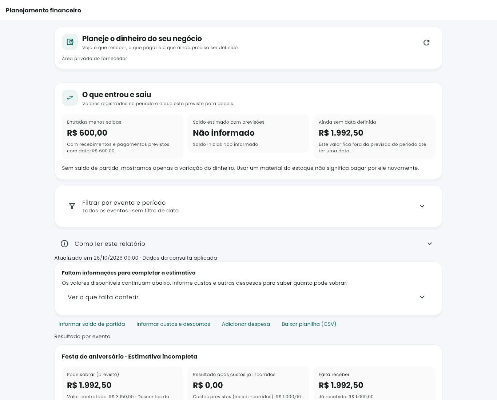
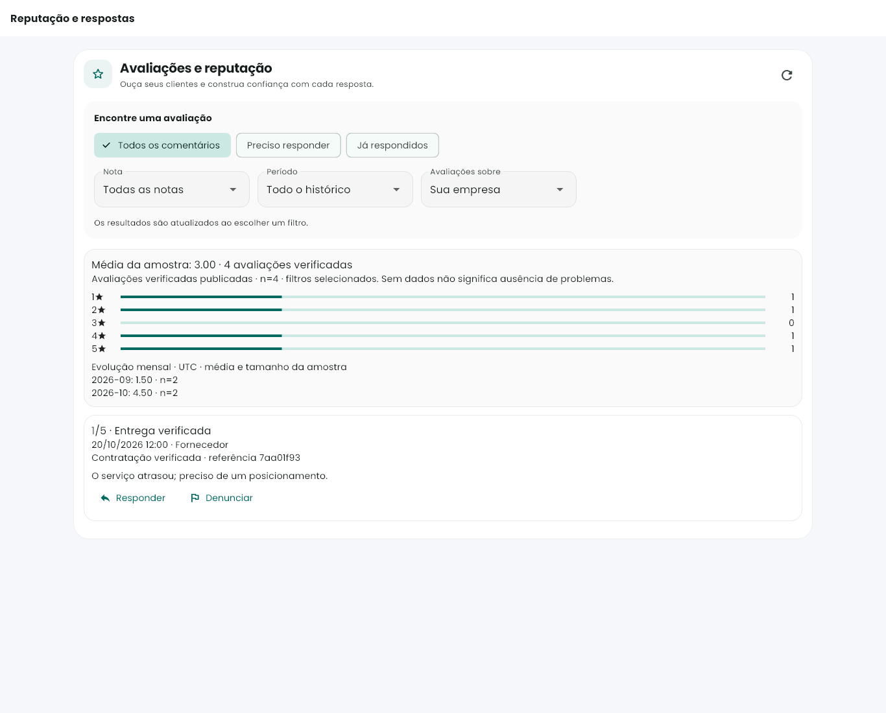

# Resumo

O Faça a Festa é um software para planejamento e acompanhamento de eventos sociais que reúne informações de convidados, tarefas, orçamento, fornecedores, cotações e presentes. O produto também contempla apoio ao planejamento por calculadora e inteligência artificial, além de recursos administrativos para contratação, comissões, mediação e acompanhamento de repasses. Sua proposta é permitir que os participantes consultem e mantenham informações relacionadas ao evento em um mesmo ambiente, respeitando seus papéis e permissões.

O planejamento inclui refeições, público, receitas, agenda e execução; a central de privacidade inclui protocolos de atendimento de dados. O cliente é desenvolvido em Flutter, com organização em camadas e uso de GetX na apresentação e composição das dependências. O backend utiliza serviços Firebase e Cloud Functions. O Firestore constitui a persistência remota; Drift e SQLite apoiam o funcionamento local do módulo de presentes. A análise generativa complementa o cálculo determinístico, com verificação de acesso e resposta alternativa quando o provedor falha.

A documentação apresenta o problema, os objetivos, o escopo, requisitos, casos de uso, arquitetura, dados, interfaces e evidências de validação. Os registros de testes demonstram verificações de domínio, interface, regras de acesso e concorrência em cenários específicos. Esses resultados não equivalem a uma avaliação estatística de satisfação, desempenho sob carga ou validação integral de produção. O principal resultado técnico é a integração de planejamento, negociação e acompanhamento operacional em uma solução com responsabilidades de cliente e servidor definidas. [S01–S10]

Palavras chave: organização de eventos; engenharia de software; Flutter; Firebase; planejamento; inteligência artificial.

# 1 Introdução e problema

Organizar um evento envolve decisões que se afetam mutuamente. O número e o perfil dos convidados influenciam consumo, custos e infraestrutura. A seleção dos fornecedores interfere no orçamento e na agenda. Mudanças nessas decisões precisam ser acompanhadas por organizadores, prestadores de serviço e convidados. A definição inicial do projeto identifica dificuldades de controle de presença, acompanhamento financeiro, comunicação e planejamento de tarefas. [S01]

O problema tratado pelo Faça a Festa é a dispersão dessas informações e a dificuldade de acompanhar o planejamento e a execução do evento de forma integrada. Como resposta, o software reúne cadastros, planejamento, solicitações comerciais e acompanhamento operacional. A aplicação deve permitir reconhecer o que foi previsto, negociado, confirmado e registrado financeiramente, sem tratar essas situações como equivalentes.

## 1 1 Objetivo geral

Desenvolver uma aplicação multiplataforma que apoie a organização de eventos sociais, integrando planejamento, gestão de convidados, orçamento e interação com fornecedores, com controle de acesso e acompanhamento das operações.

## 1 2 Objetivos específicos

- Centralizar dados do evento, grupos de convidados, convites e confirmação de presença.
- Organizar tarefas, referências visuais, cardápios e lista de presentes.
- Apoiar estimativas de consumo e custo, com revisão das sugestões pelo organizador.
- Permitir consulta a fornecedores e negociação por cotações e propostas.
- Diferenciar orçamento, contratação, recebimento, comissão e repasse.
- Oferecer recursos administrativos de acompanhamento, mediação e auditoria.
- Estruturar o software em camadas e verificar regras relevantes por testes automatizados.

## 1 3 Justificativa e contribuição

A contribuição proposta é relacionar decisões do planejamento aos seus efeitos operacionais. Uma quantidade estimada não é uma compra confirmada; uma proposta não é um contrato; um recebimento declarado não é um valor bancário conferido. Tornar essas distinções visíveis auxilia a interpretação dos dados e reduz ambiguidades no uso do software. A documentação financeira e a revisão de ergonomia evidenciam essa preocupação na evolução do produto. [S07, S09]

O levantamento de mercado de 2025 integra o acervo histórico e contextualiza a motivação do projeto. Suas estimativas de gastos e participação de mercado não são utilizadas como resultados empíricos deste relatório. O atendimento dos objetivos é discutido a partir das funções implementadas e das evidências técnicas, sem atribuir ao produto uma redução de custos ou de tempo que não tenha sido medida.

# 2 Escopo e participantes

O escopo contempla o cliente Flutter, os contratos de acesso aos dados, os serviços de backend e os mecanismos de persistência que sustentam as jornadas do evento. Web, Android e Windows aparecem nos registros de compilação e distribuição. A existência de configurações para outras plataformas não comprova sua validação ou distribuição. [S02, S03]

| Participante | Responsabilidade no processo | Limite de atuação |
| --- | --- | --- |
| Organizador | Criar e acompanhar eventos; administrar convidados, planejamento, cotações e orçamento | Operar sobre eventos e dados autorizados; autorização antecipada de repasse vinculada ao proprietário |
| Fornecedor | Manter oferta e atuação; responder solicitações; acompanhar contratos, agenda e situação financeira | Acesso restrito às próprias operações e às informações compartilhadas no contrato |
| Convidado | Acessar informações do convite, responder presença e interagir com recursos disponibilizados | Acesso condicionado ao vínculo ou token e ao fluxo permitido |
| Administrador | Manter cadastros e políticas; acompanhar contratação, comissões, mediações e auditoria | Ações sujeitas a validação no servidor; não representa o organizador em sua autorização |

## 2 1 Áreas funcionais

O planejamento reúne evento, convidados e grupos, tarefas, cardápios, calculadora, referências e presentes. A relação comercial reúne catálogo, fornecedores, território de atuação, solicitações, propostas e contratação. A operação reúne agenda, custos, recebimentos, comissões, repasses, mediação e reputação. Administração e auditoria apoiam a governança desses fluxos. [S04, S07, S09]

## 2 2 Delimitações

O software não realiza transferência bancária automática: a administração transfere pelo meio bancário adotado e registra a confirmação com referência ou comprovante. A IA oferece apoio à decisão e não comprova disponibilidade de fornecedor, preço contratado ou execução do serviço. A sincronização completa com Drift documentada refere-se ao módulo de presentes; os demais fluxos dependem dos respectivos serviços remotos. [S04, S06, S07]

## 2 3 Referência de versão

O manifesto do cliente declara 1.0.17+19. O registro de publicação de 23/10/2026 descreve essa distribuição. Há também alterações locais e registros de backend e ergonomia de 27/10/2026. Assim, este relatório descreve o estado técnico examinado em 29/10/2026 e identifica a origem das evidências. Não presume que todo recurso local esteja na compilação distribuída em 23/10. [S02, S03, S09, S10]

## 2 4 Identidade e continuidade do cadastro

O fluxo de identidade contém senha e Google, redefinição por código e componentes de MFA por TOTP e e-mail. A sessão mantém o papel e o contexto de convite. A existência dos componentes não comprova configuração e homologação de todos os métodos em toda plataforma. O cadastro do evento incorpora rascunho local, retomada e vínculo com estimativa. [S21]

## 2 5 Planejamento de alimentação e execução

A calculadora integra público, cardápios, refeições, agenda, catálogo contextual, receitas, propostas, compras e execução. O público pode derivar de previsão, cadastrados, confirmados, não recusados ou escolha manual, com estado de completude da lista e público próprio da refeição. Ocorrências de serviço mantêm identidade, data, hora, duração e fuso. [S22]

| Etapa | Comportamento identificado |
| --- | --- |
| Preparar | Recuperar contexto do evento, público, cardápio e compromissos |
| Propor | Gerar proposta principal, alternativa, perguntas, origens e pendências |
| Revisar | Preservar quantidades confirmadas e decisões; conferir contexto e fontes |
| Aplicar | Validar identidade e revisão antes de atualizar o planejamento permitido |
| Executar | Relacionar cardápio, regras, tarefas e necessidades de compra |
| Aprimorar | Registrar consumo observado e revisão pós-evento |

Planejador híbrido, cálculo determinístico e análise generativa são componentes distintos. Receitas privadas, referências aprovadas e consumo observado possuem origens diferentes. Quantidades confirmadas não devem ser substituídas silenciosamente. A proteção contra troca de sessão, evento ou cardápio procura impedir aplicação de proposta antiga em outro contexto. Esses mecanismos não dispensam validação de resultados. [S22]

## 2 6 Operação comercial e financeira ampliada

A área do fornecedor reúne painel operacional, oferta, território, atendimento, agenda, capacidade, estoque, planejamento financeiro e reputação. Estado comercial da cotação e execução do serviço são acompanhados separadamente. Confirmar agenda pode envolver capacidade simultânea, recursos e revisão; horário pendente não equivale a compromisso confirmado. [S23]

As finanças da empresa incluem custos, recebimentos, contas, liquidações e projeção de caixa. A intermediação da plataforma envolve recebimentos conferidos, alocações, comissões e repasses. São perspectivas diferentes e não devem ser somadas como um saldo único. A gestão de reputação inclui resposta, denúncia, decisão e histórico. [S23]

Comunidade, ranking, temas e inspirações são funções complementares: posts e comentários; consulta por subcategoria; personalização visual; referências associadas ao planejamento. Sua existência não demonstra métricas de engajamento ou efetividade comercial. [S20]

## 2 7 Central de privacidade e atendimento de dados

O módulo legal permite consultar política, ajustar preferências, solicitar tratamento de dados, acompanhar protocolos e exportar dossiê. O atendimento administrativo distingue análise, conclusão, recusa e execução explícita da exclusão. Criar protocolo não apaga imediatamente a conta. [S24]

Exportação, anonimização e exclusão possuem limites de consulta e lote. Portanto, o produto oferece fluxos de atendimento, sem comprovação de exportação ou remoção integral para qualquer volume. O expurgo de auditoria utiliza corte de 365 dias e até 400 registros por execução diária; sua completude depende do volume processado. [S24]

# 3 Método e decisões de engenharia

A consolidação técnica cruza a definição inicial, os documentos de arquitetura, modelos de dados, código de pontos críticos e registros de validação. O objetivo é manter uma relação verificável entre requisito, componente e evidência. Os identificadores RF, RN, UC e V deste relatório organizam o catálogo documental; não pressupõem que essas mesmas etiquetas já existam no código.

## 3 1 Organização do desenvolvimento

O repositório agrupa domínio, dados, apresentação e composição de dependências. Os registros de evolução descrevem entregas por funcionalidade e correções incrementais. Há testes Dart e Flutter, scripts TypeScript e JavaScript e testes de regras no Firebase Emulator. Esse conjunto demonstra verificações em diferentes níveis; não comprova, isoladamente, que todo o desenvolvimento tenha seguido o ciclo de TDD. [S04, S08–S10]

## 3 2 Critérios de análise

| Evidência | O que sustenta | O que não permite concluir sozinha |
| --- | --- | --- |
| Código e configuração | Existência do componente e das validações examinadas | Publicação e funcionamento de toda a jornada em produção |
| Teste de domínio | Resultado esperado para entradas e regras cobertas | Correção da interface ou do ambiente remoto |
| Teste de widget | Estado, interação e composição da interface no cenário | Acessibilidade integral ou sessão autenticada real |
| Emulador e regras | Persistência e autorização em cenários controlados | Comportamento de todos os dados legados em produção |
| Registro de publicação | Artefatos e operações conferidos naquela entrega | Ausência de regressões posteriores |

## 3 3 Decisões e consequências

Flutter permite compartilhar a base do cliente entre plataformas, mantendo adaptações de interface e integração. Firestore e Functions oferecem serviços remotos sem um servidor de aplicação tradicional mantido pelo projeto; em contrapartida, consultas, índices, regras e custos precisam ser governados. GetX oferece reatividade, navegação e composição, concentradas nas áreas de apresentação e aplicação. [S02, S04]

A separação entre domínio e infraestrutura facilita testes e substituição de dependências. Ela não elimina toda complexidade: a documentação técnica registra controladores extensos e estilos diferentes de casos de uso. O relatório assume esses limites e apresenta padrões por exemplos, sem afirmar uniformidade absoluta em todos os módulos. [S04]

# 4 Requisitos funcionais

Os requisitos abaixo consolidam capacidades identificadas na base documental e na organização atual do produto. Os critérios descrevem comportamentos observáveis para revisão e validação. A coluna Fonte aponta a sustentação técnica; a matriz do capítulo 12 diferencia evidências já registradas e verificações adicionais.

| ID | Requisito | Critério de aceite | Fonte |
| --- | --- | --- | --- |
| RF01 | Autenticar e direcionar o usuário conforme perfil | Sessão inválida ou inativa não libera área restrita; convite segue seu fluxo específico | S05 |
| RF02 | Criar e manter eventos do organizador | Evento preserva identificação, proprietário, tipo, data, local e estado | S11 |
| RF03 | Gerenciar convidados e grupos | Convidado permanece vinculado ao evento; presença e grupo são recuperáveis | S12 |
| RF04 | Enviar e responder convites | Resposta utiliza vínculo ou token válido e atualiza a presença permitida | S04, S12 |
| RF05 | Acompanhar tarefas e referências | Conteúdo permanece associado ao evento ativo e às permissões do usuário | S04 |
| RF06 | Manter e consultar catálogo e fornecedores | Serviço e fornecedor são identificados com dados e atuação correspondentes | S04 |
| RF07 | Solicitar e responder cotações | Proposta mantém solicitante, evento, fornecedor, itens, valores e estado | S13 |
| RF08 | Acompanhar orçamento e contratação | Interface distingue estimativa, negociação e contratação confirmada | S07 |
| RF09 | Calcular planejamento e consultar análise de IA | Análise respeita acesso; cálculo e recomendação têm papéis distintos | S06 |
| RF10 | Gerenciar lista de presentes | Leitura e alterações locais seguem o fluxo de persistência e sincronização do módulo | S04 |
| RF11 | Acompanhar agenda e capacidade do fornecedor | Compromissos, pendências de horário e capacidade são identificáveis | S09 |
| RF12 | Consultar custos e recebimentos | Visão financeira distingue previsão, fatos registrados e dados ausentes | S09 |
| RF13 | Controlar comissões e repasses | Liberação depende das condições do contrato e da validação do servidor | S07, S14 |
| RF14 | Tratar avaliações e reputação | Operações mantêm autoria, vínculo e regras de acesso | S10 |
| RF15 | Administrar mediações e auditoria | Decisão e alteração relevante preservam histórico e acesso autorizado | S07, S15 |

Requisitos presentes apenas na proposta inicial, como expansão de idiomas, novos gateways ou metas de usuários simultâneos, não são classificados como entregas comprovadas. Recursos com cobertura documental parcial devem ser verificados na versão escolhida para a demonstração.

## 4 1 Requisitos complementares do aplicativo atual

Os requisitos seguintes refinam capacidades identificadas na revisão. O catálogo não implica aprovação de todos os cenários; resultados atuais e pendências aparecem no capítulo 12. [S20–S25]

| ID | Requisito | Critério de aceite | Fonte |
| --- | --- | --- | --- |
| RF16 | Oferecer métodos de identidade e MFA configurados | Distinguir senha, Google, redefinição e verificação adicional habilitada | S21 |
| RF17 | Preservar e retomar cadastro e estimativa | Retomar rascunho sem herdar indevidamente outro evento | S21 |
| RF18 | Planejar público por fonte e refeição | Identificar base escolhida, completude e público específico | S22 |
| RF19 | Gerar e revisar propostas de planejamento | Exibir origens, perguntas e pendências; preservar decisões confirmadas | S22 |
| RF20 | Aplicar plano e agenda com revisão | Recusar aplicação incompatível com sessão, evento, cardápio ou revisão | S22 |
| RF21 | Registrar consumo e revisão pós-evento | Distinguir medida observada, receita privada e referência editorial | S22 |
| RF22 | Gerenciar estoque e obrigações do fornecedor | Distinguir reserva, retirada, consumo, devolução, vencimento e liquidação | S23 |
| RF23 | Gerenciar resposta e moderação de reputação | Preservar autoria, denúncia, decisão e histórico | S23 |
| RF24 | Solicitar atendimento de dados e consultar protocolo | Separar pedido da execução administrativa e informar limites | S24 |
| RF25 | Oferecer comunidade, ranking e personalização | Manter autoria e contexto e identificar critério de consulta | S20 |

## 4 2 Decomposição e critérios de aceitação

Os requisitos RF identificam capacidades do produto. Uma capacidade como planejar uma refeição contém decisões e restrições que precisam ser especificadas separadamente. A decomposição seguinte detalha comportamentos críticos e oferece critérios para aceitação; ela não constitui um novo resultado de teste. Os vínculos com serviços e testes constam do capítulo 12. [S22, S26–S29]

**RF18 A Selecionar a fonte do público.** Ao escolher previstos, o sistema utiliza a previsão do evento; ao escolher confirmados, utiliza convidados desse evento com resposta confirmada; ao escolher não recusados, exclui os recusados. A seleção manual usa a distribuição informada pelo organizador. A lista de outro evento não integra a contagem. Aceitação: uma massa de dados com respostas diferentes deve produzir totais distintos e a interface deve informar a fonte em uso.

**RF18 B Explicitar informação ausente.** Uma previsão total sem distribuição etária não equivale a distribuição conhecida. A indisponibilidade da lista também difere de lista carregada com zero pessoas. Aceitação: apresentar a pendência de distribuição ou fonte indisponível antes de interpretar porções dependentes das idades. O estado de completude da lista deve acompanhar a leitura do total.

**RF19 A Identificar a base da proposta.** A sugestão deve conservar a origem do parâmetro, o contexto de serviço e as perguntas pendentes. Receita privada, referência contextual e consumo observado são bases diferentes. Aceitação: o organizador consegue identificar por que a quantidade foi proposta e quais dados ainda precisa conferir.

**RF20 A Confirmar com revisão.** A confirmação do planejador deve conter evento, cardápio, pedido, revisão e fontes. Aceitação: alterar uma fonte após gerar a proposta exige nova revisão; repetir o mesmo pedido com o mesmo conteúdo não cria outra confirmação; reutilizar a identidade com conteúdo diferente deve ser rejeitado pelo fluxo examinado.

**RF07 A Versionar a proposta comercial.** O fornecedor informa valor bruto, desconto, validade, escopo e condições. A versão esperada impede sobrescrever silenciosamente uma proposta mais recente. Aceitação: uma proposta com validade expirada, desconto igual ou superior ao bruto ou versão antiga não é emitida como nova proposta válida.

**RF11 A Verificar capacidade da agenda.** O sistema considera as janelas operacionais e as unidades de capacidade. Aceitação: intervalos coincidentes devem ser avaliados pelo pico simultâneo; término e início no mesmo instante não configuram sobreposição no cálculo examinado. A aprovação da agenda não demonstra, por si, execução ou recebimento financeiro.

**RF13 A Revalidar a liberação.** Preparar e confirmar repasse exigem leitura atual das condições aplicáveis. Aceitação: mediação ou contestação registrada depois da preparação precisa impedir a confirmação incompatível. A confirmação manual exige evidência e mantém o registro do pagamento.

**RF24 A Separar solicitação e atendimento.** O titular solicita tratamento e acompanha protocolo; a administração executa a ação permitida. Aceitação: solicitar exclusão não produz na interface a afirmação de remoção integral antes da execução e da conferência dos limites documentados.

# 5 Qualidade e regras de negócio

## 5 1 Requisitos de qualidade

| ID | Atributo | Especificação verificável | Situação da evidência |
| --- | --- | --- | --- |
| RQ01 | Autorização | Rejeitar acesso a evento, contrato ou operação sem permissão | Código, regras e cenários de emulador específicos |
| RQ02 | Consistência | Repetição idempotente não duplica efeito financeiro ou operacional | Testes de concorrência e idempotência registrados |
| RQ03 | Responsividade | Exibir ações e estados nas larguras cobertas pelos testes | Evidências de 360 e 1366 px e texto ampliado em recortes |
| RQ04 | Recuperação de falhas | Diferenciar falha de consulta de lista vazia e permitir nova tentativa | Widgets e capturas de operação do fornecedor |
| RQ05 | Manutenibilidade | Separar domínio, acesso a dados, apresentação e composição | Estrutura arquitetural e contratos documentados |
| RQ06 | Rastreabilidade | Identificar autor, operação e vínculos do histórico aplicável | Auditoria e fluxos financeiros específicos |
| RQ07 | Desempenho | Medir latência por operação, volume e plataforma | Não há benchmark consolidado neste relatório |
| RQ08 | Acessibilidade | Verificar teclado, leitor de tela, contraste e ampliação | Há verificações parciais; avaliação integral permanece necessária |

Não se afirma tempo de resposta inferior a dois segundos, disponibilidade de 100% ou capacidade ilimitada. Essas metas exigem protocolo, ambiente, volume e resultados de medição próprios.

## 5 2 Regras financeiras e operacionais

| ID | Regra |
| --- | --- |
| RN01 | A autorização deve ser verificada no servidor; ocultar uma ação na tela não substitui a proteção dos dados |
| RN02 | Proposta, contrato, execução e situação financeira representam dimensões distintas |
| RN03 | Repasse exige contratação confirmada, comissão consistente, recebimento conferido e alocado e política ativa |
| RN04 | O evento deve estar finalizado ou existir autorização antecipada explícita do organizador proprietário |
| RN05 | Data passada, declaração de entrega ou aceite de entrega não substituem a autorização de liberação |
| RN06 | Mediação aberta, retenção efetiva, execução contestada e cancelamento bloqueiam a liberação aplicável |
| RN07 | Alterações de valor, beneficiário ou comissão invalidam a autorização antecipada anterior |
| RN08 | Repetir comando com identidade idempotente não deve duplicar saída ou comissão; payload conflitante deve ser tratado |
| RN09 | Confirmar repasse requer referência ou comprovante; a transferência bancária ocorre fora do aplicativo |
| RN10 | Encerrar mediação não transfere nem reembolsa dinheiro e não apaga pagamentos confirmados |

As regras RN03 a RN10 derivam da documentação operacional e do serviço de intermediação. A política de comissão aplicada ao contrato define quem assume o valor; não se deve atribuir automaticamente a taxa padrão a contratos legados. [S07, S14]

## 5 3 Regras do planejamento e da negociação

As regras abaixo ampliam a especificação para além das finanças. Elas descrevem os componentes examinados; limites numéricos pertencem à operação citada e não devem ser generalizados para todo o aplicativo. [S26–S29]

| ID | Regra |
| --- | --- |
| RN11 | A resolução do público filtra convidados pelo evento e mantém a fonte de cálculo selecionada |
| RN12 | Quantidade de pessoas e quantidade equivalente têm significados diferentes; pesos etários são premissas de planejamento |
| RN13 | Descartáveis usam pessoas do público aplicável; a ponderação alimentar não é aplicada automaticamente |
| RN14 | Duração global não multiplica uma porção por padrão; ajuste por duração exige premissa explícita |
| RN15 | A quantidade de compra é arredondada para cima conforme a unidade e depois conforme a embalagem informada |
| RN16 | Preço incompatível com unidade ou estado do item não deve ser interpretado como custo completo |
| RN17 | Confirmar o planejador exige fontes e revisão atuais e correspondência entre regra, item, cardápio e evento |
| RN18 | Uma ocorrência de refeição possui identidade estável; alterar sua origem não é uma simples edição de horário |
| RN19 | Agenda da calculadora aceita até 20 ocorrências; a criação examinada também verifica limite de 20 cardápios incluindo modelos e até 60 itens no modelo |
| RN20 | A proposta comercial mantém versão, validade, escopo, condições e assinatura do conteúdo aceito |
| RN21 | Encerramento comercial não comprova entrega; aceite da entrega não é autorização antecipada de repasse |
| RN22 | Reserva de estoque, compra, disponibilidade e consumo são fatos distintos |

## 5 4 Estados comerciais e de execução

Uma cotação pode ter vários fornecedores, cada qual com seu atendimento. Por isso, o estado agregado da solicitação não substitui o estado de uma proposta específica. A adaptação do legado interpreta respostas antigas como proposta enviada, fechamento como ganho e recusa ou perda como encerramentos comerciais. A consulta atual também procura o vínculo contratual e informa ambiguidade quando não consegue identificá-lo com segurança. [S28]

O estado comercial orienta a próxima ação: nova solicitação exige revisão do fornecedor; proposta enviada aguarda revisão do cliente; negociação exige retorno do participante responsável. Ganho indica a passagem à contratação. Recusado, perdido e cancelado encerram a negociação correspondente. Esses rótulos não devem ser utilizados para inferir saldo ou entrega.

Figura 1. Síntese dos estados de atendimento e execução identificados no serviço de jornada. O desenho organiza as etapas principais para leitura; as permissões e transições específicas continuam sujeitas aos comandos de servidor. Contestação é um desvio da entrega e exige acompanhamento da mediação. Fonte: S28.

Na execução, não iniciado orienta preparação e agenda; agendado permite preparar o início; em execução permite informar entrega; entrega informada demanda aceite ou contestação do cliente. Aceito mantém a necessidade de conferir pendências financeiras. Contestado encaminha o acompanhamento da assistência. Cancelado na execução mantém histórico e pode demandar mediação. O mesmo contrato pode estar comercialmente ganho, com entrega aceita e ainda ter recebimento ou repasse pendente.

Exemplo: a proposta de um buffet é aceita por R$ 2.000,00. O contrato passa à execução e recebe agenda, mas o pagamento ainda está em conferência. A entrega aceita pelo cliente não deve transformar o valor em repasse confirmado. A interface e os relatórios precisam apresentar cada dimensão com seu significado.

# 6 Casos de uso do planejamento

Os fluxos descrevem as interações centrais para a apresentação. São sínteses atualizadas da especificação, com pontos de falha explícitos. Não representam uma reexecução de todos os cenários. [S01, S04, S06, S11, S12]

## UC01 Manter evento e selecionar contexto

Ator principal: organizador. Pré-condição: sessão válida e acesso autorizado. Entrada: identificação, tipo, data, local e informações específicas. Resultado: evento persistido e selecionado como contexto de trabalho.

1. O organizador acessa seus eventos e solicita criar ou editar.
2. O sistema apresenta os campos aplicáveis ao tipo de evento.
3. O organizador informa os dados e confirma a operação.
4. O sistema valida e encaminha a persistência pelo contrato de dados.
5. Ao selecionar o evento, os módulos dependentes passam a trabalhar no contexto escolhido.

Exceções: campos inválidos exigem correção; falha de persistência não deve ser apresentada como salvamento concluído. A troca de evento precisa atualizar o contexto das áreas relacionadas. O coordenador de sessão do evento é o ponto de integração descrito na arquitetura. [S04]

## UC02 Gerenciar convidados e presença

Ator principal: organizador; participante: convidado. Pré-condição: evento acessível ao organizador. Resultado: convidado associado ao evento, com grupo e situação de presença registrados.

1. O organizador seleciona o evento e acessa convidados.
2. Cadastra ou edita a pessoa e sua classificação e agrupamento aplicáveis.
3. Aciona o fluxo de convite disponível.
4. O convidado acessa o fluxo autorizado e informa sua resposta.
5. O sistema atualiza a situação e permite acompanhar a lista.

Exceções: vínculo ou token inválido não deve liberar dados do evento. Falha no envio não equivale a convite entregue. Os modelos distinguem dados do convidado, envio, resposta e vínculo com usuário; esses estados devem ser conferidos separadamente na demonstração. [S12]

## UC03 Calcular e revisar o planejamento

Ator principal: organizador. Pré-condição: dados de contexto e público informados; análise remota requer autenticação. Resultado: estimativa e recomendações disponíveis para revisão.

1. O organizador informa o contexto da festa e os dados do público.
2. O motor de cálculo produz quantidades e custos segundo suas regras e catálogo.
3. A solicitação de IA envia dados estruturados ao backend.
4. O backend verifica acesso, limites e condições da solicitação.
5. A análise recebida ou a resposta alternativa é identificada e apresentada.
6. O organizador revisa as orientações e segue as ações permitidas de planejamento.

Exceções: usuário sem permissão é rejeitado antes da análise; falha do provedor aciona resposta alternativa. Uma recomendação não confirma compra, preço negociado ou contratação. [S06]

## 6 1 Modelo de especificação dos fluxos

UC01 a UC03 apresentam a jornada geral. Os casos seguintes detalham decisões que têm efeito persistente e os desvios que alteram o resultado. As pós-condições descrevem o que pode ser confirmado pelo fluxo, e não o que se presume pela aparência da tela. Os cenários de aceitação são propostas para homologação onde não houver evidência de execução específica. [S22, S26, S27]

## UC07 Definir público e analisar uma refeição

**Objetivo e atores.** O organizador define quantas pessoas e quais grupos serão atendidos em uma refeição do evento. A configuração evita aplicar a previsão global a um serviço destinado a um subconjunto.

**Pré-condições e entradas.** Evento selecionado e fontes de público identificadas. Entram a previsão, a distribuição entre adultos, crianças e bebês, a lista disponível, o estado de completude e a fonte escolhida. O contexto de refeição pode possuir distribuição própria. A resolução do público não confirma presença nem altera a lista de convidados.

1. O sistema recupera a previsão do evento e os convidados disponíveis.
2. O organizador escolhe previstos, todos cadastrados, não recusados, confirmados ou manual.
3. O serviço filtra a lista pelo identificador do evento antes de contar respostas e idades.
4. O sistema apresenta a fonte, o total informado e a disponibilidade da distribuição etária.
5. O organizador confere o público específico da refeição e o contexto de serviço.
6. O cálculo utiliza o público aplicável ao item e suas premissas, conforme a seção 10 3.

**Alternativas e falhas.** Previsão com idades cuja soma difere do total não é tratada como distribuição consistente. Lista indisponível mantém contagens desconhecidas; lista vazia carregada mantém contagem zero. Na ausência de distribuição, o serviço produz pendência para conferir idades antes de calcular porções. Convidado recusado continua fora da base não recusados. Selecionar confirmados não inclui quem ainda não respondeu.

**Pós-condição e observação.** O resultado conserva fonte, total, distribuição quando conhecida e completude. Exemplo de aceitação: um evento previsto para 100 pessoas com lista parcial de 40 não deve reduzir silenciosamente a base prevista para 40. O teste publico_planejamento_test.dart documenta cenários desse componente; sua presença não equivale a homologação de toda a jornada em produção. [S26, S31]

## UC08 Criar ocorrência na agenda de alimentação

**Objetivo e atores.** O organizador transforma um modelo de cardápio em ocorrência de serviço, com identidade, data, hora, duração e fuso próprios. Uma ocorrência permite tratar almoço e jantar como serviços distintos, mesmo quando compartilham um modelo.

**Pré-condições e entradas.** Sessão do proprietário do evento; modelo válido e ativo do mesmo evento; revisão atual. O comando inclui evento, ação do tipo agenda, pedido, revisão, ocorrência, configuração e, na criação, os itens de origem e a decisão sobre manter o original apenas como modelo. [S27]

1. O organizador escolhe o modelo e informa nome, formato e dados temporais.
2. O cliente prepara a proposta de ocorrência com os itens de origem.
3. O servidor valida identidade, campos aceitos, formato e associação ao evento.
4. Em transação, confere o proprietário, a versão do estado operacional, o recibo do pedido e a revisão atual.
5. Confere o período do evento, a validade do fuso, os itens do modelo e os limites do conjunto.
6. Na criação, prepara o cardápio de destino e as regras relacionadas à nova identidade; preserva os vínculos de origem.
7. Atualiza agenda e configuração da ocorrência e mantém a confirmação correspondente.

**Alternativas e falhas.** Um pedido já recebido com a mesma assinatura retorna o estado sem repetir a criação. Com assinatura diferente, exige correção. Modelo alterado após a proposta exige atualização. A ocorrência não pode trocar silenciosamente de modelo ou cardápio. Um horário civil inexistente no fuso declarado é rejeitado. Público de grupos não pode exceder o total correspondente.

**Preservação de fatos.** Transformar o original em modelo é bloqueado se esse original já contém quantidades finais, compras ou reservas que seriam descaracterizadas. A solução exige manter o serviço ou revisar o conjunto conscientemente. Pós-condição: a ocorrência possui vínculo estável e revisão atualizada; não se presume que compras ou tarefas já tenham sido executadas. Limites de 20 ocorrências e 60 regras salvas pertencem a essa implementação e devem constar da avaliação de escala.

## UC09 Confirmar uma proposta do planejador

**Objetivo e atores.** O organizador aplica regras revisadas a um serviço do evento, sem reaproveitar proposta antiga sobre fontes modificadas. A geração da proposta e sua confirmação são operações separadas.

**Pré-condições e entradas.** Cardápio disponível, identidade do pedido, revisão e instantâneo das fontes. O comando de confirmação contém evento, cardápio, pedido, revisão, regras, fontes e decisão. A decisão registra objetivo, infraestrutura, respostas e assinatura do material. Os objetivos aceitos pelo validador incluem manter receitas, comparar quantidades e avaliar custo. [S27]

1. O planejador apresenta proposta principal, alternativa, perguntas e pendências.
2. O organizador confere origem, receita, unidade, rendimento e infraestrutura exigida.
3. Confirma a proposta com a identidade do pedido que acompanha essa decisão.
4. O servidor relê as fontes e o recibo em transação.
5. Compara revisão e assinatura das fontes e verifica o cardápio.
6. Confere cada regra contra o item de cardápio, incluindo identificadores, nome normalizado e público.
7. Valida referências e medições quando essas origens sustentam a regra e atualiza o estado operacional.

**Alternativas e falhas.** A mesma identidade e assinatura recuperam o resultado existente. Fontes ou revisão alteradas exigem reabrir o planejador. Item removido, cardápio de outro evento ou referência fora do contexto bloqueiam a confirmação. O validador limita a 60 regras e a 750.000 bytes de solicitação nesse ponto de entrada; são limites diferentes dos adotados pela análise generativa.

**Pós-condição.** O estado operacional conserva a decisão e incrementa a revisão; a execução recebe indicação de contexto desatualizado para nova avaliação. A confirmação não cria automaticamente uma contratação comercial, um pagamento bancário ou uma medição de consumo. Testes do planejador e de execução estão relacionados no capítulo 12. [S27, S31]

## UC10 Conferir disponibilidade e preparar compras

**Objetivo e atores.** O organizador interpreta a necessidade de um item a partir de quantidade calculada, cardápio, compromissos e estoque. A saída é uma orientação de revisão ou compra, que deve manter a unidade e a origem. [S26]

1. O sistema relaciona o resultado calculado ao item do cardápio.
2. Examina compromissos que declaram cobertura desse item na refeição correspondente.
3. Se a cobertura é antiga ou ambígua, solicita conferência do serviço.
4. Se existe cobertura integral em serviço contratado, indica inclusão e o serviço relacionado.
5. Se o item usa ficha técnica, orienta o desdobramento de ingredientes para evitar comprar também o prato inteiro pela mesma necessidade.
6. Examina quantidades e disponibilidade conforme as informações compatíveis e informa a falta, quando determinável.
7. O organizador confere a orientação antes de comprar ou registrar o fato correspondente.

**Alternativas e falhas.** Estar previsto em orçamento não basta para considerar o item coberto por serviço contratado. Duas coberturas exigem revisão do responsável. Informação de estoque ausente ou falha de consulta não comprova disponibilidade zero. A saída admite estados como conferir porção, conferir disponibilidade, confirmar serviço, informar disponibilidade, falta comprar, disponível e incluído.

**Pós-condição.** A análise fornece situação, orientação e base, podendo incluir falta e embalagens. Registrar uma compra ou consumir um recurso pertence a outra ação. Aceitação: um item contratado e integralmente coberto não deve gerar compra duplicada, enquanto uma intenção ainda não contratada não deve eliminar silenciosamente a necessidade.

# 7 Casos de uso comerciais e financeiros

## UC04 Negociar uma cotação

Atores: organizador e fornecedor. Pré-condição: solicitante e fornecedor autorizados no fluxo. Resultado: proposta rastreável ou contratação conforme a ação confirmada.

1. O organizador prepara a solicitação vinculada ao evento.
2. O fornecedor consulta a solicitação e informa itens, valores e condições.
3. O sistema mantém a resposta e os estados comerciais e de execução aplicáveis.
4. O organizador consulta as propostas e decide sobre a contratação.
5. A confirmação segue os comandos de backend e os vínculos com o orçamento.

Exceções: solicitação cancelada, alteração concorrente ou permissão insuficiente impedem a transição inadequada. A interface deve atualizar o resultado retornado, sem presumir sucesso da contratação apenas pela emissão do comando. [S13, S16]

## UC05 Autorizar e confirmar repasse

Atores: administrador e, quando necessário, organizador proprietário. Pré-condição: contrato confirmado, dados financeiros consistentes e recursos conferidos. Resultado: reserva autorizada ou registro de repasse manual confirmado.

1. O administrador confere contrato, comissão e partes.
2. Registra o recebimento conferido e sua alocação ao contrato.
3. O servidor avalia política, impedimentos e condição de liberação.
4. Se o evento não está finalizado, o organizador pode autorizar antecipadamente com motivo.
5. O administrador prepara o repasse permitido.
6. A transferência é realizada pelo meio bancário adotado.
7. O administrador confirma o pagamento com referência ou comprovante.
8. O servidor revalida as condições e registra o efeito e o histórico.

Exceções: comissão inconsistente, mediação, retenção, falta de saldo ou autorização inválida bloqueiam a ação aplicável. Mudança nas condições exige nova avaliação. Repetições e concorrência são tratadas por transações e idempotência. [S07, S14]

## UC06 Mediar e regularizar execução

Ator principal: administrador; participantes: partes do contrato. Pré-condição: caso ou pendência acessível ao responsável. Resultado: decisão e eventual regularização registradas com histórico.

1. O responsável consulta o dossiê e os vínculos da contratação.
2. Registra decisão fundamentada e as condições aplicáveis.
3. Solicita a regularização compatível com a decisão.
4. O servidor verifica impedimentos e atualiza o estado autorizado.
5. As partes acompanham o resultado permitido.

Encerrar o caso não equivale a executar reembolso ou repasse. Reservas e autorizações anteriores podem ser invalidadas; pagamentos já confirmados permanecem no histórico. A retirada de retenção exige a confirmação específica prevista no fluxo. [S07]

## UC11 Emitir proposta comercial com versão

**Objetivo e atores.** O fornecedor responde à solicitação com condições que possam ser revistas e aceitas de forma rastreável. O servidor obtém a autoria pela sessão; o identificador informado na tela não autoriza representar outro fornecedor. [S28]

**Entradas e pré-condições.** Solicitação e participação existentes e abertas; serviços definidos; versão esperada. A entrada reúne decisão explícita, valor bruto em centavos, desconto, validade, escopo, condição de pagamento, prazo opcional, chave e agenda opcional.

1. O fornecedor confere o pedido e informa escopo, valores e condições.
2. O servidor valida decisão, inteiros, datas e textos e calcula o valor líquido como bruto menos desconto.
3. Em transação, verifica vínculo entre sessão, solicitação e participação.
4. Consulta a identidade idempotente e compara a assinatura do comando.
5. Confere abertura da negociação, versão esperada, validade futura e quantidades dos serviços.
6. Cria uma nova versão da proposta, com conteúdo e assinatura.
7. Atualiza a participação, a situação agregada da cotação e o responsável pelo retorno; grava histórico e mensagem do sistema.

**Falhas e alternativas.** O desconto deve ser inferior ao bruto; escopo e condições exigem conteúdo mínimo. Versão divergente gera erro aborted e exige recarregar. Chave já usada com conteúdo divergente gera already-exists. Uma recusa segue movimento comercial específico e conserva motivo. Após ganho ou encerramento, a negociação exige o fluxo de alteração previsto, em vez de simples reemissão.

**Pós-condição.** Proposta enviada, versão e condições recuperáveis. Isso não confirma contratação nem agenda por mera emissão. Exemplo de aceitação: dois acessos partindo da versão 2 não devem substituir silenciosamente uma proposta já atualizada para a versão 3.

## UC12 Acompanhar capacidade e compromisso do fornecedor

**Objetivo e atores.** O fornecedor organiza execução, montagem e retirada em sua agenda privada, relacionando capacidade e recursos ao atendimento. [S28]

**Entradas e pré-condições.** Perfil de fornecedor válido, contrato ativo quando exigido, capacidade configurada, revisão e identidade do comando. Janelas contêm tipo, início e fim com deslocamento de fuso explícito; a estrutura declara fuso IANA.

1. O fornecedor consulta compromissos e pendências de horário.
2. Define a janela obrigatória de execução e, se necessárias, montagem e retirada.
3. O servidor valida uma a três janelas, sem tipos repetidos, ordem temporal e duração permitida.
4. O serviço calcula o pico simultâneo das unidades de capacidade nos intervalos aplicáveis.
5. Confere recursos e reservas relacionados conforme o comando.
6. Registra compromisso e histórico quando as condições são atendidas.
7. O fornecedor acompanha os próximos passos da execução, sem confundir horário pendente com agenda confirmada.

**Alternativas e falhas.** Fuso inválido, término anterior ao início, sobreposição entre as janelas da própria operação e intervalo superior a 30 dias são rejeitados pelo validador examinado. Capacidade deve ser avaliada por simultaneidade, não pela simples soma de todos os atendimentos do mês. A validação de agenda deve ser revista após alteração concorrente do compromisso.

**Exemplo de capacidade.** Com capacidade 2, dois compromissos de uma unidade entre 18h e 20h ocupam o limite. Um terceiro nesse intervalo excede a capacidade. Um compromisso iniciado exatamente às 20h não conflita apenas por compartilhar o instante de término, pois o algoritmo utiliza intervalos semiabertos. Este exemplo ilustra o algoritmo, sem substituir a verificação completa das reservas.

## UC13 Registrar recebimento e alocar ao contrato

**Objetivo e atores.** A administração registra a evidência de entrada de recursos e define explicitamente sua destinação a contratos. Recebimento, alocação e repasse mantêm registros diferentes. [S14, S29]

**Pré-condições e entradas.** Administrador autenticado; evento e vínculos válidos. O recebimento contém evento, pagador quando identificado, valor inteiro em centavos, nível de confirmação, referência, origem e chave idempotente. A alocação contém recebimento, contratos de destino e valores.

1. O administrador confere a origem e o nível de confirmação do recebimento.
2. Registra o recebimento e conserva sua identidade para eventual nova tentativa.
3. O servidor verifica valor, evento e repetição e grava o registro com autoria.
4. O administrador escolhe os contratos e os valores da alocação explícita.
5. O servidor relê o recebimento em transação e exige nível conferência ou fonte externa para a alocação examinada.
6. Confere valor disponível e consistência dos vínculos e grava as alocações permitidas.
7. A posição do contrato reflete o valor alocado; a liberação de repasse continua sujeita ao UC05.

**Alternativas e falhas.** Uma declaração ainda não conferida não serve como recurso alocável nesse fluxo. Saldo sem destinação não é distribuído automaticamente entre fornecedores. Erro de comunicação depois da gravação exige consultar ou repetir com a identidade preservada. Uma nova chave pode representar nova intenção; por isso, não deve ser criada apenas porque a tela demorou.

**Pós-condição.** Entrada e destinação possuem vínculos consultáveis; não houve transferência bancária pelo aplicativo. Exemplo: receber R$ 3.000,00 e alocar R$ 2.000,00 ao contrato A deixa R$ 1.000,00 sem alocação. Esse restante não é comissão nem repasse disponível de A por inferência.

## UC14 Solicitar tratamento e exportar dados do titular

**Objetivo e atores.** O titular acompanha preferências e pedidos relacionados aos seus dados; a administração trata as solicitações autorizadas. O protocolo documenta andamento, mas não demonstra sozinho a completude do atendimento. [S24]

1. O titular acessa a central de privacidade e seleciona a ação desejada.
2. O sistema registra o pedido no contexto da conta e permite consultar protocolo.
3. Na exportação, a Function utiliza a sessão; consultar outro titular exige perfil administrativo.
4. O servidor reúne as informações selecionadas para o dossiê e retorna o conteúdo previsto pela implementação.
5. No atendimento administrativo, o responsável coloca o pedido em atendimento, conclui, recusa ou executa a exclusão permitida.
6. A equipe confere os dados efetivamente abrangidos antes de comunicar conclusão integral.

**Alternativas e falhas.** Solicitação inexistente, falta de autorização e tipo de pedido incompatível impedem ações administrativas específicas. A exportação examinada limita endereços a 10, eventos a 15, convidados a 40 por evento e cotações a 20. Exclusão e anonimização também usam consultas limitadas. Esses limites precisam ser informados e tratados em evolução; não devem ser ocultados por uma mensagem genérica de sucesso.

**Pós-condição.** Pedido ou exportação identificável no escopo implementado. Aceitação: a emissão de protocolo não deve ser apresentada como apagamento de todas as cópias e históricos. A seção 11 4 delimita as fronteiras técnicas deste fluxo, sem substituir análise jurídica.

# 8 Arquitetura do sistema

O Faça a Festa possui um cliente Flutter e serviços remotos Firebase, incluindo Cloud Functions. O cliente é organizado por responsabilidades em domain, data, presentation, app e core. Essa organização adota princípios de Clean Architecture, especialmente contratos de domínio e implementações de infraestrutura substituíveis. A inspeção do código atual, entretanto, encontrou exceções à separação entre camadas. A estrutura de diretórios deve ser entendida em conjunto com as dependências efetivas, e não como comprovação de isolamento integral. [S04, S19]

## 8 1 Organização do cliente e dependências

Figura 2. Organização do cliente Flutter. Setas contínuas representam dependências de referência; a seta tracejada identifica acoplamento adicional observado. app compõe dependências; core reúne recursos transversais. O desenho não representa a sequência de execução de uma requisição. Fonte: S19.

| Área | Responsabilidade | Exemplos |
| --- | --- | --- |
| domain | Entidades, contratos, casos de uso e serviços de negócio | Evento e EventoRepository; há dependência indireta de Flutter em um utilitário examinado |
| data | Modelos, conversão e implementações de infraestrutura | EventoRepositoryImpl, datasources e gateways; alguns gateways importam GetX |
| presentation | Estado e interação do usuário | Páginas, widgets e controllers GetX |
| app | Inicialização, rotas e composição das dependências | EventoBootstrap registra a implementação sob o contrato EventoRepository |
| core | Infraestrutura transversal | Banco Drift, plataforma e utilitários |

EventoBootstrap associa EventoRepository à implementação EventoRepositoryImpl e injeta o contrato no EventoController. A consulta examinada usa esse contrato diretamente, sem instanciar Firestore no controller ou exigir caso de uso intermediário. [S19]

## 8 2 Serviços remotos e fluxo de execução

Figura 3. Comunicação de execução. Setas indicam chamadas ou acesso a serviços, com respostas omitidas para legibilidade. Há acesso do cliente aos serviços Firebase e chamadas às Functions; a integração generativa ocorre no backend. A persistência local pertence ao dispositivo ou navegador. Fonte: S06, S18 e S19.

O Firestore mantém documentos remotos; Authentication fornece identidade; Storage armazena arquivos. As Cloud Functions executam comandos e validações no backend, incluindo análise de IA e operações financeiras. O cliente não encaminha obrigatoriamente toda leitura por uma Function: o datasource de eventos consulta Firestore pelo SDK. Nas chamadas de backend, os gateways encapsulam SDK ou transporte HTTPS conforme a plataforma. [S06, S19]

Um fluxo concreto é a consulta de evento por identificador:

1. EventoController.buscarEventoPeloIdEvento aciona o contrato EventoRepository.buscarPorId.
2. EventoRepositoryImpl encaminha a consulta a EventoRemoteDatasource.buscarPorId.
3. O datasource consulta a coleção evento, filtrando id_evento, ordenando por data_cadastro e limitando o resultado.
4. O documento retornado é convertido por EventoModel.fromMap; o modelo é compatível com a entidade Evento.
5. O resultado retorna ao controller, que atualiza o estado de carregamento e entrega o evento ao consumidor. O acompanhamento contínuo usa métodos com Stream próprios.

No módulo de presentes, GiftRepositoryImpl.getGifts observa o datasource local. A criação grava primeiro o registro local com sincronização pendente e tenta envio remoto. GiftOfflineBootstrap compõe Drift, os datasources e os serviços de sincronização. Essa implementação não permite concluir que todas as operações dos demais módulos funcionem sem rede. [S19]

## 8 3 Limites observados e evolução

A inspeção de imports e dos componentes citados revelou exceções à organização de referência. Elas devem ser apresentadas como dívida técnica delimitada, distinguindo intenção arquitetural e implementação. A leitura estática de imports identifica acoplamentos; não equivale a executar todas as jornadas do sistema. [S19]

| Evidência no código | Consequência arquitetural | Evolução recomendada |
| --- | --- | --- |
| JornadaAtendimentoController e controllers financeiros importam componentes de data | Parte da apresentação conhece infraestrutura concreta | Usar contratos de domínio e injetar implementações na composição |
| Algumas telas de privacidade importam cloud_firestore | Nem todo acesso remoto está isolado em data | Encapsular consultas e escritas em interfaces testáveis |
| CallableSessaoGateway e outros gateways importam GetX e resolvem dependências | A composição não está inteiramente concentrada em app | Resolver dependências no bootstrap e injetá-las explicitamente |
| ComandoTextoCalculadoraService importa NumericInput de core, que importa flutter/services.dart | Existe dependência indireta de Flutter no domínio examinado | Separar parsing numérico puro dos formatadores de interface |
| EventoController usa o contrato de repositório diretamente | Não há um caso de uso por ação de forma uniforme | Extrair casos de uso quando a orquestração ou regra justificar |

core não constitui uma camada interna obrigatória de Clean Architecture. Ele reúne infraestrutura transversal, como banco local e recursos de plataforma; cada dependência precisa ser avaliada pelo conteúdo importado. Um helper em core pode trazer dependências de interface, como no exemplo de NumericInput.

O limite cliente e servidor também importa para segurança. Middleware e interface orientam navegação; regras Firebase e validações de Functions protegem operações remotas. Chamadas executadas com privilégios administrativos no backend exigem suas próprias verificações de acesso. A organização arquitetural não substitui a verificação das regras e dos comandos. [S05, S06, S18]

O projeto possui separação funcional e uso efetivo de contratos em fluxos examinados, com aplicação parcial e não uniforme dos princípios de Clean Architecture. As melhorias desta seção são recomendações; não foram implementadas nesta revisão documental.

## 8 4 Sequência de confirmação do planejador

Figura 4. Sequência simplificada da confirmação do planejador. A proposta nasce de fontes conhecidas, mas o servidor relê os dados em transação antes de confirmar. Retorno repetido e rejeição por alteração de fontes são caminhos diferentes. Fonte: S27.

O ponto principal dessa sequência é o intervalo entre propor e confirmar. A pessoa pode permanecer com uma tela aberta enquanto outro acesso altera convidados ou cardápio. A revisão numérica verifica o estado operacional; a assinatura das fontes verifica o conjunto usado para gerar a proposta. O servidor também confere o conteúdo de cada regra, evitando tratar a assinatura enviada pelo cliente como autorização suficiente.

O recibo de confirmação vincula pedido e assinatura. Se a comunicação cai depois da gravação, uma repetição compatível recupera o estado existente. Se o pedido foi reaproveitado com dados diferentes, o fluxo recusa a tentativa. Esses mecanismos reduzem efeitos duplicados no comando examinado; não autorizam afirmar que todas as escritas do aplicativo compartilham a mesma implementação.

Uma sessão encerrada ou trocada invalida a interpretação dos dados de tela. Filtros e rascunhos precisam respeitar o contexto; recibos financeiros pertencem à identidade que iniciou o comando. A reatividade do cliente ajuda a atualizar a interface, mas não substitui a releitura transacional do servidor antes de uma decisão crítica.

## 8 5 Decisões arquiteturais e consequências

As decisões seguintes foram reconstruídas a partir do código atual. São uma interpretação técnica das escolhas implementadas, e não atas históricas de decisão da equipe. [S19, S26–S30]

**DA01 Cliente compartilhado em Flutter.** Uma base reúne navegação, estado e interfaces, com gateways e adaptações por plataforma. A consequência é reutilização de componentes e necessidade de validar particularidades de Web, Android e Windows. Compilar uma plataforma não valida automaticamente o comportamento de outra.

**DA02 Consultas diretas e comandos de backend.** O cliente consulta Firestore por datasources em vários fluxos, enquanto comandos críticos usam Functions. Isso evita presumir um único servidor intermediando todo acesso e distribui a proteção entre regras de dados e validações de comando. A revisão das regras precisa acompanhar tanto consultas quanto escritas.

**DA03 Contratos de domínio e composição por bootstrap.** Repositórios permitem que controllers recebam contratos e que testes substituam dependências. Os acoplamentos descritos na seção 8 3 mostram aplicação parcial desse princípio. A evolução deve priorizar operações sensíveis e componentes cuja mistura de responsabilidades dificulta testes, sem exigir uma classe adicional para cada clique.

**DA04 Controle transacional e identidade de comando.** Propostas, confirmações e finanças precisam distinguir repetição de uma decisão e nova intenção. Os serviços combinam revisão, recibos e transações conforme a operação. O auxiliar transacaoIdempotente repete apenas erros específicos de transação inválida ou expirada e preserva outros erros; seu nome não significa que ele sozinho torne qualquer callback idempotente. A identidade e as escritas do serviço também são necessárias.

**DA05 Geração e aplicação separadas.** A IA ou o planejador podem sugerir, mas aplicar exige validação de fontes, domínio e autorização. Isso permite inspecionar uma proposta antes do efeito persistente. A qualidade da sugestão e a correção do comando são propriedades diferentes e exigem verificações distintas.

**DA06 Persistência local delimitada.** Presentes utiliza Drift e sincronização própria; rascunhos e comandos pendentes sustentam retomada em outros recortes. A escolha exige documentar o que está apenas no dispositivo, o que está pendente e o que foi confirmado remotamente.

## 8 6 Implantação e fronteiras de responsabilidade

O cliente executa no navegador ou dispositivo e mantém a interface e seu estado local. Firebase Authentication identifica a sessão; Firestore e Storage disponibilizam serviços remotos; Functions executa código de servidor. A chave generativa é resolvida como segredo no backend. O acesso administrativo do SDK no servidor torna indispensável que cada comando confira identidade e autorização em seu próprio fluxo.

O manifesto declara a versão do cliente, mas a configuração e publicação do backend possuem ciclo próprio. Uma ficha de demonstração deve identificar versão do aplicativo, plataforma, data, revisão do código e ambiente dos serviços. Os 139 identificadores exportados pelo índice são inventário de código, não prova de 139 Functions publicadas. O relatório também não utiliza a contagem de arquivos como medida de qualidade arquitetural.

# 9 Persistência e modelo de dados

O Firestore organiza dados em coleções, documentos e subcoleções. O ID do documento identifica o registro; campos como id_evento ou id_fornecedor constituem vínculos lógicos. A existência desses campos não cria uma constraint de chave estrangeira. Validações de aplicação, regras e transações precisam proteger as relações relevantes. O SQL do acervo é uma representação relacional e não prova a adoção de MySQL em produção. [S04, S11–S14, S17]

## 9 1 Dicionário dos principais agregados

| Caminho | Identificação e conteúdo principal | Relação e cuidado |
| --- | --- | --- |
| usuarios/{uid} | Perfil, tipo e estado do usuário | Relacionado à identidade de autenticação; não confundir perfil com armazenamento de credenciais |
| usuarios/{uid}/enderecos/{id} | Endereço e indicação de principal | Acesso vinculado ao usuário e regras aplicáveis |
| evento/{id} | id_usuario, id_tipo_evento, nome_evento, data, local, status e totais de público | Organizador proprietário; informações específicas por tipo |
| convidado/{id} | id_evento, nome, contato, tipo, grupo, presença e dados do convite | Vínculo com evento e, quando aplicável, usuário |
| fornecedor/{id} | Identificação, contato, apresentação e situação operacional | Oferta e acesso próprios do fornecedor |
| cotacao/{id} | Evento, solicitante, fornecedores, serviços, valores e estados | Negociação e execução devem permanecer distinguíveis |
| orcamento/{id} | Evento, partes, custos e situação da contratação | Referência para operações financeiras pertinentes |
| calculadora_festa/{id} | Contexto, público, itens calculados e dados de análise | Acesso verificado pelo usuário e evento |
| evento/{id}/presentes/{id} | Dados e situação do presente | Módulo com persistência local e remota própria |
| plataforma_recebimentos | Recursos conferidos no fluxo de intermediação | Não equivale a recebimento apenas declarado pelo cliente |
| plataforma_alocacoes | Distribuição do recebimento aos contratos | Evitar alocação acima do recurso disponível |
| plataforma_repasses | Reserva, autorização e confirmação de repasse | Condições revalidadas pelo servidor |

Este dicionário apresenta os agregados centrais, não uma lista exaustiva de todos os campos. Os modelos de serialização e as constantes dos serviços são a referência de implementação. A documentação histórica de agosto de 2026 contém outras estruturas e achados que precisam ser interpretados segundo sua data. [S17]

## 9 2 Consistência e exclusão

IDs duplicados no corpo e no caminho exigem disciplina de atualização. Excluir um documento pai não deve ser interpretado como garantia de limpeza de todos os vínculos. Processos de inativação, retenção de histórico e eventual remoção precisam respeitar o agregado e as permissões. O registro de pagamentos confirmados preserva seu valor histórico mesmo após mediação. [S07, S14]

## 9 3 Estruturas adicionais do aplicativo atual

O dicionário central é complementado pelas famílias abaixo, identificadas em regras, serviços e datasources. Sua presença no código não comprova existência de documentos em produção. Os 95 nomes literais encontrados em chamadas collection misturam raiz e subcoleções e não cobrem referências dinâmicas; não representam o total de coleções físicas. [S20, S22–S24]

| Caminho ou família | Finalidade | Relação e limite |
| --- | --- | --- |
| calculadora_operacao/{eventoId} | Refeições, lotes, configuração, agenda, execução e revisão | Estado operacional separado da simulação |
| calculadora_operacao/{eventoId}/entradas e aplicacoes | Entrada assistida e aplicação | Identidade e revisão vinculadas ao evento |
| calculadora_operacao/{eventoId}/agenda_confirmacoes e planejador_confirmacoes | Confirmações | Proposta e confirmação têm papéis distintos |
| calculadora_preferencias/{uid} | Receitas e preferências privadas | Preferência não equivale a consumo observado |
| calculadora_itens_base/{id}/versoes_contextuais | Catálogo contextual | Aprovação e versão identificam origem dos parâmetros |
| fornecedor/{uid}/agenda_config, agenda_compromissos e agenda_historico | Capacidade, janelas e histórico | Operação da empresa |
| fornecedor/{uid}/estoque_itens, estoque_reservas e estoque_movimentos | Recursos e movimentos | Reserva não equivale a consumo |
| fornecedor/{uid}/contas_receber, contas_pagar e movimentos_caixa | Obrigações e caixa | Diferentes da intermediação da plataforma |
| plataforma_comissao_ seguido de politicas, obrigacoes, liquidacoes ou ajustes | Política e registros de comissão | Coleções distintas com o prefixo indicado |
| plataforma_mediacao_ seguido de casos, registros ou auditoria | Caso e histórico | Coleções distintas com o prefixo indicado |
| usuarios/{uid}/solicitacoes_lgpd e lgpd_protocolos | Pedidos e protocolos | Pedido e execução têm estados próprios |
| posts/{id}/comentarios | Comunidade | Autoria e acesso segundo a regra aplicável |

Rascunhos e comandos pendentes também são persistidos localmente para retomada e idempotência. Eles não constituem confirmação de fato financeiro no servidor. O inventário e os hashes das fontes acompanham a análise comparativa. [S20]

## 9 4 Relacionamentos e agregados principais

Figura 5. Relações lógicas entre agregados centrais. As linhas mostram vínculos por identificadores e contenção indicada por subcoleção; não representam chaves estrangeiras impostas pelo Firestore. O recorte não pretende enumerar todas as coleções do produto. Fonte: S11, S12, S14, S27 e S28.

O evento concentra o contexto do organizador. Convidados e cardápios utilizam o identificador desse contexto, enquanto a cotação relaciona solicitante e participantes comerciais. Na cotação, cada fornecedor mantém proposta e histórico próprios. O orçamento contratado relaciona evento, fornecedor e condições aceitas. Recebimentos e alocações vinculam recursos a contratos; repasses e mediações acompanham outras dimensões desse vínculo.

No Firestore, a existência de um identificador não garante existência do documento referenciado. Serviços precisam conferir vínculo, autoria e consistência. Algumas informações são repetidas para consulta e apresentação, como nome ou valor de referência. O instantâneo das condições aceitas preserva o significado histórico da contratação mesmo quando um cadastro posterior muda.

## 9 5 Dicionário de campos do evento e do convidado

Este recorte descreve campos centrais efetivamente serializados. Campos de casamento, aniversário, chá e personalização permanecem no modelo de evento e não são todos reproduzidos aqui. Tipo refere-se à representação observada; obrigação e validação variam conforme o fluxo. [S11, S12]

| Campo ou grupo | Tipo observado | Significado e cuidado |
| --- | --- | --- |
| evento.id_evento | String | Identidade de negócio também usada nas relações; conferir compatibilidade com o documento |
| evento.id_usuario | String | Identificador do proprietário utilizado na autorização de comandos |
| evento.id_tipo_evento | String | Classificação do evento e seleção dos dados específicos |
| evento.nome_evento e local_evento | String | Identificação e local apresentado aos participantes autorizados |
| evento.data e data_fim | Timestamp | Início e término opcional; não substituem a hora civil e o fuso de uma ocorrência |
| evento.hora | String opcional | Horário de apresentação; interpretar com o contexto temporal do fluxo |
| evento.total_convidados | Número opcional | Previsão total, distinta do tamanho da lista cadastrada |
| evento.total_adultos, total_criancas e total_bebes | Números opcionais | Distribuição prevista; soma e disponibilidade são verificadas na resolução do público |
| evento.custo_estimado | Valor numérico do modelo | Estimativa do planejamento; não é saldo conferido |
| evento.status, ativo e data_cadastro | Estado, booleano e Timestamp | Ciclo do evento, disponibilidade e registro temporal |
| convidado.id_convidado e id_evento | Strings | Identidade e vínculo do convidado ao contexto |
| convidado.nome, contato e email | Strings | Dados pessoais para identificação e comunicação |
| convidado.status e tipo_convidado | Strings de enumeração | Resposta de presença e faixa utilizada no planejamento |
| convidado.id_grupo e id_mesa | Strings opcionais | Agrupamento e disposição; nome e número podem acompanhar a relação |
| convidado.ocupa_assento e cuidado_especial | Booleanos | Necessidades operacionais distintas da contagem de porções |
| convidado.data_envio e data_resposta | Timestamp opcional | Envio e resposta representam acontecimentos diferentes |
| convidado.convite_token e convite_status | Strings | Link e estado do vínculo; token não deve ser exposto em evidências públicas |
| convidado.id_usuario e email_normalizado | Strings opcionais | Associação à conta quando disponível e suporte à identificação |

O leitor de convidados aceita nomes legados para vínculo de evento e converte tipos antigos de adulto para a classificação atual. Isso é compatibilidade de leitura, não uma migração que uniformize automaticamente todos os documentos. O escritor deriva o estado do convite do vínculo da conta; a auditoria de dados precisa considerar esse comportamento.

## 9 6 Estado operacional do planejamento

O documento calculadora_operacao/{eventoId} separa operação de alimentação da simulação. O planejador usa fontes de cardápios, itens, configuração e referências e conserva revisão para verificar concorrência. [S22, S27]

| Campo ou estrutura | Representação | Responsabilidade |
| --- | --- | --- |
| id_evento e id_usuario | Strings | Vínculo do estado ao evento e ao organizador |
| versao | Inteiro | Versão de leitura do formato; comandos rejeitam versão incompatível |
| revisao | Inteiro | Evolução do estado usada para confirmar com concorrência controlada |
| configuracao_planejamento | Mapa | Fonte do público e parâmetros do planejamento |
| refeicoes | Mapa por cardápio | Configuração específica de cada serviço e público aplicável |
| agenda | Lista de ocorrências | Identidade, modelo, cardápio, data, hora, duração e fuso |
| execucao | Mapa | Regras e estado de execução do plano |
| planejador | Mapa | Decisão e dados associados ao planejamento confirmado |
| lotes e revisão pós-evento | Estruturas operacionais | Disponibilidade e retrospectiva conforme os serviços consumidores |
| agenda_confirmacoes/{pedido} | Subcoleção de recibos | Identidade e assinatura da confirmação de agenda |
| planejador_confirmacoes/{pedido} | Subcoleção de recibos | Identidade e assinatura da confirmação do planejador |

Na agenda, id da ocorrência coincide com id_cardapio e difere de id_modelo no validador examinado. O vínculo estável impede reutilizar uma ocorrência como outro serviço. Data local, hora local e fuso preservam a intenção civil do organizador; o intervalo do fornecedor usa instantes com deslocamento explícito. Esses formatos atendem a problemas diferentes e não devem ser misturados por conversão textual indiscriminada.

## 9 7 Proposta contratada e fatos financeiros

O atendimento comercial é representado em cotacao/{id}/fornecedores/{uid}. O serviço atual grava proposta_atual e proposta_versao, versões na subcoleção propostas e movimentos em historico_jornada. Essa estrutura é mais rica do que o resumo mantido no modelo de cotação do cliente. O dicionário deve acompanhar o serviço efetivamente utilizado pela jornada. [S13, S28]

| Estrutura | Campos de interesse | Interpretação |
| --- | --- | --- |
| Proposta versionada | versao, brutoCentavos, descontoCentavos, liquidoCentavos | Valores da proposta emitida; líquido resulta da diferença validada |
| Condições da proposta | validade, prazoEntrega, escopo e condicoes | Prazo de decisão, prazo de entrega e conteúdo negociado |
| Autoria da proposta | autor_id, assinatura e criado_em | Origem, integridade do conteúdo comparado e momento de emissão |
| Orçamento contratado | id_evento, id_fornecedor e contrato_financeiro | Relação com evento, prestador e identidade contratual |
| Execução | estado_execucao e execucao_revisao | Estado operacional e revisão, distintos da situação comercial |
| Recebimento da plataforma | valor_centavos, nivel_confirmacao e alocado_centavos | Montante registrado, qualidade da confirmação e parcela destinada |
| Alocação | id_recebimento, id_contrato e valor | Destinação explícita; não é saída bancária |
| Comissão | politica_aplicada e valores da obrigação | Taxa, pagador e obrigação efetivamente registrada no contrato |
| Autorização de repasse | ativa, autor_id e assinatura_contrato | Decisão do proprietário vinculada às condições conferidas |

Valores monetários novos desse núcleo usam centavos inteiros e moeda BRL, com limite validado pelo helper dinheiro. Campos legados em reais podem existir e precisam de adaptação explícita; não se deve converter indiscriminadamente qualquer número como se já estivesse em centavos. A validação de legado recusa valores ambíguos para a precisão esperada.

O orçamento contratado mantém o instantâneo da proposta aceita. Por isso, editar o catálogo do fornecedor não deve ser interpretado como alterar retroativamente o preço contratado. Da mesma forma, o histórico de repasse confirmado permanece um fato registrado após uma mediação; regularização exige novo registro apropriado, preservando a sequência dos acontecimentos.

# 10 Integrações e inteligência artificial

A calculadora e a análise generativa têm funções diferentes. O cálculo produz estimativas segundo regras e parâmetros; a IA interpreta o contexto e oferece recomendações. Essa distinção permite avaliar a estimativa sem atribuir ao modelo generativo autoridade sobre valores contratados ou fatos financeiros. [S06]

## 10 1 Fluxo implementado de análise

O ponto de entrada examinado é analisarCalculadoraFestaIA, uma Cloud Function callable configurada na região southamerica-east1. A função verifica autenticação, normaliza a entrada, atribui o UID autenticado e valida o acesso ao evento e ao cálculo. Também verifica tamanho da solicitação, aplica limitação de análise e tenta consultar sugestões editoriais. A indisponibilidade dessa base é tratada sem interromper necessariamente a análise. [S06]

A chave do provedor é declarada como segredo do backend. Após a geração, o serviço complementa os dados e aplica rastreabilidade da análise. Se ocorrer falha no processamento generativo, retorna análise alternativa identificada como fallback_local. A implementação examinada retorna a resposta; persistência e apresentação devem ser acompanhadas nos componentes consumidores, sem assumir que todo retorno foi salvo pela própria função. [S06]

| Etapa | Proteção ou comportamento | Implicação |
| --- | --- | --- |
| Identificação | UID obtido da autenticação | Não confiar no usuário enviado pelo cliente |
| Autorização | Conferência de evento e cálculo | Restringir leitura e análise de contexto alheio |
| Limites | Tamanho de payload e limitação de chamadas | Reduzir solicitações abusivas ou incompatíveis |
| Provedor | Segredo no backend e modelo resolvido por configuração | Evitar chave embutida no aplicativo |
| Resultado | Complementação e rastreabilidade | Identificar origem da análise |
| Falha generativa | Resposta alternativa | Manter apoio por regras sem alegar geração remota bem-sucedida |

## 10 2 Limites de interpretação

Preços e quantidades estimados não constituem orçamento comercial garantido. Recomendações devem ser revisadas por quem organiza o evento e conferidas com fornecedores. A presença da integração no código não demonstra qualidade estatística das sugestões: tal conclusão exigiria conjunto de avaliação, critérios, amostra e resultados específicos. A resposta alternativa reduz a dependência da geração, mas não elimina a necessidade de conexão e autorização da chamada remota.

## 10 3 Memória de cálculo das quantidades

O motor determinístico permite explicar o resultado sem depender de texto generativo. Para o público geral, o padrão da entidade ConvidadosEquivalentes é um adulto com peso 1, uma criança com peso 0,6 e um bebê com peso 0,2. O item pode restringir público ou substituir pesos conforme suas premissas. Descartáveis usam a contagem de pessoas aplicável, em vez da ponderação alimentar. Esses valores são parâmetros do software para planejamento; não constituem recomendação nutricional. [S26]

O cálculo de um item multiplica público equivalente, porção de referência, fator de perfil, fator de duração, número de serviços e participação na composição e divide pelo rendimento. Em seguida, aplica a margem. A quantidade de compra passa por arredondamento superior da unidade e, quando presente, da embalagem. A regra textual do resultado registra esses fatores e suas origens.

| Fator | Origem ou padrão observado | Efeito no resultado |
| --- | --- | --- |
| Público | Fonte escolhida e público do item ou da refeição | Define as pessoas atendidas e a ponderação aplicável |
| Porção | quantidadePorConvidadoEquivalente | Quantidade de referência na medida indicada |
| Perfil | Multiplicador da quantidade; 1 para descartável ou premissa que desativa ajuste | Ajusta a quantidade; não é autorização para modificar preço contratado |
| Duração | 1 por padrão; ajuste depende de premissa explícita | Evita repetir uma refeição apenas pela duração global da festa |
| Serviços | numero_servicos, com padrão 1 | Representa repetição informada do serviço |
| Composição | fator_composicao, com padrão 1 | Representa participação do item no conjunto |
| Rendimento | rendimento, com padrão 1 | Converte necessidade segundo a relação informada |
| Margem | Personalizada ou do perfil | Acrescenta reserva à quantidade base |
| Embalagem | embalagem, quando positiva | Eleva a compra ao múltiplo correspondente |

No perfil padrão, o multiplicador de quantidade é 1 e a margem padrão é 10%. No econômico, os valores são 0,90 e 5%; no premium, 1,20 e 15%. O método de custo do item multiplica quantidade arredondada pelo preço unitário compatível. A existência do atributo multiplicadorCusto no perfil não significa que esse método aplique automaticamente outro fator ao preço. [S26]

**Exemplo didático com entradas fictícias.** Considere 50 adultos, 10 crianças e 5 bebês, público todos, porção de 0,1 kg por equivalente, perfil padrão, um serviço, composição 1, rendimento 1 e ajuste de duração desativado. O público equivalente é 50 + 10 × 0,6 + 5 × 0,2 = 57. A necessidade base é 5,7 kg. Com reserva de 10%, chega a 6,27 kg. Em embalagens de 1 kg, a compra calculada é 7 kg. A R$ 20,00 por kg compatível, a estimativa é R$ 140,00.

O exemplo separa 65 pessoas informadas, 57 equivalentes, 6,27 kg necessários com margem e 7 kg de compra. Mostrar apenas o número 7 sem essas premissas impediria avaliar o resultado. Os dados são exclusivamente ilustrativos e não representam referência alimentar aprovada nem resultado comercial do aplicativo.

**Duração e ocorrência.** Com ajuste explícito, a escala implementada é 0,85 até duas horas, 0,95 em três, 1 em quatro, 1,08 em cinco, 1,15 em seis e 1,25 acima disso. Uma ocorrência utiliza sua duração local quando essa premissa está ativada; a duração global não é acumulada sobre ela. O catálogo e a revisão do organizador precisam indicar quando a heurística é apropriada.

**Unidade, arredondamento e preço.** Quilos e litros sobem ao centésimo; outras unidades sobem ao inteiro; depois é aplicado o múltiplo da embalagem. Um preço de produto cru por kg não pode ser tratado automaticamente como preço do produto pronto em outra unidade. O método retorna custo zero quando o preço não é compatível; na leitura funcional, isso representa parcela sem estimativa válida, não gratuidade. A conferência de completude do orçamento deve acompanhar o total.

## 10 4 Consumo observado e revisão retrospectiva

O reaproveitamento de consumo observado exige compatibilidade de contexto, receita, unidade, rendimento e demais parâmetros. No validador de confirmação examinado, o backend relê medições privadas em vez de confiar em uma mediana enviada pelo cliente. Seleciona a medição mais recente por evento elegível, exclui o evento atual e considera o intervalo temporal implementado. [S27]

O consumo para a base retrospectiva parte do disponibilizado menos sobra não servida. Desperdício informado é conservado na interpretação do preparo e as quantidades precisam ser consistentes. O denominador utiliza público aplicável, ponderação, serviços e composição. O backend exige pelo menos três medições verificáveis para essa origem e compara a mediana recomputada com a regra proposta. Com cinco ou mais valores, verifica também dispersão e valores atípicos pelo critério implementado de desvio absoluto mediano.

Isso constitui uma regra estatística específica para validar uma base privada. Não comprova treinamento de modelo, aprendizado automático ou menor desperdício medido em uma população de usuários. A contribuição técnica demonstrável é a preservação das origens e a validação dos dados utilizados para propor a regra.

## 10 5 Contratos de integração do núcleo crítico

As integrações seguintes são callable Functions ou funções de serviço chamadas por esses pontos de entrada. Os nomes identificam o código local examinado; publicação e configuração devem ser conferidas no ambiente utilizado. Os campos listados formam o núcleo do contrato, não uma reprodução exaustiva de todos os aliases e campos opcionais. [S06, S14, S24, S27–S29]

| Comando | Entrada central | Resultado ou responsabilidade |
| --- | --- | --- |
| analisarCalculadoraFestaIA | Contexto do cálculo e evento; UID vem da sessão | Retorna análise com rastreabilidade ou resposta alternativa identificada |
| sugerirCandidatosCalculadora | Contexto e fontes do planejador | Sugere candidatos sujeitos aos IDs e versões disponíveis |
| confirmarPlanejadorCalculadora | evento, cardapio, pedido, revisao, regras, fontes e decisao | Confere fontes e recibo e atualiza o estado operacional |
| confirmarAgendaCalculadora | evento e acao contendo tipo, pedido, revisao, ocorrencia e config | Valida ocorrência e confirma alteração de agenda |
| emitirProposta | Cotação, decisão, valores, validade, escopo, condições e versão esperada | Serviço grava proposta versionada, histórico e próxima responsabilidade |
| consultarJornadaAtendimentoFn | idCotacao e idFornecedor | Retorna visão vinculada de proposta, contrato, execução e histórico |
| registrarRecebimentoPlataformaFn | idEvento, valorCentavos, nível, referência e chaveIdempotencia | Registra entrada com autoria e identidade |
| alocarRecebimentoContratosFn | idRecebimento, alocacoes e chaveIdempotencia | Registra destinação explícita aos contratos |
| autorizarRepasseOrganizadorFn | idOrcamento, autorizar booleano e motivo | Autoriza ou revoga pelo perfil e propriedade aplicáveis |
| prepararRepasseFornecedorFn | Contrato, orçamento, fornecedor, valores e chave | Prepara posição sujeita às condições atuais e política |
| confirmarRepasseManualFn | idRepasse e evidencias | Revalida e registra confirmação manual |
| exportarDossieTitular | idUsuario opcional | Exporta o recorte implementado; outro titular exige administrador |

Os contratos não aceitam a autoria do cliente como prova. Na análise de IA, o backend substitui o usuário informado pelo UID autenticado. No atendimento, o vínculo é verificado contra a solicitação e a participação. Na confirmação do planejador, fontes e conteúdo são relidos. Na intermediação, taxa e comissão efetivas são conferidas a partir da obrigação e política registradas, mesmo quando a entrada transporta campos de valor.

## 10 6 Erros e recuperação de comandos

Erros de autenticação exigem restabelecer a sessão; erros de autorização exigem revisar vínculo ou perfil. invalid-argument aponta dados inválidos; failed-precondition aponta condição de negócio ou estado incompatível; aborted aparece na proposta concorrente; already-exists identifica, no fluxo de proposta examinado, reaproveitamento divergente da chave. A aplicação deve apresentar orientação compatível com a operação, sem converter qualquer falha em lista vazia ou sucesso presumido.

Uma falha de transporte pode ocorrer antes ou depois de o servidor gravar. A recuperação precisa conservar a identidade da intenção e consultar o resultado, conforme o fluxo suporta. Idempotência evita repetir o efeito de um comando compatível, mas não elimina a necessidade de conferir payload, autoria e estado atual. As implementações variam entre serviços; sua uniformização e testes de conflitos constituem parte da evolução técnica.

A falha generativa tratada por fallback é diferente da falha de autorização. A Function de análise valida autenticação, acesso e limites antes do trecho de geração que produz a resposta alternativa. Assim, fallback não é um mecanismo para ignorar permissão, nem uma execução local integral do aplicativo sem rede.

# 11 Segurança e funcionamento local

## 11 1 Identidade e autorização

A autenticação identifica a sessão; a autorização determina quais dados e ações estão disponíveis. O middleware de papel controla navegação e contempla o fluxo de convidados por link. Ele não substitui as regras do Firestore nem as validações das Functions. O backend que utiliza privilégios administrativos deve aplicar suas próprias verificações de autoria e acesso. [S05, S06, S14, S18]

O firebase.json referencia regras e índices do Firestore e regras do Storage. Portanto, a afirmação histórica de que regras e índices não são versionados não corresponde à configuração local examinada. O registro de 27/10 relata publicação das regras e verificações de endpoints; essa evidência é temporal e não representa inspeção contínua do ambiente. [S10, S18]

A política local não restringe todas as leituras ao proprietário: firestore.rules permite leitura de evento e subcoleções genéricas a usuários autenticados. A proteção varia por coleção e operação. Isso exige classificar dados compartilháveis e privados e revisar a política desejada, sem inferir acesso exclusivo apenas da navegação ou do perfil na tela. Esta é uma observação estática das regras locais, não uma demonstração de acesso em produção. [S20, S18]

## 11 2 Auditoria e proteção dos dados

A documentação de auditoria descreve impedimento de escrita pelo cliente, consulta por administrador ativo e consulta limitada do fornecedor a eventos próprios visíveis. Também apresenta verificação de integridade para registros. Um hash de integridade auxilia a detecção de alterações segundo o procedimento aplicado; não deve ser descrito como garantia absoluta de inviolabilidade. [S15]

Dados de convidados, contatos, documentos e histórico financeiro precisam de acesso restrito, finalidade e tratamento compatíveis com o processo. Este relatório não constitui certificação jurídica de conformidade. Para a demonstração, utilizar dados fictícios, evitar credenciais em capturas e manter os casos financeiros fora de operações bancárias reais.

## 11 3 Persistência local e conectividade

A arquitetura documenta Drift e sincronização no módulo de presentes. Nos demais módulos, as operações utilizam Firestore e Functions conforme o datasource. Cache e eventuais filas específicas não devem ser interpretados como cobertura offline integral. Antes de apresentar uma funcionalidade sem rede, deve-se verificar o comportamento daquela operação e plataforma. [S04]

Falha de consulta deve ser distinguida de ausência de registros. A revisão operacional registra essa separação, nova tentativa e preservação de filtros depois de falhas posteriores ao carregamento. Também registra descarte de estado vinculado à sessão, evitando reaproveitar opções financeiras de outra identidade. [S09]

## 11 4 Fronteiras de confiança e exposição de dados

Existem três verificações complementares. A interface orienta quais ações estão disponíveis; as regras do Firestore limitam acessos realizados pelo SDK do cliente; o comando de servidor aplica sua autorização e regras de negócio. Uma restrição em uma dessas fronteiras não comprova a proteção das demais. O acesso administrativo de Functions precisa ser limitado pelo código do serviço. [S18, S19, S24, S28, S29]

O achado de leitura autenticada ampla em evento deve ser tratado como diferença entre política desejada e regra observada. Uma futura alteração precisa considerar organizadores, convidados vinculados e fornecedores participantes e ser verificada em emulador. Esta revisão documental não altera regras de produção nem afirma vazamento efetivamente observado.

Solicitações de dados também exigem rastrear a completude do processamento. Os limites de exportação e remoção significam que sucesso técnico de uma chamada não comprova abrangência de todos os documentos de um titular. Paginação, resumo de itens processados e identificação de pendências são evoluções recomendadas. A conclusão administrativa de um pedido deve ser avaliada à luz desse recorte técnico.

## 11 5 Continuidade e recuperação por tipo de informação

| Informação | Mecanismo observado | Limite de interpretação |
| --- | --- | --- |
| Presentes | Drift, datasource local e sincronização específica | Registro local pode estar pendente de envio remoto |
| Cadastro do evento | Armazenamento de rascunho e retomada | Rascunho não equivale a evento confirmado no servidor |
| Evento ativo | Estado de contexto e coordenação da sessão | Troca de evento deve atualizar consumidores |
| Recebimento pendente | Armazenamento por usuário com identidade da operação | Nova tentativa deve preservar a intenção; não comprova recebimento bancário |
| Consultas operacionais | Estados de carga, falha e nova tentativa | Indisponibilidade não significa ausência de dados |
| Comando remoto crítico | Revisões, recibos e transações nos fluxos descritos | Não há promessa de que todo comando use o mesmo protocolo |

Uma demonstração sem rede deve escolher operações cujo mecanismo local foi verificado naquela plataforma. Para recuperação de desastre, não há neste relatório evidência de exercício completo de restauração de Firestore e Storage. Portanto, não são atribuídos RPO ou RTO ao produto; essas métricas dependem de política e ensaio específicos.

# 12 Verificação e rastreabilidade

Os registros V01 a V07 são históricos e pertencem às entregas citadas. A nova execução de 29/10/2026 está na seção 12 3. Contagens de entregas diferentes podem se sobrepor e não devem ser somadas como cobertura total. [S03, S09, S10, S25]

| ID | Requisito e cenário | Evidência | Resultado registrado e limite |
| --- | --- | --- | --- |
| V01 | RF11, RF12, RF14; telas operacionais, falha e filtros | S09, widgets.txt e analyze.txt | 82 testes aprovados na rodada final; fixtures sintéticas; inclui cenários de 360 e 1366 px |
| V02 | RF08, RF12; contratos e jornada | S10 | 22 testes Flutter aprovados; recorte financeiro e atendimento |
| V03 | RF14; avaliações e reputação concorrentes | S10, deploy-reviews-final-3.txt | Suítes isoladas aprovadas com concorrência, idempotência, histórico e regras |
| V04 | RF11 a RF14; operação integrada | S10 | 13 cenários sustentados por evidências complementares; não houve uma única rodada completa final 13 de 13 |
| V05 | RF13; administração e financeiro | S03 | 138 testes registrados na entrega 1.0.17; 18 diretamente relacionados repetidos após últimos rótulos |
| V06 | RQ01; endpoints sem autenticação | S10 | Respostas 401 nos endpoints verificados; não comprova jornada autenticada completa |
| V07 | Distribuição Web, Windows e Android | S03 | Compilações e verificações de artefatos registradas em 23/10; AAB não enviado ao Play Console nessa entrega |

## 12 1 Falhas e resultados parciais

O registro de 27/10 descreve erro de transação inválida sob concorrência e adoção de um helper de repetição limitada de transações invalidadas ou expiradas. O histórico preserva tentativas que falharam e uma rodada completa interrompida. A aprovação posterior de avaliações e reputação é documentada por repetição isolada, sem remover as assertivas de unicidade e conflito. Essa apresentação mantém o limite real da evidência. [S10]

## 12 2 Verificações adicionais de aceitação

| Cenário | Critério para a demonstração e revisão final |
| --- | --- |
| RF01 a RF04 | Confirmar login, mudança de perfil, criação de evento e resposta por convite no ambiente escolhido |
| RF05, RF06 e RF10 | Conferir tarefas, catálogo e presentes; testar conectividade do módulo apresentado |
| RF07 a RF09 | Percorrer solicitação, proposta e planejamento sem misturar estimativa com contratação |
| RF13 e RF15 | Demonstrar bloqueios e histórico com dados fictícios; não executar transferência real |
| RQ07 e RQ08 | Registrar medições de desempenho e avaliação de acessibilidade antes de alegar conformidade integral |

## 12 3 Verificação atual do aplicativo

Em 29/10/2026 foi realizada nova verificação sobre o estado local, incluindo alterações preexistentes. Foram usados Flutter 3.27.2 e Node 24.12.0; o backend declara runtime Node 22. O inventário contém 854 arquivos Dart, 21 módulos de apresentação, 173 arquivos de teste em test e 16 em integration_test. Quantidade de arquivos não equivale a quantidade de cenários ou cobertura funcional. [S20, S25]

| Verificação | Resultado atual | Limite |
| --- | --- | --- |
| flutter test --no-pub --reporter expanded | 996 aprovados e 11 falhas; saída 1 | Não inclui automaticamente integration_test; suíte global não aprovada |
| Repetição dos cinco arquivos com falha | 41 aprovados e as mesmas 11 falhas; saída 1 | Confirma reprodução no ambiente local, sem determinar causa de todas as diferenças |
| dart analyze lib test | 1 warning e 4 infos; saída 2 | Nenhum diagnóstico classificado como error; não foi uma análise limpa |
| npm --prefix functions run build | Aprovado; saída 0 | Compilação TypeScript, sem publicação |
| check:calculadora no backend | Aprovado; saída 0 | Scripts de regras e planejador; não comprova jornada autenticada completa |
| check:financeiro no backend | Aprovado; saída 0 | Fundação, autorização, concorrência, caixa, estoque, comissão e integração de domínio |

As 11 falhas distribuem-se em cinco arquivos: uma de decisão financeira da calculadora, três de interação da calculadora e sete em layout operacional, incluindo seis diferenças visuais com imagens de referência e uma expectativa de filtro ausente. Diferença visual não comprova, por si só, defeito funcional; atualização da referência exige revisão da mudança. Nenhuma imagem de referência foi atualizada para tornar o teste aprovado. [S25]

Também foram identificadas leituras amplas de eventos nas regras locais e limites de lote no atendimento de dados. Esses pontos impedem afirmações de privacidade universal de eventos ou remoção integral comprovada. A análise comparativa registra evidências e prioridades. Não foram executadas exclusões, cobranças, repasses, migrações ou comandos de negócio em produção. [S20, S24]

## 12 4 Rastreabilidade dos fluxos aprofundados

A matriz relaciona requisitos, implementação e arquivos de teste existentes. A coluna de teste identifica onde investigar o cenário; ela não atribui aprovação individual além dos logs preservados. A suíte global atual permanece com 11 falhas. Os cenários de aceitação propostos exigem resultado e ambiente registrados antes de serem classificados como homologados. [S25, S31]

| Fluxo | Requisito relacionado | Evidência de teste ou inspeção |
| --- | --- | --- |
| UC07 Público e refeição | RF18 e RN11–RN13 | publico_planejamento_test.dart; calculadora_porcoes_contexto_test.dart |
| UC08 Ocorrência | RF20 e RN18–RN19 | agenda_ocorrencias_test.dart; inspeção de agendaServicoService |
| UC09 Planejador | RF19–RF20 e RN17 | planejador_hibrido_test.dart; plano_execucao_test.dart; plano_execucao_remote_test.dart |
| UC10 Compras | RF20 e RN22 | calculadora_lista_compras_test.dart; ListaComprasCalculadoraService |
| UC11 Proposta versionada | RF07 e RN20 | jornada_atendimento_test.dart; serviço de jornada e scripts de emulador existentes |
| UC12 Capacidade | RF11 e RN21–RN22 | test/features/agenda; agendaFornecedorService e testes de emulador existentes |
| UC13 Recebimento e alocação | RF12–RF13 e RN03–RN09 | recebimentos_caixa_idempotencia_test.dart; check:financeiro e serviço de persistência |
| UC14 Atendimento de dados | RF24 | Inspeção das Functions de exportação e atendimento; homologação integral não comprovada |
| Fórmulas de quantidade | RF09 e RN12–RN16 | EstimativaFinanceira e CalculadoraFestaService; exemplo didático reproduzível |

Os arquivos Flutter citados estão sob test/features/calculadora, test/features/cotacoes ou test/features/financeiro conforme o módulo. Scripts de emulador citados representam material disponível; não foram reexecutados na rodada atual apenas por serem referenciados nesta matriz. A verificação do backend registrada continua sendo a compilação e os scripts de domínio descritos na seção 12 3.

## 12 5 Protocolo de aceitação para a versão da banca

Para cada cenário, registrar identificador, versão do cliente, revisão do código, ambiente do backend, plataforma, massa fictícia, entrada, resultado esperado, resultado observado e evidência. A aprovação exige comparação entre esperado e observado; captura sem contexto ou presença do arquivo de teste não basta.

1. Criar dois eventos e verificar se convidados, cardápios e propostas permanecem no contexto correto após alternar entre eles.
2. Comparar base prevista, confirmada e manual com valores deliberadamente diferentes e verificar a informação da fonte.
3. Reproduzir a memória de cálculo da seção 10 3 e conferir necessidade, compra por embalagem e custo compatível.
4. Gerar proposta do planejador, alterar uma fonte em outro acesso e verificar exigência de revisão antes de aplicar.
5. Repetir a confirmação com a mesma identidade e verificar ausência de efeito duplicado; depois tentar conteúdo divergente no mesmo pedido.
6. Emitir duas revisões comerciais concorrentes e conferir a recusa da versão esperada antiga.
7. Reservar capacidade até o limite e testar uma sobreposição adicional e um início coincidente com término.
8. Registrar recebimento como declaração e verificar o bloqueio da alocação antes da conferência.
9. Preparar repasse elegível, abrir impedimento e verificar a revalidação na confirmação, sem realizar transferência real.
10. Solicitar dossiê com massa acima dos limites documentados e registrar a abrangência efetiva, sem classificar a saída como integral automaticamente.

Esse protocolo é uma especificação de homologação, não uma lista de resultados já executados. Ele complementa a automação e direciona a apresentação às propriedades que justificam as decisões de engenharia.

# 13 Interfaces e experiência de uso

As imagens seguintes são capturas de widgets reais com dados sintéticos, preservadas na revisão de 27/10/2026. Elas documentam interface e estados; não comprovam sessão autenticada em produção. [S09]

Figura 6. Agenda em largura de 1366 pixels. O cabeçalho reúne atualização, capacidade e estoque; os registros distinguem compromisso agendado e contrato com horário pendente. Fonte: evidência local S09.

O exemplo evidencia que a falta de intervalo não é exibida como compromisso confirmado. Ações e pendências aparecem próximas do contrato correspondente. A apresentação de capacidade permite discutir uma restrição operacional concreta, além do cadastro de informações.

Figura 7. Estado de falha na consulta de reputação. O sistema oferece nova tentativa e não apresenta a indisponibilidade como ausência de avaliações. Fonte: evidência local S09.

A revisão também registra filtros preservados quando uma nova consulta falha após carga bem-sucedida. Essas escolhas tornam o estado da operação compreensível e permitem recuperar a consulta. A avaliação registrada cobre larguras e cenários específicos; não substitui teste com todos os dispositivos ou usuários.

## 13 1 Planejamento financeiro na execução atual

Figura 8. Primeiro quadro da tela financeira em teste de 29/10/2026, com dados sintéticos e largura de 1366 pixels. O valor sem data, o saldo inicial ausente e a estimativa incompleta são diferenciados. A imagem é saída atual de um teste com divergência visual em relação à referência, não evidência de aprovação desse teste. Fonte: S25.

O painel separa entradas e saídas, saldo estimado, valores sem data e resultado por evento. A identificação de informação ausente impede interpretar previsão parcial como saldo bancário confirmado. A comparação visual precisa considerar as alterações de conteúdo e organização, sem aceitar automaticamente uma imagem apenas porque foi produzida pelo teste.

## 13 2 Gestão de reputação na execução atual

Figura 9. Reputação em teste de 29/10/2026. Filtros, média da amostra, distribuição de notas, evolução e resposta ou denúncia estão presentes. Os quatro registros da fixture não representam usuários reais nem validam eficácia do ranking. O teste de referência visual divergiu e permanece registrado como falha. Fonte: S25.

A tela evidencia que reputação não é apenas uma nota média. Ela reúne seleção da amostra e ações relacionadas ao conteúdo, cuja autorização e persistência precisam ser verificadas nos fluxos correspondentes.

## 13 3 Orientação de uso por perfil

**Organizador.** Começar pelo evento e conferir local, período e previsão. Cadastrar convidados e acompanhar respostas antes de escolher a fonte do cálculo. No planejamento, revisar o público de cada refeição, a origem das regras e as pendências. Em compras, distinguir falta calculada, disponibilidade informada e cobertura contratada. Em contratação, conferir versão, validade, escopo e condições antes de confirmar. A autorização antecipada de repasse é uma decisão própria, vinculada às condições do contrato.

**Fornecedor.** Manter oferta e atuação e consultar solicitações. Ao responder, informar escopo, prazo, validade e condições suficientes para a decisão do cliente. Depois da contratação, conferir horários pendentes, capacidade, montagem, execução, retirada e recursos. Usar planejamento financeiro para distinguir contas, previsões, liquidações e informação ausente. Entrega informada aguarda o fluxo do cliente; consultar reputação permite acompanhar respostas e denúncias no contexto autorizado.

**Convidado.** Acessar pelo vínculo autorizado, conferir o evento e responder presença no fluxo disponibilizado. Resposta de presença, vínculo com conta e envio do convite são registros diferentes. O funcionamento de cada recurso oferecido ao convidado depende da configuração e da permissão do evento.

**Administrador.** Conferir condições comerciais, recebimentos e alocações antes de preparar repasse. Tratar mediações preservando decisões e histórico. Registrar confirmação manual somente com evidência da operação externa pertinente. No atendimento de dados, verificar alcance do processamento antes de concluir integralmente um pedido. As funções administrativas demandam autorização de servidor, mesmo quando a interface já restringe a navegação.

Essas orientações descrevem a sequência lógica e os cuidados de interpretação. Os nomes de botões e posições podem mudar entre versões; as capturas identificadas neste capítulo devem ser usadas como referência da versão e massa indicadas.

# 14 Resultados e discussão

O conjunto de componentes documentados sustenta uma solução que relaciona planejamento, negociação e operação do evento. O evento é o contexto de trabalho; convidados, tarefas e estimativas apoiam a preparação; cotações e contratos formalizam a relação comercial; agenda e financeiro apoiam o acompanhamento. A separação dessas responsabilidades oferece uma narrativa verificável para apresentar o software à banca. [S04, S07, S09]

| Objetivo | Resultado técnico sustentado | Limite da conclusão |
| --- | --- | --- |
| Centralizar planejamento | Modelos e módulos relacionados ao evento e coordenador de contexto | Não foi medida redução do tempo de organização |
| Apoiar estimativas | Calculadora e integração de análise com controle de acesso e fallback | Não há avaliação estatística de qualidade das recomendações neste relatório |
| Integrar fornecedores | Catálogo, cotação, proposta e fluxos de contratação | Não há medição de conversão comercial |
| Controlar operações financeiras | Regras de comissão, recebimento, alocação e repasse | Transferência bancária permanece manual |
| Melhorar clareza operacional | Estados de falha, pendência e filtros documentados em widgets | Não há estudo formal de usabilidade com amostra de usuários |
| Sustentar evolução | Camadas, contratos e testes em recortes relevantes | Não se afirma cobertura integral nem uniformidade arquitetural absoluta |

## 14 1 Evolução em relação à proposta inicial

A atualização documental corrige a promessa ampla de funcionamento offline, distingue representação SQL de persistência Firestore e substitui a descrição de IA apenas planejada pelo ponto de entrada já implementado. Também incorpora operação administrativa, mediação e regras de repasse que precisam ser compreendidas para avaliar o produto atual. [S01, S04, S06, S07]

## 14 2 Limitações e próximos estudos

Permanecem necessários um protocolo consolidado de aceitação por perfil, medições de desempenho sob carga, avaliação sistemática de acessibilidade e estudo de usabilidade com participantes. O dicionário completo deve acompanhar mudanças de modelos e migrações. A demonstração precisa identificar o cliente e o backend usados, pois evidências de código local e de publicações em datas diferentes não são intercambiáveis.

Evoluções possíveis incluem ampliar a cobertura de testes entre módulos, avaliar qualidade e custo da IA, aprimorar governança de dados e estudar integração bancária por provedor apropriado. Esses itens são trabalhos futuros e não características já comprovadas.

# 15 Conclusão

O Faça a Festa apresenta uma aplicação para apoiar o ciclo de organização de eventos, do planejamento ao acompanhamento das relações com convidados e fornecedores. Sua implementação utiliza cliente Flutter, serviços Firebase, backend em Cloud Functions e divisão de responsabilidades em camadas. O planejador de alimentação integra público, cardápio, agenda, compras, execução e revisão. Identidade, privacidade, contratação, comissões, mediação e repasses complementam o acompanhamento operacional.

As evidências técnicas sustentam verificações de regras, interface, autorização, persistência e concorrência em cenários definidos. Elas também registram falhas e limites, permitindo discutir a maturidade da solução sem atribuir resultados não medidos. O atendimento dos objetivos é, portanto, sustentado pela existência e integração dos componentes e pelas validações apresentadas, sem equivaler a comprovação de impacto econômico ou satisfação dos usuários.

A contribuição do trabalho está na integração das informações e na distinção explícita entre planejamento, compromisso comercial, execução e fatos financeiros. A evolução do produto deve preservar essas distinções e ampliar os estudos de qualidade, mantendo documentação, versão demonstrada e evidências alinhadas.

A verificação atual registrou 996 testes Flutter aprovados e 11 falhas reproduzidas, além de avisos de análise estática. Portanto, a suíte global permanece pendente de correção e homologação. Os scripts de domínio e a compilação do backend passaram, sem que isso substitua a validação autenticada ponta a ponta. [S25]

# Referências documentais e técnicas

As referências S identificam os artefatos internos que sustentam as afirmações do relatório. Caminhos sem prefixo são relativos à raiz app_faca_festa. A base acadêmica original está em D:/repository/unicesumar/tcc/app/documentos. Data de consulta ao acervo e ao código: 29/10/2026. Este catálogo não substitui a revisão bibliográfica exigida no formato institucional definitivo.

- S01. Equipe Faça a Festa. Documentação do Projeto.docx e TCC definição.pdf. Acervo acadêmico em app/documentos; definição de 2025.
- S02. Equipe Faça a Festa. README.md e pubspec.yaml. Estrutura do projeto e manifesto do cliente, versão declarada 1.0.17+19.
- S03. Equipe Faça a Festa. docs/publicacao-1.0.17.md. Publicação e validações registradas em 23/10/2026.
- S04. Equipe Faça a Festa. document/arquitetura/README.md; 01-camadas-e-regras.md; 02-organogramas.md; 03-modulos-bootstrap-e-fluxos.md. Inventário arquitetural de setembro de 2026.
- S05. Equipe Faça a Festa. lib/app/middleware/papel_middleware.dart. Controle de navegação por perfil e fluxo de convite.
- S06. Equipe Faça a Festa. functions/src/functions/calculadora/analisarCalculadoraFestaIA.ts. Autenticação, autorização, integração generativa e resposta alternativa.
- S07. Equipe Faça a Festa. docs/operacao-contratacao-repasses.md. Regras de contratação, comissão, autorização, repasse e mediação.
- S08. Equipe Faça a Festa. package.json. Comandos locais de testes de domínio, interface, regras e emulador.
- S09. Equipe Faça a Festa. docs/evidencias_validacao/operacao-fornecedor/layout-v2/README.md; widgets.txt; analyze.txt e capturas. Revisão de ergonomia e validação de 27/10/2026.
- S10. Equipe Faça a Festa. docs/evidencias_validacao/operacao-fornecedor/deploy-2026-10-27/README.md e logs associados. Publicação, verificações e limites em 27/10/2026.
- S11. Equipe Faça a Festa. lib/data/models/evento/evento_model.dart. Modelo e serialização do evento.
- S12. Equipe Faça a Festa. lib/data/models/convidado/convidado_model.dart. Modelo e serialização de convidados e convite.
- S13. Equipe Faça a Festa. lib/data/models/cotacao/cotacao_model.dart. Modelo e estados da cotação.
- S14. Equipe Faça a Festa. functions/src/services/financeiro/intermediacaoPersistenciaService.ts. Recebimentos, alocações, autorizações e repasses.
- S15. Equipe Faça a Festa. docs/auditoria-validacao-producao.md. Critérios e roteiro de validação de auditoria.
- S16. Equipe Faça a Festa. functions/src/functions/cotacao/criarCotacao.ts; responderCotacao.ts; fecharCotacao.ts. Comandos de cotação.
- S17. Equipe Faça a Festa. document/MAPEAMENTO_FIREBASE_APRESENTACAO.md; GUIA_MODELO_SQL_VYCANIS.md e modelo_sql_vycanis.sql. Mapeamento histórico e representação relacional.
- S18. Equipe Faça a Festa. firebase.json; firestore.rules; firestore.indexes.json; storage.rules. Configuração e regras locais de infraestrutura.

- S19. Equipe Faça a Festa. Revisão arquitetural do código em 29/10/2026: lib/main.dart; lib/app/bootstrap/evento_bootstrap.dart e gift_offline_bootstrap.dart; lib/presentation/modules/eventos/controllers/evento_controller.dart; lib/data/repositories_impl/evento_repository_impl.dart e gift_repository_impl.dart; lib/data/datasources/remote/evento_remote_ds.dart; lib/data/services/functions/callable_sessao_gateway.dart; lib/domain/services/comando_texto_calculadora_service.dart; lib/core/utils/numeric_input.dart. Imports adicionais em jornada_atendimento_controller.dart, controllers financeiros e telas de privacidade.

- S20. Equipe Faça a Festa. document/tcc/analise-aplicativo-2026-10-29/comparacao-aplicativo-documentacao.md e inventario.json. Comparação dos 21 módulos, contagens, rotas, exports, nomes de coleções, imports e hashes de fontes.
- S21. Equipe Faça a Festa. lib/presentation/modules/auth/controllers/login_controller.dart; lib/presentation/modules/eventos/controllers/evento_cadastro_controller.dart e arquivos part; functions/src/functions/auth. Identidade, MFA e retomada.
- S22. Equipe Faça a Festa. lib/presentation/modules/calculadora/controllers/calculadora_festa_*.dart; lib/domain/services/planejador_hibrido_service.dart, publico_planejamento_service.dart e plano_execucao_service.dart; lib/data/repositories_impl/calculadora_festa_repository_impl.dart. Planejamento, aplicação e revisão.
- S23. Equipe Faça a Festa. functions/src/services/agenda/agendaFornecedorService.ts; services/cotacao/jornadaAtendimentoService.ts; services/financeiro/planejamentoFornecedorService.ts; services/fornecedores/painelOperacionalService.ts; services/avaliacoes/gestaoReputacaoService.ts. Operação ampliada.
- S24. Equipe Faça a Festa. lib/presentation/modules/legal; functions/src/functions/lgpd/exportarDossieTitular.ts, atenderSolicitacaoLgpd.ts e expurgarAuditoriaAntiga.ts. Atendimento de dados e limites.
- S25. Equipe Faça a Festa. document/tcc/analise-aplicativo-2026-10-29/logs. Execução atual de testes, repetição de falhas, análise estática e verificações do backend em 29/10/2026. Capturas atuais em document/tcc/assets/financeiro-atual-2026-10-29.png e reputacao-atual-2026-10-29.png.

- S26. Equipe Faça a Festa. lib/domain/entities/convidados_equivalentes.dart, estimativa_financeira.dart e perfil_festa.dart; lib/domain/services/calculadora_festa_service.dart, publico_planejamento_service.dart e lista_compras_calculadora_service.dart. Fórmulas, resolução de público, arredondamento e interpretação de compras.
- S27. Equipe Faça a Festa. functions/src/services/calculadora/agendaServicoService.ts e planejadorHibridoService.ts; functions/src/functions/calculadora/planejarServicoCalculadora.ts e confirmarAgendaCalculadora.ts. Contratos de confirmação, fontes, limites e medições privadas.
- S28. Equipe Faça a Festa. functions/src/services/cotacao/jornadaAtendimentoService.ts; functions/src/services/agenda/agendaFornecedorService.ts; lib/domain/entities/jornada_atendimento.dart. Propostas versionadas, estados comerciais, execução e capacidade.
- S29. Equipe Faça a Festa. functions/src/functions/financeiro/comandosIntermediacaoFinanceira.ts; functions/src/services/financeiro/liberacaoRepasseService.ts, intermediacaoFinanceiraService.ts e dinheiro.ts. Contratos, divisão financeira, revalidação e representação monetária.
- S30. Equipe Faça a Festa. functions/src/shared/transacaoIdempotente.ts. Tratamento específico de repetição de transações invalidadas ou expiradas.
- S31. Equipe Faça a Festa. test/features/calculadora/publico_planejamento_test.dart, agenda_ocorrencias_test.dart, planejador_hibrido_test.dart, plano_execucao_test.dart, plano_execucao_remote_test.dart, calculadora_lista_compras_test.dart e calculadora_porcoes_contexto_test.dart; test/features/cotacoes/jornada_atendimento_test.dart; test/features/agenda; test/features/financeiro/recebimentos_caixa_idempotencia_test.dart. Fontes de rastreabilidade de cenários, sem atribuição automática de aprovação individual.

# Apêndice A Roteiro de demonstração

O roteiro abaixo organiza uma apresentação de aproximadamente 12 minutos. Ajustar o tempo à orientação da banca. Utilizar uma base fictícia previamente preparada e registrar a identificação das versões do cliente e backend.

| Tempo | Demonstração | Mensagem técnica |
| --- | --- | --- |
| 1 min | Problema e objetivo | Integrar decisões e informações do evento |
| 2 min | Evento, convidados e presença | Contexto do organizador e participação do convidado |
| 2 min | Calculadora e análise | Estimativa por regras e recomendação revisável |
| 2 min | Solicitação e proposta | Diferença entre planejamento e compromisso comercial |
| 2 min | Agenda e situação financeira | Pendências, capacidade e fatos financeiros distinguíveis |
| 1 min | Bloqueio de repasse ou mediação | Autorização no servidor e histórico; sem transferência real |
| 2 min | Arquitetura, evidências e conclusão | Resultados cobertos e limites assumidos |

Preparar respostas para: por que usar Firestore; como os vínculos são protegidos; o que funciona sem rede; como a IA falha; como evitar comandos duplicados; como distinguir pagamento registrado e transferência bancária; quais testes sustentam cada afirmação.

Se a rede ou o ambiente falhar, utilizar capturas identificadas como evidências e explicar o limite, sem simular uma execução bem-sucedida. A apresentação deve mostrar uma jornada coerente e reservar os detalhes extensos de modelos e logs para consulta.

# Apêndice B Glossário dos conceitos do domínio

| Termo | Significado adotado neste documento |
| --- | --- |
| Evento ativo | Contexto de trabalho selecionado; não implica que o evento esteja ocorrendo naquele instante |
| Público previsto | Quantidade antecipada no cadastro, diferente da lista já preenchida |
| Público equivalente | Ponderação usada no planejamento conforme item e premissas; não é quantidade de pessoas |
| Modelo de cardápio | Estrutura de origem para composição; não se confunde com ocorrência agendada |
| Ocorrência | Serviço com identidade e contexto temporal próprios |
| Regra de cálculo | Parâmetros que produzem quantidade e memória de cálculo |
| Proposta do planejador | Sugestão revisável antes de confirmar regras operacionais |
| Proposta comercial | Condições versionadas emitidas por fornecedor para decisão do cliente |
| Contrato ou orçamento contratado | Vínculo confirmado com condições aceitas; não equivale a entrega ou pagamento |
| Recebimento declarado | Informação ainda distinta de valor conferido pela plataforma |
| Alocação | Destinação explícita de recebimento a contrato |
| Comissão | Obrigação de remuneração segundo política e pagador registrados |
| Repasse | Registro operacional de destinação ao fornecedor, com estados e confirmação manual |
| Idempotência | Tratamento da repetição de uma mesma intenção para evitar novo efeito conforme o contrato |
| Revisão | Número de evolução do estado utilizado para conferir concorrência |
| Assinatura de conteúdo | Resumo calculado para comparar o conteúdo esperado; não é assinatura digital pessoal |
| Fallback | Resposta alternativa identificada quando a geração falha no trecho tratado |
| Consumo observado | Medição retrospectiva registrada com contexto e origem, distinta de estimativa |

# Apêndice C Guia de consulta técnica

Para compreender uma jornada, consultar o caso de uso correspondente, os requisitos e regras, o contrato do serviço e a evidência de validação. A leitura do código deve seguir o caminho efetivamente utilizado pelo módulo; a existência de um modelo resumido não significa que toda a operação remota use apenas seus campos.

| Necessidade de consulta | Ponto de entrada documental | Fonte técnica principal |
| --- | --- | --- |
| Explicar uma quantidade | Seção 10 3 e UC07 | EstimativaFinanceira, CalculadoraFestaService e resolução do público |
| Entender confirmação do planejamento | UC08 e UC09 e seção 8 4 | agendaServicoService e planejadorHibridoService |
| Entender negociação | UC04 e UC11 e seção 5 4 | jornadaAtendimentoService e comandos de cotação |
| Verificar capacidade | UC12 | agendaFornecedorService e estoqueFornecedorService |
| Justificar bloqueio de repasse | UC05, UC13 e RN03–RN10 | liberacaoRepasseService e intermediacaoPersistenciaService |
| Identificar dados persistidos | Capítulo 9 | Modelos e serviços de escrita do agregado |
| Conferir estado dos testes | Seções 12 3 a 12 5 | Logs preservados da revisão de 29/10/2026 |
| Comparar com o acervo anterior | Análise comparativa de apoio | analise-aplicativo-2026-10-29/comparacao-aplicativo-documentacao.md |

O relatório e seus arquivos de apoio ficam em document/tcc. A fonte editável em Markdown permite revisar conteúdo e rastrear as alterações; o gerador produz a versão Word. Diagramas descrevem recortes de implementação e devem ser atualizados quando o fluxo mudar. Logs históricos mantêm data e ambiente e não devem ser reclassificados como resultados da nova versão sem execução correspondente.
